# PCB 회로 이상탐지 시스템 하위 기획안

**문서 유형:** PCB anomaly detection 상세 기술 설계  
**버전:** v1.0  
**현재 범위:** 개발 및 내부 테스트  
**운영 배포:** 추후

사진 촬영부터 PatchCore 검사, 결과 확인, 사용자 검토, 검사 이력 관리까지 — 일반 외관 검사 MVP의 전체 개발 설계.

> **개발 범위와 문서 상태**  
> **현재 개발 범위** · 외부 배포 없이 기능과 내부 테스트를 먼저 완성합니다. 로그인·ADMIN/USER 역할 구분·전용 기능 접근 제한은 유지합니다. 개발용 임시 비밀번호만 사용하며 비밀번호 해시, 운영 TLS 및 추가 보안 검증은 실제 배포 전에 진행합니다. 본 문서는 설계안이며 개발이나 성능 검증이 완료된 것은 아닙니다.

## 0. 처음 읽는 사람을 위한 안내 (기술 지식 없이 읽기)

이 장은 PCB나 AI에 익숙하지 않은 사람도 프로젝트의 목적과 동작 방식을 이해할 수 있도록 작성했다. 아래의 이름, 번호, 시간 및 점수는 설명을 위한 가상의 예시이며 실제 검사 결과가 아니다. 개발에 필요한 정확한 데이터 형식과 기능 명세는 1장 이후에 설명한다.

### 0.1 우리가 만들려는 것은 무엇인가?

PCB(Printed Circuit Board, 인쇄회로기판)는 컴퓨터, 스마트폰, 가전제품 등의 내부에 들어가는 회로가 그려진 판이다. 판 위에 부품이 놓여 있고, 구리로 만들어진 배선을 통해 전기 신호가 이동한다. 배선이 끊어지거나 부품이 잘못 배치되는 등의 문제가 생기면 제품이 제대로 작동하지 않을 수 있다.

예를 들어 공장에서 같은 종류의 회로기판 100개를 생산했다고 가정하자. 검사 담당자는 각 기판의 사진을 살펴보고 정상적인 모양과 다른 곳이 있는지 확인해야 한다. 이 프로젝트는 그 과정에서 AI의 도움을 받을 수 있도록 만드는 웹 기반 검사 플랫폼이다.

**핵심 목표는 사진을 AI에 넣어서 결과만 받는 것이 아니라, 사진 촬영부터 검사, 결과 확인, 사람의 검토, 과거 기록 관리까지 하나의 시스템으로 연결하는 것이다.**

**DIAGRAM 01 흐름도**

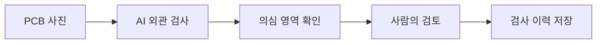

### 0.2 무엇을 검사할 수 있고, 무엇은 아직 검사하지 않는가?

| 구분 | 쉽게 설명하면 | 이번에 구현하는가? |
| --- | --- | --- |
| 일반 외관 검사 | PCB 전체 사진에서 평소와 다른 모양을 찾는다. | 예 |
| 정밀 검사 | 의심 부위를 별도로 확대 촬영하고 작은 결함을 자세히 확인한다. | 추후 |
| 잠재적 결함 검사 | 회로 연결 구조나 전압·전류 등으로 겉모습만으로 알기 어려운 결함을 확인한다. | 추후 |

MVP(Minimum Viable Product, 최소 기능 제품)는 핵심 기능이 동작하는 첫 번째 제품이다. 이번에는 일반 외관 검사만 완성하고, 다른 검사는 검증과 데이터 확보 이후 확장한다. AI가 PASS라고 판단하더라도 모든 미세 결함이나 내부 전기적 문제가 없다는 보장은 아니다.

### 0.3 AI는 어떻게 정상과 이상을 판단하는가?

이번에는 이미 공개되어 있는 Industrial Defect Inspection의 PCB용 PatchCore 모델을 활용한다. PatchCore를 쉽게 비유하면 정상적인 기판을 여러 장 살펴보고, 정상일 때 나타나는 작은 부분들의 특징을 기억해 둔 검사 도구와 같다. 이를 Memory Bank(정상 특징 저장소)라고 부른다.

**DIAGRAM 02 흐름도**

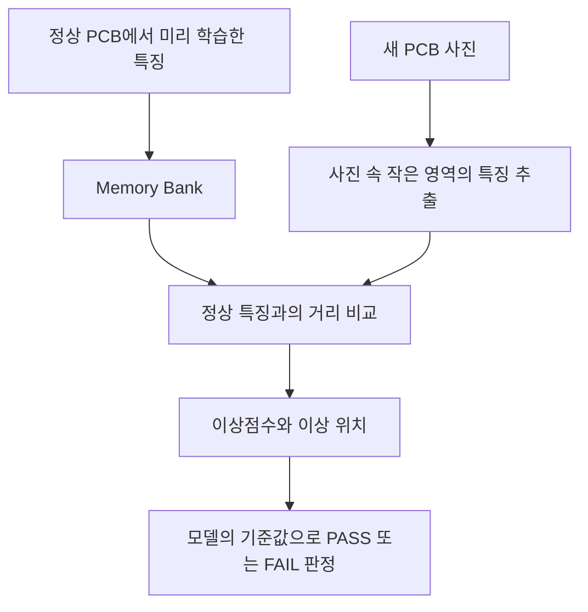

정상일 때 자주 보던 특징과 매우 다른 부분이 있다면 이상점수가 높아질 수 있다. 이것은 모든 픽셀을 단순히 1대1로 비교하는 것과 다르며, 발견된 영역이 실제 불량인지는 추가 확인이 필요하다.

검사 대상 PCB가 모델의 학습 대상과 맞지 않으면 정상 기판도 이상으로 판단할 수 있다. 그래서 관리자가 PCB 종류와 사용 가능한 모델을 연결하고, 사용자가 검사 전에 직접 선택하도록 설계한다. 이번 MVP는 모델을 새로 학습시키지 않으며 기존 공개 모델을 연결해 검사한다.

### 0.4 실제 사용 예시: 검사 담당자는 무엇을 하는가?

관리자가 먼저 `PCB-A`라는 검사 대상을 등록하고, 사용할 수 있는 PatchCore 모델을 연결했다고 가정한다.

| 순서 | 사용자가 하는 일 | 시스템이 하는 일 |
| --- | --- | --- |
| 1 | 로그인한다. | 사용자 계정과 권한을 확인한다. |
| 2 | PCB-A와 연결된 AI 모델을 선택한다. | 이번 검사 이력을 하나 생성한다. |
| 3 | 휴대폰이나 웹캠으로 기판을 촬영한다. | 촬영한 사진을 화면에 보여준다. |
| 4 | 사진을 확인하고 업로드한다. | 원본 사진과 관련 정보를 저장한다. 아직 AI 검사는 시작하지 않는다. |
| 5 | 검사 실행 버튼을 누른다. | AI 엔진에 사진을 전달하고 진행 상황을 알려준다. |
| 6 | 점수, PASS/FAIL, 의심 영역을 확인한다. | 검사 결과와 분석 파일을 저장한다. |
| 7 | 필요하면 자신의 판정과 의견을 입력한다. | AI 판정과 사람의 판정을 각각 기록한다. |
| 8 | 나중에 검사 이력을 열어본다. | 이전에 저장된 사진, 결과, 검토 내용을 함께 보여준다. |

사진을 잘못 촬영했다면 업로드 전에 다시 촬영한다. 검사 작업이 실패하거나 취소되었다면 기존 기록을 보존한 상태에서 그 검사와 연결된 재검사를 진행할 수 있다.

### 0.5 검사 결과는 어떻게 보이는가?

아래는 검사 상세 화면에 표시될 정보의 예시다. 실제 UI 디자인이나 모델의 점수 범위를 확정하는 예시는 아니다.

| 화면 정보 | 예시 | 의미 |
| --- | --- | --- |
| 검사 번호 | 101 | 이번 검사를 찾아가기 위한 번호 |
| PCB 이름 | PCB-A | 검사한 회로기판 종류 |
| AI 모델 | PCB PatchCore | 사용한 검사 도구 |
| 검사 상태 | COMPLETED | AI 검사와 결과 저장이 완료됨 |
| 이미지 이상점수 | 0.82 | 모델에서 나온 가상의 이상점수 (82%라는 뜻이 아님) |
| AI 판정 | FAIL | AI가 정상 기준에서 벗어났다고 판단함 |
| 사용자 판정 | PASS | 사람이 확인한 결과 정상이라고 판단함 |
| 검토 의견 | 빛 반사로 보임 | 사람의 판단 근거 |

| 이미지 종류 | 보는 방법과 목적 |
| --- | --- |
| 원본 이미지 | 사용자가 실제로 촬영한 사진. 무엇을 검사했는지 확인한다. |
| Heatmap | 원본 사진 위에 이상 의심 영역을 색으로 표시한 그림. 어디를 자세히 볼지 알려준다. |
| Anomaly Map | 위치별 이상점수를 표현한 지도. 화면에서는 색상으로 시각화하고, 서버에는 실제 수치도 보관한다. |
| 전처리 이미지 | AI가 검사하기 좋게 크기 등을 바꾼 사진. 일반 사용자에게 표시하지 않고 관리자가 향후 모델 개선에 활용할 수 있도록 별도 보관한다. |

AI가 FAIL을 판정하고 사람이 PASS를 선택했다면 오경보 후보로 기록할 수 있다. 사람이 AI의 결과를 덮어쓰지는 않는다. 두 판단을 비교할 수 있어야 나중에 AI의 성능을 분석할 수 있기 때문이다.

### 0.6 시스템은 어떻게 나누어져 있는가?

쉽게 말하면 검사 화면, 일을 처리하는 서버, 검사하는 AI, 기록을 보관하는 저장소로 나뉜다.

**DIAGRAM 03 흐름도**

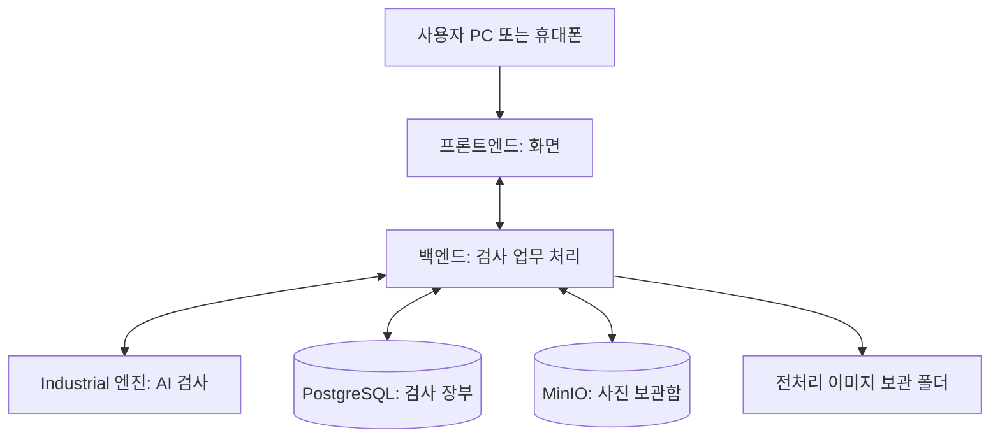

| 구성 요소 | 비유와 역할 | 선택 기술 |
| --- | --- | --- |
| 프론트엔드 | 사용자가 사진을 촬영하고 버튼을 누르는 검사 화면 | React 등 |
| 백엔드 | 검사를 접수하고 AI에게 전달하며 결과를 정리하는 업무 담당자 | FastAPI |
| AI 엔진 | 사진을 분석해 이상점수와 위치를 반환하는 검사 도구 | Industrial Defect Inspection, PatchCore |
| 데이터베이스 | 어떤 PCB를 언제 누가 검사했고 결과가 무엇인지 기록하는 장부 | PostgreSQL |
| 파일 저장소 | 사진, Heatmap, Anomaly Map 등 파일을 보관하는 사진 보관함 | MinIO |
| 전처리 보관 폴더 | AI에 실제로 입력된 형태의 사진을 확인하는 관리자용 자료 보관 장소 | GB10 로컬 폴더 |

이 구성 요소들을 GB10 중앙 서버에서 운영한다. 브라우저는 우리 백엔드를 통해 기능을 사용하고 데이터베이스나 AI 엔진에 직접 접속하지 않는다.

### 0.7 API, 어댑터, SSE는 왜 사용하는가?

| 용어 | 쉬운 설명 | 이 프로젝트에서의 예시 |
| --- | --- | --- |
| REST API | 다른 프로그램에 정해진 방식으로 일을 요청하고 응답을 받는 창구 | 프론트엔드가 `/api/inspections/101`을 요청해서 101번 검사 결과를 가져온다. |
| Adapter(어댑터) | 서로 다른 AI 모델의 사용 방법과 결과 형식을 우리 서비스에서 사용할 수 있게 맞추는 연결 부품 | PatchCore의 결과를 우리 시스템이 사용하는 이상점수와 PASS/FAIL 형식으로 변환한다. |
| SSE | 서버에서 진행 상황을 브라우저로 지속적으로 전달하는 연결 | 검사를 실행한 후 AI 진행 중, 결과 저장, 검사 완료 등을 화면에 표시한다. |
| 비동기 작업 | 시간이 걸리는 일이 끝날 때까지 화면 전체를 멈추지 않도록 처리하는 방식 | AI 검사가 진행되는 동안 진행 상황을 확인할 수 있다. |

이번에는 Industrial 엔진이 이미 이미지 크기 변환과 정규화를 수행하므로 같은 전처리를 우리 백엔드에서 중복 구현하지 않는다. 추후 자체 모델을 추가하면 그 모델의 실제 학습 조건(예: 입력 크기)에 맞게 처리하도록 어댑터를 확장한다. 모든 모델이 똑같은 해상도를 사용한다고 가정하지 않는다.

### 0.8 DB 테이블과 ID는 왜 여러 개 필요한가?

같은 종류의 PCB를 여러 번 검사할 수 있기 때문이다. PCB 이름은 검사 대상을 설명하고, ID는 어떤 기록과 연결되는지 정확하게 구분한다. 사용자가 번호를 모두 직접 기억하거나 입력할 필요는 없다.

예를 들어 PCB-A를 오전에 검사하고 오후에 다시 검사하면 PCB 종류는 하나지만 두 검사의 사진, 결과, 시각은 다를 수 있다. 아래는 그 관계를 설명하기 위한 예시다.

**DIAGRAM 04 흐름도**

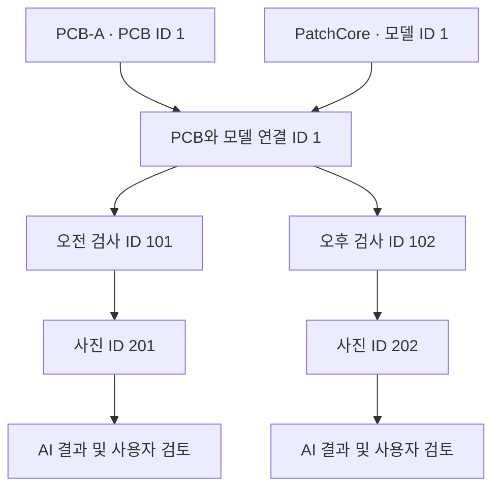

| 테이블 | 장부에 기록하는 내용 |
| --- | --- |
| pcb_registrations | 검사할 PCB 종류와 이름 |
| ai_models | 사용할 수 있는 AI 모델 목록 |
| pcb_model_connections | 어떤 PCB에 어떤 모델을 사용할 수 있는지 |
| users | 누가 시스템을 사용하는지 |
| inspection_history | 언제 어떤 검사를 했으며 어떤 상태인지 |
| captured_images | 이번 검사에 사용한 사진과 파일 위치 |
| ai_inspection_results | AI가 계산한 점수와 판정, 분석 결과 파일 위치 |
| inspection_users_reviews | 사람이 확인한 판정과 의견 |

모든 정보를 하나의 테이블에 넣으면 같은 PCB 이름과 모델 이름이 검사할 때마다 반복 저장된다. 역할에 맞게 나누고 ID로 연결하면 그런 중복을 줄일 수 있다. View는 여러 장부를 연결해 한 화면에서 보기 편하게 만든 조회용 구조다. 원본 장부를 별도로 복제하는 것이 아니다.

### 0.9 검사가 제대로 작동하는지는 어떻게 확인하는가?

프로그램이 정상적으로 동작하는 것과 AI가 불량을 정확하게 탐지하는 것은 서로 다른 문제다.

| 검증 | 쉽게 설명하면 |
| --- | --- |
| 기능 테스트 | 사진 업로드, 검사 버튼, AI 호출, 결과 표시 등이 순서대로 작동하는지 확인한다. |
| 데이터 테스트 | 검사 결과가 다른 PCB나 다른 사진에 잘못 저장되지 않는지 확인한다. |
| AI 성능 테스트 | 실제 정상·불량 PCB 표본으로 정상인데 FAIL이 되는 비율과 실제 불량을 찾는 비율을 측정한다. |
| 배포 테스트 | GB10을 재시작하거나 프로그램을 업데이트해도 사진과 검사 이력이 남아 있는지 확인한다. |

실제 회로 품질을 보장할 수 있는지는 대상 PCB와 정답 표본을 확보한 뒤 평가한다. 테스트 환경은 운영 환경과 분리하여 연습 중 발생한 오류가 실제 검사 기록에 영향을 주지 않도록 한다.

### 0.10 이 문서를 읽는 순서

| 궁금한 내용 | 읽을 부분 |
| --- | --- |
| 어떤 제품을 만들고 누가 사용하는가? | 0~3장 |
| 서버와 AI가 어떻게 연결되는가? | 4~5장 |
| 어떤 정보를 저장하고 관리하는가? | 6~8장 |
| 프로그램끼리 어떻게 통신하는가? | 9~10장 |
| 개발할 파일, 클래스, 화면은 어떻게 구성되는가? | 11~13장 |
| 어떻게 테스트하고 실제 서버에서 운영하는가? | 14~16장 |
| 나중에 무엇을 추가하고 무엇을 먼저 검증해야 하는가? | 17~18장 |

---

## 1. 프로젝트 목적과 MVP 범위

PCB 사진을 촬영하고 사용자가 선택한 AI 모델로 일반 외관 검사를 수행하는 플랫폼을 구축한다. AI의 판정을 사람이 검토할 수 있고 검사 결과, 원본 이미지, 이상 위치, 검사 이력을 추적할 수 있도록 한다. 확보된 검토 데이터는 추후 관리자 주도 모델 개선에 활용한다.

| 검사 종류 | 목적 | 개발 단계 |
| --- | --- | --- |
| 일반 외관 검사 | 전체 PCB 이미지의 외관 이상탐지 | MVP |
| 정밀 검사 | 별도 확대 촬영 및 픽셀 비교 등으로 미세 결함 검사 | 추후 확장 |
| 잠재적 결함 검사 | 회로 구조 및 전기적 신호 등을 이용해 외관으로 확인하기 어려운 결함 분석 | 추후 확장 |

**DIAGRAM 05 흐름도**

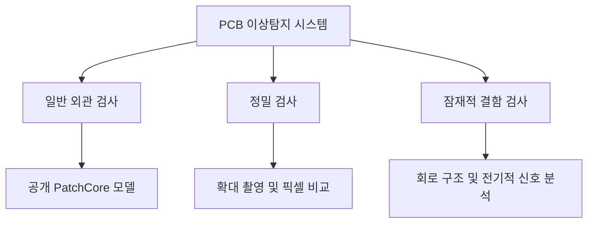

### 1.1 MVP 기능

- 관리자 계정 생성 및 일반 사용자 관리, 로그인과 접근 권한 구분.
- PCB 등록, AI 모델 등록, 두 항목의 수동 연결 및 상태 관리.
- PCB 및 모델 수동 선택, 웹캠·휴대폰 사진 촬영, 업로드 전 미리보기와 재촬영.
- 원본 이미지 저장 후 사용자가 검사 실행 버튼을 눌러 검사 시작.
- 공개 Industrial Defect Inspection의 PCB PatchCore 추론 REST API 연동.
- AI 이상점수, PASS/FAIL, Heatmap 및 Anomaly Map 표시.
- 검사 이력, 상세 조회, 취소, 실패, 이전 검사와 연결된 재검사.
- 사용자 검토 및 의견 등록·수정, 기본 대시보드 및 통계.
- 관리자 분석용 전처리 이미지는 GB10 로컬에 별도 보관.

### 1.2 MVP에서 제외할 기능

정밀 검사, 잠재적 결함 검사, 모델 자동 선택 및 PCB 자동 인식, Best Frame, 자동 촬영 품질 검사, 자체 모델 학습·가중치 업로드, 임계값 자동 보정, 실시간 재학습, Redis, 별도 Worker, Materialized View, 성능 최적화 전용 추가 Index는 추후 확장한다. 자체 이미지 전처리 상세 구현은 기존 Industrial 엔진을 활용하므로 보류한다. 기업 품번 관리도 MVP에 추가하지 않는다.

## 2. 사용자 및 운영 권한

| 기능 | 일반 사용자 USER | 관리자 ADMIN |
| --- | --- | --- |
| 로그인, 본인 비밀번호 변경 | O | O |
| PCB·모델의 조회 및 상태 확인 | O | O |
| 신규 검사, 검사 결과·이력 조회 | O | O |
| 자신의 검사 취소·재검사 | O | O |
| 다른 사용자의 검사 관리 | X | O |
| 검토 등록 및 자신의 검토 수정 | O | O |
| 다른 사용자의 검토 수정 | X | O |
| 대시보드 조회 | O | O |
| PCB·모델·연결 등록 및 수정 | X | O |
| 사용자 계정 관리 | X | O |
| 로컬 전처리 이미지 분석 | X | O (인가된 서버 접근) |
| 자체 모델 학습·교체 | X | 추후 확장 |

내부 플랫폼이므로 공개 회원가입은 제공하지 않는다. 관리자는 개발·테스트용 사용자 계정을 생성한다. 비활성 계정은 서비스에 접근할 수 없지만 과거 이력은 유지한다. 최소 한 명의 관리자 계정은 유지한다. 관리자 전용 API는 반드시 서버에서 ADMIN 권한을 확인한다. 실제 사용자 계정의 인증 보안은 배포 전 보완한다.

## 3. 통합 검사 시나리오

**DIAGRAM 06 흐름도**

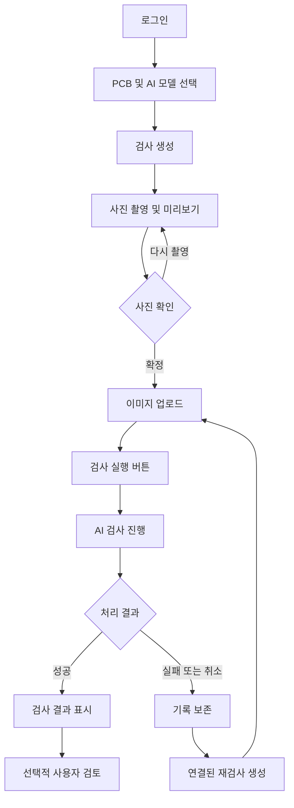

1. 사용자는 등록된 PCB와 연결된 AI 모델을 선택한다. 검사 가능한 상태인지 서버가 확인한다.
2. 검사 레코드를 생성하고 사진을 촬영한다. 여러 사진을 자동 저장하지 않고 최종 선택 사진 1개만 업로드한다.
3. 사진을 MinIO에 저장하고 해상도와 관련 정보를 PostgreSQL에 저장한다.
4. 사용자가 검사 실행을 누르면 서버가 비동기로 검사 작업을 시작한다. 업로드만으로 검사를 자동 실행하지 않는다.
5. Industrial 엔진이 전처리와 추론을 수행한다. 우리 서버가 반환 데이터를 변환하여 DB 및 파일 저장소에 저장한다.
6. SSE로 진행 상태와 완료 여부를 알린다. 프론트엔드는 상세 조회 API와 이미지 파일 API를 사용하여 결과를 구성한다.
7. 사용자는 선택적으로 PASS/FAIL과 검토 의견을 저장한다. AI 결과 원본은 변경하지 않는다.

### 3.1 결과 화면

| 영역 | 표시 정보 |
| --- | --- |
| 기본 정보 | 검사 ID, PCB 이름, 모델 이름, 검사 사용자 |
| 이미지 비교 | 원본, Heatmap(원본 위 합성), Anomaly Map(점수 분포 시각화) |
| AI 결과 | image_anomaly_score, PASS/FAIL |
| Timeline | 생성·촬영·업로드·시작·종료 및 AI 처리 시간 |
| 사용자 검토 | PASS/FAIL, 의견, 검토 시간, 검토 사용자 |
| 오류·재검사 | 실패 원인, 이전 검사 연결, 취소 및 재검사 버튼(상태·권한에 따라) |

검사 직후 화면과 검사 이력의 상세 화면은 동일한 컴포넌트를 재사용한다. 전처리 이미지는 일반 사용자 화면에는 노출하지 않는다.

## 4. 시스템 아키텍처

**DIAGRAM 07 흐름도**

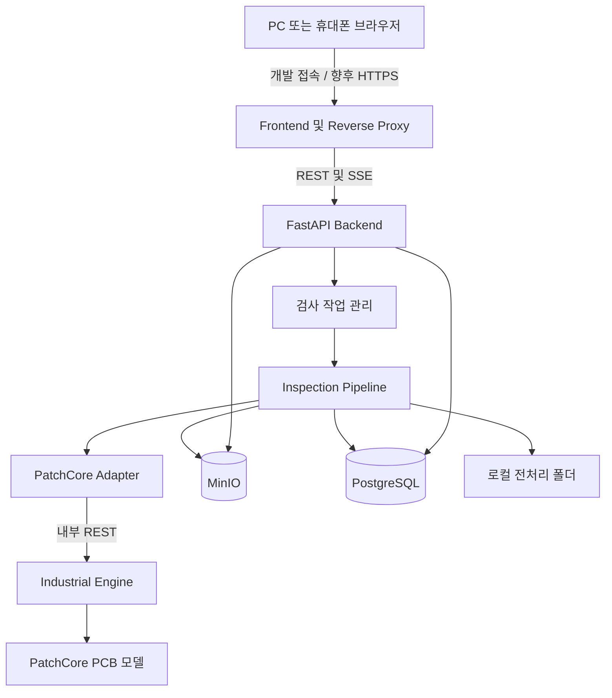

| 기술 | 적용 목적 |
| --- | --- |
| GB10 | 중앙 서버, 추론 및 데이터 저장 실행 환경 |
| React + TypeScript + Vite | 독립 프론트엔드 SPA |
| FastAPI | 업무 API, 인증, 검사 작업 관리, SSE |
| PostgreSQL | 정규화된 업무 데이터 |
| MinIO | 원본과 AI 결과 파일 |
| Industrial Defect Inspection | 공개 PatchCore 추론 및 기존 전처리 |
| Docker Compose | 구성 요소 실행 및 운영·테스트 분리 |
| Nginx | SPA 제공 및 백엔드 REST/SSE 프록시; TLS는 향후 운영 배포 시 적용 |

프론트엔드 페이지는 `/inspections/101`과 같이 사용하며 백엔드 API는 `/api/inspections/101`과 같이 사용한다. `/v1` 접두사는 MVP에서 사용하지 않는다. Industrial 엔진ㆍDBㆍMinIO는 브라우저에 직접 공개하지 않는다.

## 5. AI 모델 연동과 이미지 전처리

### 5.1 모델 연동 기준

공개 후보 저장소는 `5dawn/industrial-defect-inspection`이다. 해당 공개 문서는 VisA `pcb1`, ResNet-18 기반 PatchCore, 256×256 입력으로 평가된 모델 및 추론 기능을 안내한다. 실제 선택한 저장소와 체크포인트 버전은 개발 착수 시 재확인하고 해시로 고정한다. 다른 PatchCore 모델의 224×224 등의 입력 조건을 이 모델에 임의 적용하지 않는다. [R1]

| 엔진 API | 사용 목적 |
| --- | --- |
| `GET /health` | 엔진 상태 확인 |
| `GET /metadata/anomaly` | 모델 분류 및 가용 정보 조회 |
| `POST /predict/anomaly?category=pcb1` | 원본 이미지 추론 요청 (multipart/form-data) |

API 주소는 내부 서버 설정에서, 모델 연결에 필요한 실행 파라미터는 Adapter에서 관리한다. DB에 endpoint, model_key를 추가하지 않는다. `ai_model_id`로 등록 모델을 식별하고 설정에서 그 ID와 실제 실행 어댑터를 연결한다. 개발·운영 환경별 ID가 다를 수 있으므로 초기 데이터 설정과 실행 매핑을 함께 관리하며, 등록되지 않은 매핑은 활성화하지 않는다.

PCB와 AI 모델의 연결은 학습 대상 PCB와의 적합성을 관리하는 업무 관계다. 사진만 보고 PCB 종류를 자동 판단하는 기능은 없다. 학습하지 않은 회로를 입력해도 연산이 가능할 수 있으나 유효한 검사 성능이 보장되지 않는다.

### 5.2 전처리의 책임 분리

| 처리 | 수행 위치 |
| --- | --- |
| 파일 유효성 확인, 이미지 크기·형식 확인 | 우리 서버 |
| 원본 파일 보관 | 우리 서버 / MinIO |
| 모델용 RGB, Resize, Padding 등 | Industrial 엔진의 기존 학습 조건 |
| Tensor 변환 및 정규화 | Industrial 엔진의 기존 설정 |
| 추론 및 이상점수 계산 | Industrial 엔진 |
| 엔진 응답 공통 형식 변환 | PatchCoreAdapter |
| 전처리 이미지 보관 및 결과 저장 | 우리 서버 |

우리 서버는 모델용 해상도 변환과 정규화를 중복 실행하지 않는다. 공개 엔진의 기존 모델 전처리를 그대로 유지한다. 자체 모델 운영 시 그 모델별 학습 조건에 맞춰 어댑터 구현을 추가한다.

### 5.3 엔진 응답 및 소스 수정

공개 문서는 이상점수, 판정 임계값, Heatmap, Mask, Overlay 및 시간 정보를 안내한다. 실제 REST 응답 스키마와 데이터 좌표계는 소스 또는 Swagger로 개발 전에 검증한다. [R1]

| 데이터 | 우리 시스템 사용 및 처리 |
| --- | --- |
| 이미지 이상점수 | `image_anomaly_score`에 원래 값 저장 |
| AI 판정 | 모델 판정을 PASS/FAIL로 변환 |
| Threshold | 엔진의 고정 판정 기준 활용; MVP 별도 칼럼 미추가 |
| Heatmap / Overlay | 표시용 합성 이미지 PNG |
| Anomaly Map | 실제 위치별 수치 배열 NPY |
| Preprocessed Image | 실제 엔진 전처리 직후, 수치 정규화 이전 이미지 PNG |
| Mask | MVP 별도 저장·표시 제외 |

필요한 경우 엔진 소스를 최소 수정해 실제 Anomaly Map과 전처리 이미지가 REST 응답에 포함되도록 한다. 모델 구조, 학습된 Bank, 임계값, 특징 추출 및 기존 점수 계산 로직을 변경하지 않는다. REST의 JSON·바이너리 전달 형태는 실제 엔진 스키마 확인 후 정하며, 초기에는 바이너리 데이터의 Base64 전달을 사용할 수 있다. 색상 Heatmap에서 역으로 원본 이상점수 수치를 추정하지 않는다.

`PatchCoreAdapter`가 반환하는 내부 공통 데이터는 `image_anomaly_score`, `ai_judgment`, `threshold`, `heatmap`, `anomaly_map`, `preprocessed_image`로 정의한다. 점수는 확률 또는 0~1 값이라고 가정하지 않는다.

원본 위치와 모델 좌표가 다른 경우 정확한 변환 정보로 정렬한다. 저장하는 Heatmap은 원본 사진과 이상 위치가 맞는 합성 이미지이며, Anomaly Map은 수치 자체를 보존한다. 열지도에서 패딩·좌표 복원을 중복 수행하지 않는다. 원본 해상도를 보존하되 낮은 입력 해상도에서 소실된 미세 결함을 확대 표시로 복구할 수는 없다.

## 6. PostgreSQL 데이터베이스 설계

**쉽게 이해하기:** 데이터베이스는 검사 장부를 정리해 놓은 곳이다. 테이블은 장부의 종류, 행은 한 건의 기록, 칼럼은 이름이나 검사 시간처럼 기록할 항목을 뜻한다. 아래 상세 표는 이러한 장부에 어떤 값을 어떤 형식으로 저장할지를 정의한다.

| 용어 | 쉽게 설명하면 | 예시 |
| --- | --- | --- |
| PK (기본키) | 한 행을 유일하게 찾는 번호 | 검사 ID 101 |
| FK (외래키) | 다른 장부의 기록과 연결하는 번호 | 검사 101번이 PCB-모델 연결 1번을 참조 |
| UNIQUE | 같은 값이나 조합을 중복 등록하지 않는 규칙 | 같은 PCB와 모델의 중복 연결 방지 |
| NULL | 아직 값이 없거나 알 수 없는 상태 | 검사 실행 전 시작 시각 |
| DEFAULT | 값을 입력하지 않으면 자동 적용되는 값 | 신규 검사 상태 WAITING |
| CHECK | 허용되지 않은 값의 등록을 막는 규칙 | AI 판정은 PASS 또는 FAIL만 허용 |
| TIMESTAMPTZ | 시간대가 반영되는 시점을 저장하는 데이터 타입 | 검사 시작 시각을 저장하고 한국 시간으로 표시 |

### 6.1 공통 원칙

8개 기본 테이블과 4개 일반 View를 사용한다. ID는 BIGINT 자동 발급을 기본으로 하고 모든 연결은 FK로 관리한다. 값의 중복을 방지하기 위해 UNIQUE와 CHECK를 적용한다. 시간은 TIMESTAMPTZ를 사용하고 사용자 화면 및 날짜별 저장 경로는 KST 기준으로 표기한다. 마스터 데이터는 비활성화하여 과거 이력을 보존한다. 추가 성능 Index와 Materialized View는 측정 후 검토한다.

**DIAGRAM 08 ERD · 데이터 관계**

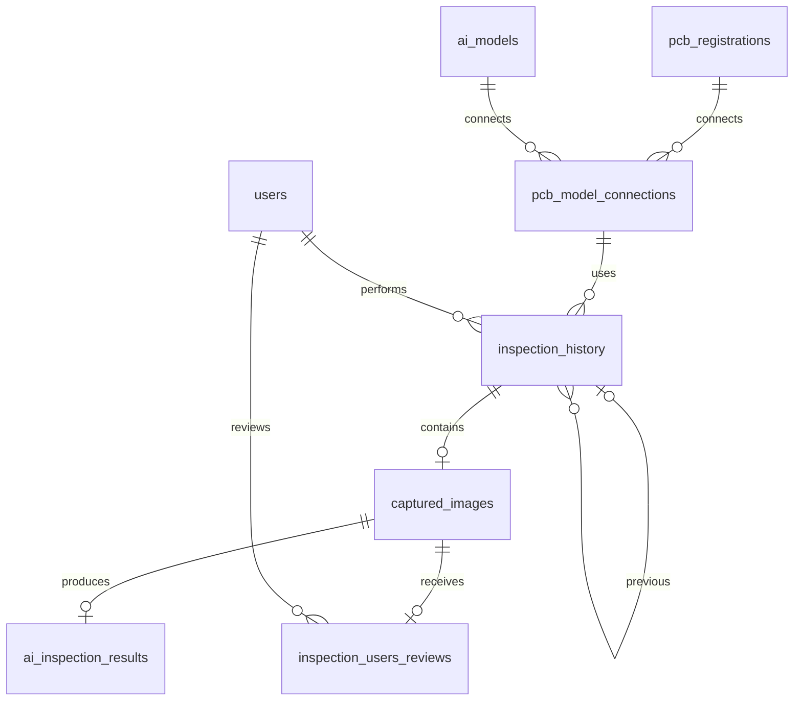

다음은 API 명세까지 통합한 구현 기준 칼럼 및 제약조건이다. ID와 시간의 실제 DB 타입, 기본값은 아래 기준으로 DDL 구현 단계에서 적용한다. 아직 SQL 실행은 하지 않는다.

### 6.2 pcb_registrations — PCB 등록 관리

| 칼럼 | 타입 | NULL | 제약/기본값 및 목적 |
| --- | --- | --- | --- |
| pcb_registration_id | BIGINT | N | PK, 자동 생성 |
| pcb_name | VARCHAR(150) | N | UNIQUE, 공백 이름 불가, 화면 표시 |
| description | TEXT | Y | PCB 설명 |
| is_active | BOOLEAN | N | DEFAULT TRUE, 검사 대상 선택 제어 |

예: `(1, PCB-A, 전원 공급용 회로, TRUE)`. 기업 품번 컬럼은 보류한다.

### 6.3 ai_models — AI 모델 정보 관리

| 칼럼 | 타입 | NULL | 제약/기본값 및 목적 |
| --- | --- | --- | --- |
| ai_model_id | BIGINT | N | PK, 자동 생성 |
| model_name | VARCHAR(150) | N | UNIQUE, 사용자 선택 이름 |
| description | TEXT | Y | 모델 설명 |
| status | VARCHAR(20) | N | CHECK: ACTIVE, DEVELOPING, INACTIVE; 기본 DEVELOPING |

`model_key`와 `is_active`는 사용하지 않는다. 개발 중인 모델을 등록하되 검사는 ACTIVE에서만 실행한다. 기존 모델의 실제 체크포인트 또는 판정 기준을 교체할 경우 신규 모델 기록으로 관리하여 이전 검사 기록의 의미를 유지한다.

### 6.4 pcb_model_connections — PCB와 AI 모델 연결

| 칼럼 | 타입 | NULL | 제약/기본값 및 목적 |
| --- | --- | --- | --- |
| pcb_model_connection_id | BIGINT | N | PK, 자동 생성 |
| pcb_registration_id | BIGINT | N | FK → pcb_registrations |
| ai_model_id | BIGINT | N | FK → ai_models |
| is_active | BOOLEAN | N | DEFAULT TRUE, 연결 사용 여부 |

`UNIQUE(pcb_registration_id, ai_model_id)`을 적용한다. 동일한 PCB와 모델을 POST로 다시 등록하면 409를 반환한다. 비활성 연결을 다시 사용할 때는 PATCH로 기존 행을 재활성화한다. 기존 연결의 PCB ID와 모델 ID는 변경하지 않는다.

| 연결 ID | PCB ID | 모델 ID | 활성 여부 |
| --- | --- | --- | --- |
| 1 | 1 | 1 | TRUE |
| 2 | 1 | 2 | TRUE |
| 3 | 2 | 1 | FALSE |

PCB 활성, 연결 활성, 모델 ACTIVE가 모두 만족될 때만 검사 가능하다. 개발 중 모델의 연결은 미리 등록할 수 있다.

### 6.5 users — 사용자 관리

| 칼럼 | 타입 | NULL | 제약/기본값 및 목적 |
| --- | --- | --- | --- |
| user_id | BIGINT | N | PK, 자동 생성 |
| username | VARCHAR(100) | N | UNIQUE, 로그인 ID |
| password | TEXT | N | 내부 개발·테스트 전용 임시 비밀번호 (해시 미적용) |
| role | VARCHAR(10) | N | CHECK: ADMIN, USER; 기본 USER |
| is_active | BOOLEAN | N | DEFAULT TRUE |

사용자 삭제보다는 비활성화로 과거 검사 및 검토 이력을 유지한다. 임시 비밀번호는 개인이 실제 사용하는 비밀번호와 무관한 테스트 값만 허용한다. 운영 배포 전에 `password`를 제거하고 `password_hash` 및 신규 비밀번호 설정으로 전환한다.

### 6.6 inspection_history — 검사 이력

| 칼럼 | 타입 | NULL | 제약/기본값 및 목적 |
| --- | --- | --- | --- |
| inspection_id | BIGINT | N | PK, 자동 생성 |
| pcb_model_connection_id | BIGINT | N | FK → pcb_model_connections |
| user_id | BIGINT | N | FK → users, 검사 수행자 |
| previous_inspection_id | BIGINT | Y | 자기 참조 FK, 재검사 연결 |
| status | VARCHAR(20) | N | CHECK: WAITING, ING, COMPLETED, FAILED, CANCELLED |
| created_at | TIMESTAMPTZ | N | DEFAULT 현재 시각 |
| started_at | TIMESTAMPTZ | Y | 실제 검사 시작 시각 |
| finished_at | TIMESTAMPTZ | Y | 완료, 실패 또는 취소 시각 |
| failure_reason | TEXT | Y | 실제 실패 원인 기록 |

신규 검사는 WAITING을 기본값으로 둔다. 검사 생성 후 사진 업로드 및 실행 버튼을 누르기 전까지 대기 상태가 필요하기 때문이다. 검사 이력에는 PCB ID와 AI 모델 ID를 중복 저장하지 않고 연결 ID만 참조한다.

### 6.7 captured_images — 촬영 이미지 정보

| 칼럼 | 타입 | NULL | 제약/기본값 및 목적 |
| --- | --- | --- | --- |
| image_id | BIGINT | N | PK, 자동 생성 |
| inspection_id | BIGINT | N | FK → inspection_history, UNIQUE (MVP 1장/검사) |
| image_object_key | TEXT | N | MinIO 원본 경로 |
| width | INTEGER | N | CHECK > 0, 원본 가로 해상도 |
| height | INTEGER | N | CHECK > 0, 원본 세로 해상도 |
| captured_at | TIMESTAMPTZ | Y | 실제 촬영 시각 확인 가능한 경우 |
| uploaded_at | TIMESTAMPTZ | N | 서버 저장 시각 |

원본 해상도는 추후 해상도별 검사 성능 실험을 위해 유지한다. 원본 파일을 재사용하는 재검사에서는 같은 Object Key를 참조하므로 `image_object_key`를 UNIQUE로 제한하지 않는다.

### 6.8 ai_inspection_results — AI 검사 결과

| 칼럼 | 타입 | NULL | 제약/기본값 및 목적 |
| --- | --- | --- | --- |
| image_id | BIGINT | N | PK, FK → captured_images |
| image_anomaly_score | DOUBLE PRECISION | N | 유한한 원본 이상점수 |
| ai_judgment | VARCHAR(10) | N | CHECK: PASS, FAIL |
| heatmap_object_key | TEXT | N | 합성 Heatmap 파일 경로 |
| anomaly_map_object_key | TEXT | N | 실제 점수 배열 파일 경로 |
| ai_started_at | TIMESTAMPTZ | N | AI 엔진 호출 직전 |
| ai_completed_at | TIMESTAMPTZ | N | 유효한 AI 응답 수신 시각 |

AI 검사 1회에 결과 1개를 저장하며, `ai_completed_at - ai_started_at`은 엔진 호출 왕복 구간(엔진 전처리·추론 및 통신 포함)이다. 순수 GPU 추론 소요시간과 동일하다고 해석하지 않는다. 실제 엔진 세부 시간은 추후 실험으로 분리할 수 있다.

### 6.9 inspection_users_reviews — 사용자 검토 결과

| 칼럼 | 타입 | NULL | 제약/기본값 및 목적 |
| --- | --- | --- | --- |
| image_id | BIGINT | N | PK, FK → captured_images |
| user_id | BIGINT | N | FK → users, 마지막 검토 저장자 |
| user_judgment | VARCHAR(10) | N | CHECK: PASS, FAIL |
| comment | TEXT | Y | 선택적 검토 의견 |
| reviewed_at | TIMESTAMPTZ | N | 마지막 검토 저장 시각 |

검토하지 않은 이미지는 이 테이블에 행이 없다. 1개 이미지에 1개 최신 검토만 관리한다. 관리자 수정 시 마지막 저장자와 시각을 반영한다. 세부 변경 이력은 추후 확장한다. AI 결과는 사용자 검토와 독립적으로 유지한다.

### 6.10 View 구조

| View | 데이터 및 역할 |
| --- | --- |
| v_integrated_inspection_lookup | 검사 ID, 연결 ID, PCB 및 모델 ID·이름, 사용자, 상태, 이미지 정보, AI 결과, 사용자 검토, 시간, 이전 검사·실패 정보 통합 조회 |
| v_daily_inspection_statistics | 날짜·PCB·모델 단위의 상태 및 판정별 건수 집계 기초 데이터 |
| v_model_performance_statistics | 모델·PCB·날짜별 검토 완료 판정 조합 건수와 AI 호출 소요시간 기초 데이터 |
| v_pending_inspection_reviews | COMPLETED 상태이고 사용자 검토가 없는 검사 목록 |

기존 테이블의 원본 데이터를 중복 저장하지 않는다. 통계 View는 필요한 집계용 건수 및 시간 합계·건수 등 기초 자료만 제공하고 비율 계산은 DashboardService에서 담당한다. 모든 조회에 필터가 적용되도록 날짜 및 모델·PCB 조건을 유지한다.

## 7. 검사 상태 및 업무 규칙

| 상태 | 의미 |
| --- | --- |
| WAITING | 생성 이후 이미지 업로드 및 실행 대기 |
| ING | 검사 작업이 접수되어 진행 중 |
| COMPLETED | 결과 파일과 DB 기록 저장 완료 |
| FAILED | 실제 검사 또는 필수 결과 저장 과정 실패 |
| CANCELLED | 사용자 또는 관리자가 검사 취소 |

**DIAGRAM 09 상태 전이도**

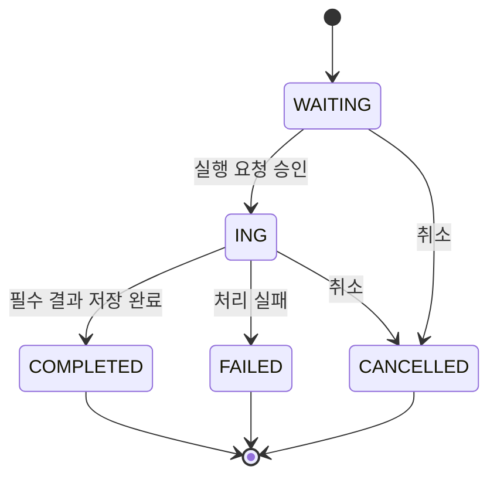

`PASS`, `FAIL`은 검사 판정이며 `FAILED`는 검사 실행 자체의 실패다. `FAIL` 판정도 검사 처리가 정상 완료되었다면 상태는 COMPLETED다.

| 기능 | WAITING | ING | COMPLETED | FAILED | CANCELLED |
| --- | --- | --- | --- | --- | --- |
| 최종 이미지 최초 업로드 | O | X | X | X | X |
| 검사 실행 | O | X | X | X | X |
| 검사 취소 | O | O | X | X | X |
| 연결된 재검사 생성 | X | X | X | O | O |
| 조회 | O | O | O | O | O |
| 사용자 검토 | X | X | O | X | X |

실패 유형: 원본 이미지 읽기 실패, 엔진 전처리 실패, AI API 호출 및 응답 오류, 필수 검사 결과 저장 실패. 단순 응답 시간이 길다는 이유만으로 업무상 FAILED 처리하지 않는다. 네트워크 타임아웃 정책의 별도 최적화는 보류한다. 실제 연결 단절 등 통신 오류는 실패로 기록한다.

재검사는 기존 ID를 덮어쓰지 않고 새 검사 ID에 `previous_inspection_id`를 기록한다. 재검사에서 원본을 재사용하면 신규 이미지 기록이 같은 파일을 참조하고, 새로운 AI 결과는 신규 이미지 ID로 저장한다.

| inspection_id | previous_inspection_id | status | image_id | 원본 파일 |
| --- | --- | --- | --- | --- |
| 101 | NULL | CANCELLED | 201 | originals/2026/11/21/201.jpg |
| 102 | 101 | FAILED | 202 | originals/2026/11/21/201.jpg |
| 103 | 102 | COMPLETED | 203 | originals/2026/11/21/201.jpg |

## 8. 파일 저장 설계

**쉽게 이해하기:** 사진 자체는 MinIO에 넣고 검사 장부에는 그 사진을 찾을 수 있는 주소(Object Key)를 적는다. 예를 들어 201번 사진의 주소가 `originals/2026/11/21/201.jpg`라면, 나중에 검사 상세 화면을 열 때 그 주소로 원본 사진을 찾아온다. 관리자용 전처리 사진만 별도 로컬 폴더에 보관한다.

MinIO에는 검사 원본과 AI 결과를 저장하고 PostgreSQL에는 실제 파일의 Object Key만 보관한다. 날짜별 Prefix와 이미지 ID로 파일을 식별한다.

```text
MinIO bucket: pcb-inspections/
├── originals/2026/11/21/
│   ├── 201.jpg
│   └── 204.png
└── results/2026/11/21/
    ├── 203_heatmap.png
    └── 203_anomaly_map.npy

GB10 host / backend/data/
└── preprocessed/2026/11/21/
    ├── 203.png
    └── 204.png
```

| 파일 | 저장 위치 | 접근 |
| --- | --- | --- |
| 원본 촬영 이미지 | MinIO originals | 인증 사용자, 백엔드 경유 |
| Heatmap 합성 이미지 | MinIO results | 인증 사용자, 백엔드 경유 |
| Anomaly Map 실제 수치 | MinIO results, NPY | 백엔드에서 PNG로 시각화, 관리자 분석용 원본 보존 |
| 실제 전처리 이미지 | GB10 로컬 data/preprocessed | 인가된 관리자 서버 접근 |
| 정규화 Tensor | 엔진 메모리 | 파일 저장하지 않음 |

MinIO와 로컬 저장일은 KST 기준이다. 원본 확장자는 실제 지원 이미지 형식에 따라 결정한다. 파일 경로는 이름 변경의 영향을 받지 않도록 PCB/모델 이름 대신 이미지 ID로 구성한다. 전처리 이미지용 DB 칼럼은 추가하지 않는다. 필요 시 같은 ID의 부가 설명 JSON은 향후 실험용으로 추가한다.

원본은 덮어쓰지 않는다. 다른 검사에서 공유 중인 Object Key는 삭제하지 않는다. 자동 삭제·보관기간 정책은 추후 검토한다. 필수 결과 파일이 모두 저장된 다음 DB 트랜잭션으로 AI 결과와 완료 상태를 확정한다. 미완료 상태의 부분 파일은 정상 검사 결과로 제공하지 않는다. 운영 중 발생한 고아 파일은 기록하고 관리자 확인 후 별도 정리한다.

## 9. REST API 명세

**쉽게 이해하기:** 화면에서 버튼을 누른다고 데이터베이스나 AI가 직접 실행되는 것은 아니다. 화면이 백엔드에 약속된 주소와 형식으로 요청을 보내면, 백엔드가 필요한 일을 수행하고 결과를 돌려준다. 아래 명세는 프론트엔드와 백엔드 개발자가 동일하게 따라야 하는 요청·응답 약속이다.

| 요청 방식 | 의미 | 예시 |
| --- | --- | --- |
| GET | 기존 정보 가져오기 | 검사 상세 조회 |
| POST | 새 정보 만들기 또는 작업 실행 요청 | 검사 생성, 검사 실행 |
| PATCH | 기존 정보의 일부 수정 | 모델 상태 변경 |

JSON은 이름과 값의 쌍으로 데이터를 표현하는 형식이다. `multipart/form-data`는 사진 파일과 검사 ID 같은 일반 정보를 한 요청으로 함께 보낼 때 사용하는 형식이다. HTTP 상태 코드는 200이나 404처럼 서버가 알려주는 요청 처리 결과이며, PCB의 PASS/FAIL 판정과는 다르다.

### 9.1 공통 규칙

- 백엔드 경로는 `/api` 로 시작한다. 버전 접두사는 사용하지 않는다.
- GET은 경로와 Query Parameter, 등록 POST와 수정 PATCH는 JSON을 사용한다. 이미지 업로드는 `multipart/form-data` 로 파일과 일반 필드를 함께 보낸다.
- 로그인한 사용자의 ID 및 권한은 서버 세션에서 결정하며 브라우저의 임의 ID를 신뢰하지 않는다.
- 목록은 JSON 배열로 응답한다. 검사 이력은 날짜/상태/PCB/모델 필터와 `limit`, `offset` 을 지원하고 기본 50건, 최신 생성 순으로 조회한다.
- 조회 200, 신규 생성 201, 검사 비동기 접수 202, 본문 없는 작업 204를 사용한다.
- 공통 오류는 `detail` 메시지로 전달한다. 401 인증 필요, 403 권한 부족, 404 대상 없음, 409 상태 충돌·중복, 413 용량 초과, 415 형식 불가, 422 입력 오류. 인증 오류 응답은 계정 존재 여부를 불필요하게 공개하지 않는다.
- 저장 경로, 개발용 비밀번호, 내부 엔진 응답 전문, 예외 스택은 일반 응답에 노출하지 않는다.

### 9.2 PCB 등록

| Method | Path | 요청 | 응답 |
| --- | --- | --- | --- |
| POST | /api/pcb-registrations | pcb_name, description? | PCB 객체 |
| GET | /api/pcb-registrations | is_active? | PCB 객체 배열 |
| GET | /api/pcb-registrations/{id} | 경로 ID | PCB 객체 |
| PATCH | /api/pcb-registrations/{id} | pcb_name?, description?, is_active? | 수정된 PCB 객체 |

```json
{"pcb_name":"PCB-A","description":"전원 공급용 회로"}
```

```json
{"pcb_registration_id":1,"pcb_name":"PCB-A","description":"전원 공급용 회로","is_active":true}
```

관리자만 등록·수정하며 일반 사용자는 활성 항목을 조회한다. 설명은 생략하거나 null로 지울 수 있다. ID는 수정하지 않는다.

### 9.3 AI 모델 관리

| Method | Path | 요청 | 응답 |
| --- | --- | --- | --- |
| POST | /api/ai-models | model_name, description?, status? | 모델 객체 |
| GET | /api/ai-models | status? | 모델 객체 배열 |
| GET | /api/ai-models/{id} | 경로 ID | 모델 객체 |
| PATCH | /api/ai-models/{id} | model_name?, description?, status? | 수정된 모델 객체 |

```json
{"model_name":"PatchCore PCB","description":"일반 외관 검사","status":"ACTIVE"}
```

```json
{"ai_model_id":1,"model_name":"PatchCore PCB","description":"일반 외관 검사","status":"ACTIVE"}
```

상태는 ACTIVE(사용 가능), DEVELOPING(개발 중), INACTIVE(사용 중단). 일반 사용자에게 상태를 표시하지만 검사 선택은 ACTIVE만 허용한다. 관리자만 등록·수정한다. 실제 어댑터 연결이 없는 모델은 개발 중으로 등록할 수 있으나 ACTIVE로 변경하지 못한다. `model_key`는 제외한다.

### 9.4 PCB-모델 연결

| Method | Path | 요청 | 응답 |
| --- | --- | --- | --- |
| POST | /api/pcb-model-connections | pcb_registration_id, ai_model_id | 연결 객체 |
| GET | /api/pcb-model-connections | pcb_registration_id?, ai_model_id?, is_active? | 연결 목록, 모델명 및 상태 포함 |
| PATCH | /api/pcb-model-connections/{id} | is_active | 수정된 연결 객체 |

```json
{"pcb_registration_id":1,"ai_model_id":1}
```

```json
{"pcb_model_connection_id":1,"pcb_registration_id":1,"ai_model_id":1,"is_active":true}
```

조회 예: `/api/pcb-model-connections?pcb_registration_id=1`

```json
[
  {"pcb_model_connection_id":1,"pcb_registration_id":1,"ai_model_id":1,"model_name":"PatchCore PCB","model_status":"ACTIVE","is_active":true},
  {"pcb_model_connection_id":2,"pcb_registration_id":1,"ai_model_id":2,"model_name":"EfficientAD PCB","model_status":"DEVELOPING","is_active":true}
]
```

일반 사용자는 활성 연결을 조회하고 DEVELOPING 모델은 개발 중으로 표시한다. 관리자만 등록·활성 변경 가능하다. 모델과 PCB ID의 쌍은 변경하지 않는다.

### 9.5 인증 및 사용자

| Method | Path | 요청 | 응답 |
| --- | --- | --- | --- |
| POST | /api/auth/login | username, password | user_id, username, role 및 세션 쿠키 |
| POST | /api/auth/logout | 없음 | 204, 세션 무효화 |
| GET | /api/auth/me | 없음 | 로그인 사용자 정보 |
| PATCH | /api/auth/password | current_password, new_password | 204 |
| POST | /api/users | username, password, role? | 사용자 객체 |
| GET | /api/users | is_active? | 사용자 객체 배열 |
| PATCH | /api/users/{id} | username?, role?, is_active?, password? | 수정된 사용자 객체 |

```json
{"user_id":2,"username":"tester01","role":"USER","is_active":true}
```

사용자 관리 API는 관리자 전용이다. 본인 비밀번호 변경 및 관리자 비밀번호 재설정 시 관련 세션 무효화 정책을 적용한다. 개발 단계에서는 실제 개인 비밀번호가 아닌 임시 테스트 값과 입력값을 비교하여 로그인한다. 비밀번호 해시·암호화는 구현하지 않는다. 세션은 FastAPI 메모리에 저장하고 만료시간을 설정한다. Redis와 추가 세션 테이블은 사용하지 않으며 서버 재시작 시 재로그인한다. 개발 단계는 HttpOnly, SameSite 등 기본 쿠키 설정과 서버 권한 검증을 유지한다. 운영 비밀번호 해시, HTTPS의 Secure 설정 및 추가 CSRF 방어 검증은 외부 배포 전 진행한다. 개발 환경을 외부에 공개하지 않는다.

### 9.6 검사 생성 및 실행

| Method | Path | 요청 | 응답 |
| --- | --- | --- | --- |
| POST | /api/inspections | pcb_model_connection_id | 검사 식별 및 WAITING 상태 |
| POST | /api/inspections/{id}/start | 없음 | 검사 식별, ING, 시작 시간 (202) |
| POST | /api/inspections/{id}/cancel | 없음 | CANCELLED, 종료 시간 |
| POST | /api/inspections/{id}/retry | reuse_image (Boolean) | 신규 검사 및 이전 ID, WAITING |
| GET | /api/inspections | PCB, 모델, 상태, 날짜, limit, offset | 검사 이력 배열 |
| GET | /api/inspections/{id} | 검사 ID | 통합 상세 객체 |

**생성 요청**

```json
{"pcb_model_connection_id":1}
```

**생성 응답**

```json
{"inspection_id":101,"pcb_model_connection_id":1,"user_id":2,"status":"WAITING","previous_inspection_id":null,"created_at":"2026-11-21T19:00:00+09:00"}
```

**시작 응답 (202)**

```json
{"inspection_id":101,"status":"ING","started_at":"2026-11-21T19:00:15+09:00"}
```

**재검사 요청과 응답**

```json
{"reuse_image":true}
```

```json
{"inspection_id":102,"previous_inspection_id":101,"pcb_model_connection_id":1,"status":"WAITING"}
```

**이력 응답 예시**

```json
[
  {"inspection_id":101,"pcb_name":"PCB-A","model_name":"PatchCore PCB","status":"COMPLETED","image_anomaly_score":0.873,"ai_judgment":"FAIL","user_judgment":"PASS","created_at":"2026-11-21T19:00:00+09:00"}
]
```

**상세 응답 예시**

```json
{
  "inspection_id":101,
  "previous_inspection_id":null,
  "status":"COMPLETED",
  "failure_reason":null,
  "pcb":{"pcb_registration_id":1,"pcb_name":"PCB-A"},
  "model":{"ai_model_id":1,"model_name":"PatchCore PCB"},
  "user":{"user_id":2,"username":"tester01"},
  "image":{"image_id":201,"width":1920,"height":1080},
  "ai_result":{"image_anomaly_score":0.873,"ai_judgment":"FAIL"},
  "review":{"user_id":2,"user_judgment":"PASS","comment":"허용되는 납땜 형태","reviewed_at":"2026-11-21T19:05:00+09:00"},
  "timeline":{"created_at":"2026-11-21T19:00:00+09:00","captured_at":"2026-11-21T19:00:05+09:00","uploaded_at":"2026-11-21T19:00:10+09:00","started_at":"2026-11-21T19:00:15+09:00","ai_started_at":"2026-11-21T19:00:15.200+09:00","ai_completed_at":"2026-11-21T19:00:16.440+09:00","finished_at":"2026-11-21T19:00:17+09:00"}
}
```

판정 전이면 ai_result, 미검토이면 review, 업로드 전이면 image는 null로 응답한다. 진행 중이 아닌 검사의 시간 값도 상황에 맞게 null이다. 실제 이미지 바이너리 대신 이미지 ID를 제공한다.

### 9.7 이미지 업로드 및 조회

| Method | Path | 요청 | 응답 |
| --- | --- | --- | --- |
| POST | /api/images | multipart: inspection_id, file, captured_at? | 이미지 객체 (201) |
| GET | /api/images/{id} | type=original, heatmap, anomaly-map (기본 original) | 실제 이미지 바이너리 (200) |

multipart/form-data는 일반 필드와 실제 이미지 파일을 하나의 요청 안에서 구분하여 전달하는 형식이다. 브라우저 FormData로 생성한다.

```json
{"image_id":201,"inspection_id":101,"width":1920,"height":1080,"captured_at":"2026-11-21T19:00:05+09:00","uploaded_at":"2026-11-21T19:00:10+09:00"}
```

원본은 실제 Content-Type, heatmap과 anomaly-map은 image/png를 반환한다. anomaly-map은 저장된 NPY 수치를 시각화하여 반환한다. type은 조회 조건이며 AI 검사 실행과 관계없다. 최종 업로드는 검사당 1개, 촬영 재시도는 업로드 전에 수행한다. 기본 업로드 정책은 선택한 엔진 문서의 10 MB 제한과 일치시키고 JPEG·PNG·WebP 지원을 실제 엔진으로 검증한다. [R1]

### 9.8 사용자 검토

| Method | Path | 요청 | 응답 |
| --- | --- | --- | --- |
| POST | /api/inspections/{id}/review | user_judgment, comment? | 검토 객체 (201) |
| PATCH | /api/inspections/{id}/review | user_judgment?, comment? | 수정 검토 객체 (200) |

```json
{"user_judgment":"PASS","comment":"허용되는 납땜 형태"}
```

```json
{"inspection_id":101,"image_id":201,"user_id":2,"user_judgment":"PASS","comment":"허용되는 납땜 형태","reviewed_at":"2026-11-21T19:05:00+09:00"}
```

검사 완료 후에만 검토 가능하다. 검토 ID를 별도로 추가하지 않는다. 중복 등록은 409, 수정 권한 부족 403, 등록되지 않은 검토 수정 404. 조회는 기존 상세 API를 사용한다.

### 9.9 대시보드 및 통계

`GET /api/dashboard` 하나의 API를 사용하며 `pcb_registration_id`, `ai_model_id`, `start_date`, `end_date`를 선택적으로 전달한다. 기본 범위는 KST 오늘, 기간 지정 시 해당 범위의 검사 생성일 코호트를 집계한다. 생성일 기준으로 집계하므로 자정 이후 완료된 검사는 생성일의 현재 상태에 반영한다.

```json
{
  "inspection_counts":{"total":122,"waiting":1,"ing":1,"completed":120,"failed":0,"cancelled":0},
  "ai_counts":{"pass":108,"fail":12},
  "review_counts":{"completed":112,"pending":8},
  "daily":[{"date":"2026-11-21","pass":108,"fail":12}],
  "model_performance":[{"ai_model_id":1,"model_name":"PatchCore PCB","review_count":112,"agreement_rate":96.4,"false_alarm_rate":2.9,"defect_detection_rate":90.0,"avg_ai_seconds":1.24}]
}
```

예시의 리뷰 완료 112개 기준 판정 조합은 AI PASS/사용자 PASS 99, AI FAIL/사용자 PASS 3, AI PASS/사용자 FAIL 1, AI FAIL/사용자 FAIL 9이다. 일치율 `(99+9)/112`, 오경보율 `3/(99+3)`, 검출률 `9/(1+9)`이며 결과는 %로 반환한다. 분모가 0이면 null(데이터 없음)로 표시한다. 사용자 판정 기반 운영 지표이지 독립 정답이 보장된 검출 성능은 아니며, 학습·검증 데이터의 평가와 구분한다. MVP 대시보드는 기본 카드, 일별 검사 그래프, 모델별 통계에 집중한다.

## 10. SSE 및 비동기 검사 실행

**쉽게 이해하기:** 검사 실행 버튼을 누르면 서버는 먼저 검사를 접수하고, 실제 AI 작업이 진행되는 동안 화면에 계속 상태를 알려준다. 사용자가 매번 새로고침하며 확인할 필요가 없다. 이번 MVP에서는 다른 검사 작업이 동시에 중복으로 실행되지 않도록 한 번에 하나의 검사만 진행한다.

`GET /api/inspections/{id}/events`의 `text/event-stream`으로 서버 상태를 전달한다. 세션 쿠키로 인증하고 요청한 검사에 대한 접근 권한을 확인한다. 프론트엔드는 검사 실행 전에 구독하고, 연결이 끊기면 상세 상태를 재조회한다.

| 이벤트 | 상태 | 의미 |
| --- | --- | --- |
| inspection_started | ING | 검사 접수·시작 |
| images_preprocessing | ING | 전처리 진행을 실제 알 수 있을 때만 |
| ai_ing | ING | AI 호출 진행 (MVP 엔진 전처리 포함) |
| saving_results | ING | 파일·DB 결과 저장 |
| inspection_completed | COMPLETED | 저장 완료 |
| inspection_failed | FAILED | 실패 |
| inspection_cancelled | CANCELLED | 취소 |

```text
event: ai_ing
data: {"inspection_id":101,"status":"ING"}

event: inspection_completed
data: {"inspection_id":101,"status":"COMPLETED"}
```

실패 시 `message`에 사용자에게 제공할 실패 사유를 넣는다. SSE는 상태만 전달하며 AI 결과와 파일은 상세 및 이미지 API로 조회한다. 임의로 퍼센트 진행률을 만들지 않는다. 이벤트 전체 저장은 하지 않고, Heartbeat로 연결을 유지하며 종료 이벤트 후 프론트엔드가 EventSource를 닫는다. 구독 경쟁 상태 및 재접속 상황은 DB 상태 확인으로 보완한다.

**DIAGRAM 10 시퀀스 다이어그램**

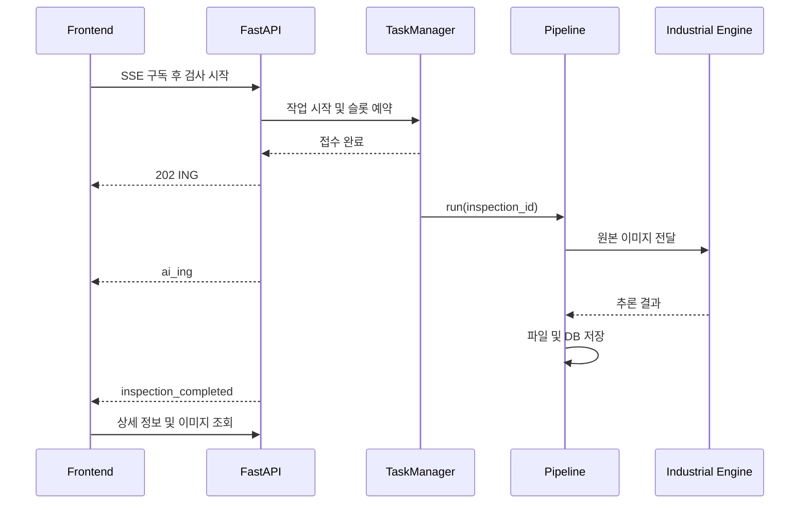

FastAPI 내부 `InspectionTaskManager` 방식(A안)을 사용한다. 별도 Worker나 Redis를 도입하지 않는다. 서버 단일 프로세스에서 동시 AI 검사 수는 초기 1개로 제한한다. 두 번째 실행 요청은 409로 알려주고 사용자가 다시 요청한다. 자동 작업 대기열은 만들지 않는다. 조회·업로드처럼 AI 연산이 아닌 업무는 계속 처리한다.

검사 시작 검증, 슬롯 예약, WAITING → ING 상태 변경은 경쟁 요청에서 중복 실행되지 않도록 제어한다. 오래 걸리는 외부 호출과 동기 파일 작업이 API 이벤트 루프를 막지 않도록 비동기 I/O 또는 필요 시 스레드 오프로딩을 사용한다. DB 트랜잭션을 엔진 추론 내내 열어두지 않는다.

외부 엔진에서 이미 연산 중인 상태에서 취소하면 CANCELLED로 표시하고 늦은 결과의 DB 반영을 금지한다. 실제 엔진 작업이 종료되거나 중단 확인되기 전에는 검사 슬롯을 섣불리 해제하지 않는다. 프로세스 재시작 때 남아 있는 ING 기록은 FAILED로 조정하고 원인을 보존한다. 자동 재검사는 하지 않는다.

## 11. 전체 디렉터리 구조

**쉽게 이해하기:** 프로그램을 하나의 커다란 파일로 만들지 않고 역할별 폴더로 나눈다. `frontend`에는 사용자가 보는 화면, `backend`에는 검사·저장·권한 처리 코드, 배포 설정에는 서버에서 프로그램을 실행하기 위한 설정을 둔다. 아래 폴더들은 실제 개발할 때 만들 구조이며 이미 구현되어 있다는 뜻은 아니다.

```text
pcb-inspection/
├── frontend/
│   ├── src/
│   │   ├── pages/
│   │   ├── components/
│   │   │   ├── camera/
│   │   │   ├── inspection/
│   │   │   ├── images/
│   │   │   ├── reviews/
│   │   │   ├── dashboard/
│   │   │   └── common/
│   │   ├── api_client/
│   │   ├── hooks/
│   │   ├── stores/
│   │   ├── types/
│   │   ├── layouts/
│   │   ├── utils/
│   │   └── styles/
│   ├── public/
│   ├── tests/
│   ├── package.json
│   ├── package-lock.json
│   ├── vite.config.ts
│   └── Dockerfile
├── backend/
│   ├── app/
│   │   ├── main.py
│   │   ├── api/
│   │   ├── services/
│   │   ├── repositories/
│   │   ├── schemas/
│   │   ├── adapters/
│   │   ├── tasks/
│   │   ├── events/
│   │   ├── database/
│   │   │   ├── models/
│   │   │   ├── views/
│   │   │   └── migrations/
│   │   ├── storage/
│   │   └── core/
│   ├── data/preprocessed/
│   ├── tests/
│   ├── requirements.txt
│   └── Dockerfile
├── infrastructure/
│   ├── nginx/
│   └── industrial-engine/
├── tests/e2e/
├── docs/
├── docker-compose.yml
├── docker-compose.prod.yml
├── docker-compose.test.yml
├── .env.example
├── .gitignore
└── README.md
```

프론트엔드와 백엔드는 독립적으로 개발한다. 프로젝트 소스와 MinIO 저장 공간, DB 데이터, 엔진 체크포인트, 로컬 전처리 자료를 구분하며 실제 데이터·비밀값·모델 파일은 Git에 커밋하지 않는다. `infrastructure/industrial-engine/`에는 버전 고정 및 최소 출력 수정 사항을 관리하며 공개 엔진 전체를 우리 백엔드의 업무 코드에 혼합하지 않는다.

## 12. 백엔드 클래스 및 메서드 상세 설계

**쉽게 이해하기:** 클래스는 특정 일을 담당하도록 만든 프로그램 설계도이고, 메서드는 그 담당자가 수행하는 기능이다. 예를 들어 `InspectionService`는 검사를 관리하는 담당자이고, 검사 생성이나 실행 요청과 관련한 메서드를 가진다. 기능을 나누면 AI 모델만 교체하거나 파일 저장 방식만 수정할 때 다른 코드에 미치는 영향을 줄일 수 있다.

| 계층 | 담당하는 일 |
| --- | --- |
| Router | 화면에서 API 요청을 받는 접수 창구 |
| Service | 권한과 검사 규칙을 판단하고 업무를 처리하는 담당자 |
| Repository | 데이터베이스에 기록하고 찾아오는 담당자 |
| Adapter | AI 엔진을 호출하고 결과 형식을 맞추는 담당자 |
| Pipeline | 여러 검사 단계를 순서대로 수행하는 담당자 |

### 12.1 계층별 역할

**DIAGRAM 11 흐름도**

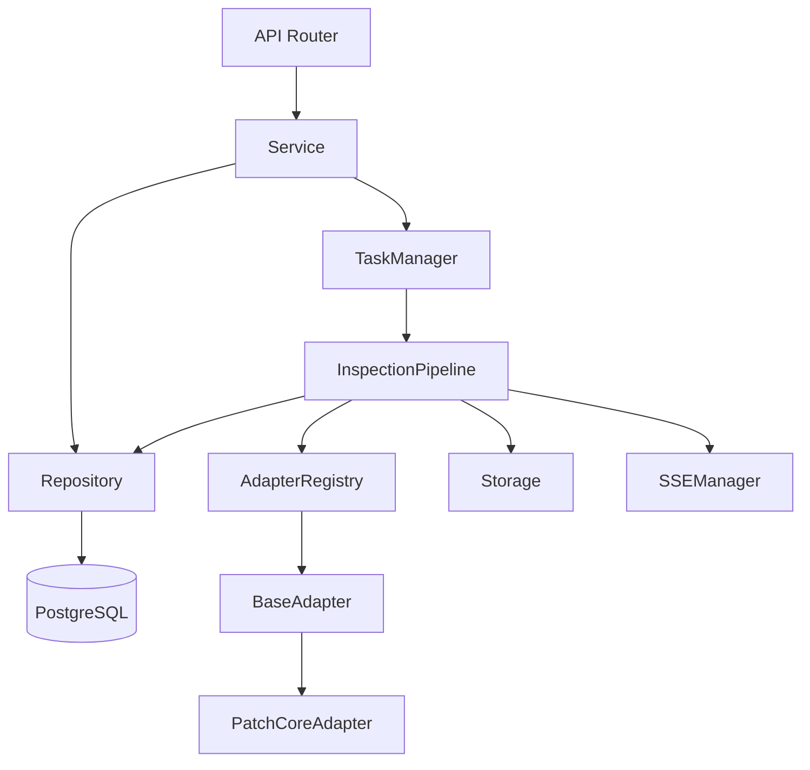

| 계층 | 주요 책임 |
| --- | --- |
| api | 요청 검증, 인증·권한 확인, Service 호출 및 응답 |
| schemas | API 및 내부 데이터 형식 |
| services | 업무 규칙, 업무 흐름 조합 |
| tasks | 비동기 실행, 동시 작업 제한, 취소 |
| adapters | 모델 호출 규약과 결과 변환 |
| repositories | DB의 조회 및 저장 |
| database | 연결/세션, DB 테이블, View, 마이그레이션 |
| storage | MinIO 및 로컬 파일 I/O |
| events | SSE 이벤트 발행과 연결 관리 |
| core | 설정, 인증, 공통 예외, 로그, 상태값 |

아래의 메서드는 구현 코드를 의미하지 않고 개발자가 지켜야 할 기능 계약이다. 입력값 및 반환 모델의 세부 타입은 API 스키마를 이용한다. `None` 반환인 검증 메서드는 실패 시 업무 예외를 발생시킨다.

### 12.2 검사 핵심 클래스

**DIAGRAM 12 클래스 다이어그램**

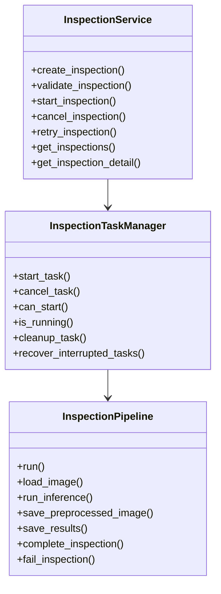

**InspectionService — `app/services/inspection_service.py`**

| 메서드 | 입력 | 반환 및 책임 |
| --- | --- | --- |
| create_inspection | connection_id, user_id | InspectionInfo; WAITING 생성 |
| validate_inspection | inspection_id | None; 이미지·PCB·모델·연결·상태 검증 |
| start_inspection | inspection_id, current_user | InspectionStatus; 검증 후 작업 접수 |
| cancel_inspection | inspection_id, current_user | InspectionStatus; 권한 및 상태 검증 후 취소 |
| retry_inspection | previous_id, reuse_image, current_user | InspectionInfo; 새 검사 및 필요 시 이미지 연결 |
| get_inspections | filters, current_user | List[InspectionListItem] |
| get_inspection_detail | inspection_id, current_user | InspectionDetail |

**InspectionTaskManager — `app/tasks/inspection_task_manager.py`**

| 메서드 | 입력 | 반환 및 책임 |
| --- | --- | --- |
| start_task | inspection_id | 접수 결과; 슬롯 예약, ING 변경, 파이프라인 비동기 시작 |
| cancel_task | inspection_id | 취소 접수 결과; 취소 상태 변경 및 실행 중단 요청 |
| can_start | 없음 | Boolean; 가용 슬롯 확인 |
| is_running | inspection_id | Boolean; 실행 목록 확인 |
| cleanup_task | inspection_id | None; 작업 종료 후 슬롯 반환 |
| recover_interrupted_tasks | 없음 | None; 서버 재시작 시 미완료 ING 기록 복구 |

관리 속성: `running_tasks`, `max_concurrent_tasks=1`, `task_lock`. 단일 프로세스 메모리에서 관리하며 사용 가능한지 확인하는 동작과 슬롯 예약을 원자적으로 처리한다.

**InspectionPipeline — `app/services/inspection_pipeline.py`**

| 메서드 | 입력 | 반환 및 책임 |
| --- | --- | --- |
| run | inspection_id | None; 전체 검사 처리 순서 및 오류 관리 |
| load_image | image_id | ImageData; 원본 바이트와 미디어 타입 |
| run_inference | ai_model_id, image | AIResult; 어댑터 추론 |
| save_preprocessed_image | image_id, preprocessed_image | 로컬 Path; 관리자 분석 파일 |
| save_results | image_id, ai_result | 결과 Object Key 등; 필수 파일 저장 |
| complete_inspection | inspection_id, result_data | None; AI 결과 DB 저장과 완료 상태를 한 트랜잭션으로 확정 후 SSE |
| fail_inspection | inspection_id, reason | None; 아직 ING 상태일 때만 FAILED 및 사유 기록 후 SSE |

취소와 완료가 동시에 발생해도 상태 전이 검증으로 하나의 종결 상태만 확정한다. 전처리 이미지 등 보관 실패는 명시적으로 로그에 기록한다. 본 MVP에서 필요한 엔진 응답 데이터가 누락되거나 필수 검사 결과 파일이 저장되지 않으면 COMPLETED로 처리하지 않는다.

### 12.3 Adapter 클래스

**DIAGRAM 13 클래스 다이어그램**

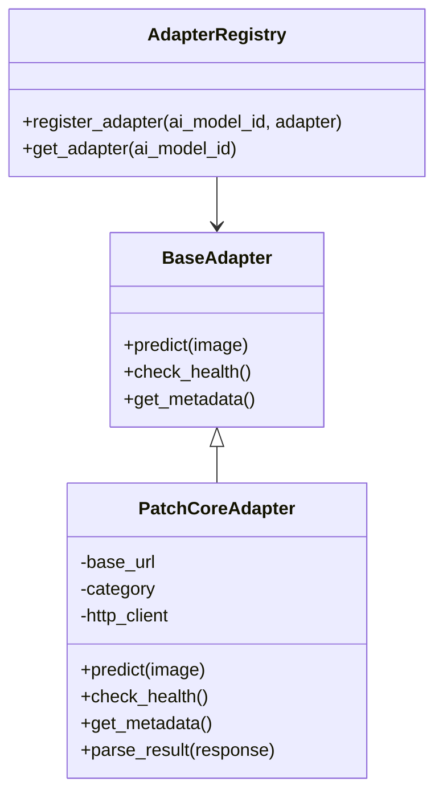

| 파일 / 클래스 | 메서드 및 입력 → 반환 |
| --- | --- |
| adapters/base_adapter.py — BaseAdapter | predict(ImageData) → AIResult; check_health() → 사용 가능 상태; get_metadata() → ModelMetadata |
| adapters/patchcore_adapter.py — PatchCoreAdapter | predict(image) → AIResult; check_health() → 상태; get_metadata() → 모델 정보; parse_result(response) → AIResult |
| adapters/adapter_registry.py — AdapterRegistry | register_adapter(ai_model_id, adapter) → None; get_adapter(ai_model_id) → BaseAdapter |

PatchCoreAdapter는 `base_url`, `category`, `http_client`를 관리한다. 기존 모델 전처리를 활용하므로 MVP 자체 `preprocess()`는 구현하지 않는다. 추후 EfficientAD, DINOv2 및 로컬 학습 모델은 같은 공통 계약을 구현한다.

### 12.4 기타 Service 클래스

| 파일 / 클래스 | 메서드 (입력 → 반환) |
| --- | --- |
| services/pcb_registration_service.py — PcbRegistrationService | register_pcb(name, description) → PCB; get_pcbs(filters) → 목록; get_pcb(id) → PCB; update_pcb(id, changes) → PCB |
| services/ai_model_service.py — AiModelService | register_model(name, description, status) → 모델; get_models(filters) → 목록; get_model(id) → 모델; update_model(id, changes) → 모델; validate_model(id) → None |
| services/pcb_model_connection_service.py — PcbModelConnectionService | connect_model(pcb_id, ai_model_id) → 연결; get_connections(filters) → 목록; update_connection(id, active) → 연결; validate_connection(id) → None |
| services/image_service.py — ImageService | validate_image(file) → 이미지 속성; upload_image(inspection_id, file, captured_at) → 이미지 정보; get_image_metadata(id) → 이미지 정보; get_image_file(id, type) → 파일 데이터 |
| services/review_service.py — ReviewService | create_review(inspection_id, user_id, judgment, comment) → 검토; update_review(inspection_id, user_id, changes) → 검토; validate_review(inspection_id, current_user) → None |
| services/auth_service.py — AuthService | login(username, password) → 사용자 및 세션; logout(session) → None; get_current_user(session) → 사용자; change_password(user_id, current, new) → None |
| services/user_service.py — UserService | create_user(data) → 사용자; get_users(filters) → 목록; update_user(id, changes) → 사용자 |
| services/dashboard_service.py — DashboardService | get_dashboard(filters) → DashboardData; calculate_statistics(counts) → 통계; calculate_model_performance(review_counts, times) → 성능 통계 |

업무 권한은 API 인증·권한 확인과 Service의 자원별 검증 단계에서 적용한다. 사용자 검토는 AI 결과를 변경하지 않는다. 관리자 모델 활성화 시 어댑터 매핑 및 실제 사용 가능 상태를 검증한다.

### 12.5 Storage와 SSE 클래스

| 파일 / 클래스 | 메서드 및 책임 |
| --- | --- |
| storage/minio_storage.py — MinioStorage | upload_file(key, bytes, content_type) → key; download_file(key) → bytes; file_exists(key) → bool; delete_file(key) → None (내부 관리, 공유 참조 확인 후) |
| storage/preprocessed_storage.py — PreprocessedStorage | save_image(image_id, image) → Path; build_save_path(image_id, date) → Path |
| storage/object_keys.py — 공통 함수 | 원본 및 결과의 날짜별 Object Key 생성 함수; 저장소 규칙 중앙화 |
| events/sse_manager.py — SSEManager | subscribe(inspection_id) → 스트림; unsubscribe(inspection_id, subscription) → None; publish_event(inspection_id, event_type, data) → None; send_heartbeat(subscription) → None; close_stream(inspection_id) → None |
| core/security.py — SessionManager | create_session(user_id) → 세션 ID; validate_session(session_id) → 인증 결과; delete_session(session_id) → None; invalidate_user_sessions(user_id) → None |

### 12.6 Repository 클래스

| 파일 / 클래스 | 주요 메서드 |
| --- | --- |
| pcb_registration_repository.py / PcbRegistrationRepository | create, get_by_id, get_all, update |
| ai_model_repository.py / AiModelRepository | create, get_by_id, get_all, update |
| pcb_model_connection_repository.py / PcbModelConnectionRepository | create, get_by_id, get_by_pcb_id, get_all, update |
| user_repository.py / UserRepository | create, get_by_id, get_by_username, get_all, update |
| inspection_repository.py / InspectionRepository | create, get_by_id, get_all, get_detail, update_status (기대 상태 검증) |
| image_repository.py / ImageRepository | create, get_by_id, get_by_inspection_id, 원본 참조 확인 |
| ai_result_repository.py / AiResultRepository | create, get_by_image_id |
| review_repository.py / ReviewRepository | create, get_by_image_id, update |
| dashboard_repository.py / DashboardRepository | get_daily_statistics, get_model_statistics, get_pending_reviews |

공통 메서드는 create(data) → 객체, get_by_id(id) → 객체 또는 None, get_all(filters) → 목록, update(id, changes) → 수정 객체 형태를 기본으로 한다. 제약조건 오류를 업무 오류로 변환하고 SQL 로직이 Service에 흩어지지 않도록 한다. 여러 Repository의 원자적 처리에는 같은 DB 세션의 트랜잭션을 사용한다.

### 12.7 API 파일 및 기타 구성

```text
backend/app/
├── main.py
├── api/
│   ├── router.py
│   ├── auth.py
│   ├── users.py
│   ├── pcb_registrations.py
│   ├── ai_models.py
│   ├── pcb_model_connections.py
│   ├── inspections.py
│   ├── images.py
│   ├── reviews.py
│   ├── events.py
│   └── dashboard.py
├── schemas/
│   ├── auth.py
│   ├── users.py
│   ├── pcb_registrations.py
│   ├── ai_models.py
│   ├── pcb_model_connections.py
│   ├── inspections.py
│   ├── images.py
│   ├── reviews.py
│   ├── dashboard.py
│   ├── events.py
│   └── common.py
├── database/
│   ├── connection.py
│   ├── base.py
│   ├── models/ (8개 테이블별 Python 파일)
│   ├── views/ (4개 View 정의 파일)
│   └── migrations/
└── core/
    ├── config.py
    ├── security.py
    ├── permissions.py
    ├── exceptions.py
    ├── logging.py
    └── constants.py
```

API 라우터는 해당 경로별 일반 함수로 구성한다. 예를 들어 `api/inspections.py`의 실행 함수가 `InspectionService.start_inspection()`을 호출한다. 요청/응답 스키마는 Pydantic으로 정의하고 데이터베이스는 SQLAlchemy 및 Alembic을 사용하여 구현한다. 의존성 버전은 GB10 환경에서 검증 후 고정한다.

### 12.8 클래스 및 메서드 실행 시나리오

**DIAGRAM 14 시퀀스 다이어그램**

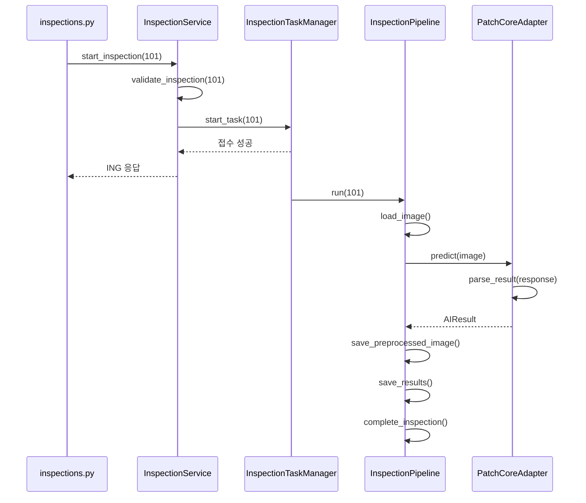

| 향후 변경 작업 | 주요 수정 위치 |
| --- | --- |
| 동시 검사 제한 | InspectionTaskManager.max_concurrent_tasks |
| 검사 조건 변경 | InspectionService.validate_inspection |
| 엔진 API 응답 변경 | PatchCoreAdapter.parse_result |
| AI 모델 지원 추가 | BaseAdapter 구현 및 AdapterRegistry 등록 |
| 전처리 파일 저장 위치 | PreprocessedStorage.build_save_path |
| 전체 검사 순서 | InspectionPipeline.run |
| SSE 전송 | SSEManager.publish_event |
| 통계 계산 | DashboardService.calculate_model_performance |

## 13. 프론트엔드 기술 설계

**쉽게 이해하기:** 프론트엔드는 사용자가 직접 보는 홈페이지와 검사 화면이다. React에서는 카메라 화면, 검사 실행 버튼, 결과 표시처럼 반복해서 사용하는 화면 요소를 컴포넌트라는 작은 단위로 나눈다. 필요한 페이지에서 그 부품들을 조합하여 화면을 구성한다.

### 13.1 기술 선정

| 기술 | 설계 목적 |
| --- | --- |
| React | 페이지와 재사용 컴포넌트 구현 |
| TypeScript | API 계약과 화면 데이터 형식 일치 |
| Vite | 프론트 개발 및 정적 빌드 |
| React Router | 브라우저 페이지 라우팅 |
| Fetch API / FormData | REST 요청 및 이미지 업로드 |
| EventSource | SSE 연결 |
| MediaDevices / Canvas | 사용자 카메라 접근 및 사진 캡처 |
| React Context / hooks | 인증과 화면 상태 관리 |
| CSS 및 간단한 SVG 그래프 | 반응형 화면 및 기본 대시보드 |

내부 검사 화면의 SEO와 서버 사이드 렌더링이 핵심 요구사항이 아니므로 별도의 Node 업무 서버는 필요하지 않다. Vite의 정적 빌드 결과는 향후 Nginx에서 제공하고, 현재는 Vite 개발 서버로 검증한다. [R2] 카메라 사용은 HTTPS 또는 신뢰되는 로컬 개발 보안 컨텍스트가 필요하므로 개발 PC의 localhost에서 우선 검증한다. 휴대폰에서 실제 카메라를 시험할 때는 신뢰되는 HTTPS 테스트 주소 등을 사용하며, 운영 배포용 TLS는 추후 적용한다. [R3]

### 13.2 페이지 및 컴포넌트

| 페이지 경로 | 페이지 파일 | 주요 컴포넌트 |
| --- | --- | --- |
| /login | LoginPage.tsx | 로그인 폼, 오류 표시 |
| /dashboard | DashboardPage.tsx | StatisticsCard, DailyInspectionChart, ModelPerformance |
| /inspections/new | InspectionPage.tsx | PcbSelector, ModelSelector, CameraPreview, CaptureButton, ImageUpload, InspectionStartButton |
| /inspections | InspectionHistoryPage.tsx | InspectionHistory, 검색·필터·페이지 |
| /inspections/:id | InspectionDetailPage.tsx | InspectionProgress, InspectionResult, InspectionTimeline, OriginalImage, HeatmapImage, AnomalyMapImage, ReviewForm, ReviewResult |
| /pcb-registrations | PcbRegistrationPage.tsx | 목록, 등록 및 수정 폼 |
| /ai-models | AiModelsPage.tsx | 모델 목록, 상태 표시, 등록·수정 |
| /pcb-model-connections | PcbModelConnectionsPage.tsx | PCB 및 모델 선택, 연결 상태 관리 |
| /users | UsersPage.tsx | 사용자 등록·관리 |

관리자 페이지는 메뉴와 라우팅 가드에서 구분하고, 최종 권한은 항상 백엔드에서 검증한다. 레이아웃은 MainLayout, Sidebar, Header 및 공통 Button, Table, Modal, Loading, Notification을 활용한다. 데스크톱과 모바일 모두 검사 작업이 가능하도록 반응형으로 구성한다.

### 13.3 상세 모듈

```text
frontend/src/
├── pages/               (위 페이지 파일)
├── components/
│   ├── camera/          CameraPreview, CaptureButton, ImageUpload
│   ├── inspection/      PcbSelector, ModelSelector, InspectionStartButton,
│   │                     InspectionProgress, InspectionResult, InspectionTimeline, InspectionHistory
│   ├── images/          OriginalImage, HeatmapImage, AnomalyMapImage
│   ├── reviews/         ReviewForm, ReviewResult
│   ├── dashboard/       StatisticsCard, DailyInspectionChart, ModelPerformance
│   └── common/          Button, Modal, Table, Loading, Notification
├── api_client/
│   ├── client.ts
│   ├── auth.ts
│   ├── users.ts
│   ├── pcb_registrations.ts
│   ├── ai_models.ts
│   ├── pcb_model_connections.ts
│   ├── inspections.ts
│   ├── images.ts
│   ├── reviews.ts
│   └── dashboard.ts
├── hooks/               useCamera.ts, useInspection.ts, useSSE.ts
├── stores/              authStore.ts, inspectionStore.ts
├── types/               user.ts, pcb.ts, ai_model.ts, inspection.ts,
│                         image.ts, review.ts, dashboard.ts, event.ts
├── layouts/             MainLayout.tsx, Sidebar.tsx, Header.tsx
├── utils/               datetime.ts, format.ts
└── styles/
```

파일명은 MVP 구현 기준이며 빈 미래 기능 폴더는 만들지 않는다.

### 13.4 상태 관리와 카메라 연동

| 상태 | 관리 위치 |
| --- | --- |
| 로그인 사용자와 권한 | authStore/Context, /api/auth/me로 확인 |
| PCB, 모델 선택, 미리보기 이미지 | 검사 페이지의 지역 상태 |
| 검사 ID 및 진행 단계 | inspectionStore/useInspection |
| SSE 연결 및 수신 이벤트 | useSSE |
| 서버에 저장된 실제 검사 상태 | PostgreSQL + 상세 API (최종 기준) |

`useCamera`에서 웹캠 또는 휴대폰 카메라 권한을 요청하고 비디오 스트림을 표시한다. 촬영 버튼으로 현재 프레임을 가져와 미리보기 이미지를 만든다. 카메라 접근 거절 또는 장치 부재 시 기존 이미지 파일 선택을 제공한다. 이미지 해상도를 모델 입력 크기로 축소하지 않고 촬영 결과를 그대로 업로드한다. 페이지 이탈 시 카메라 스트림 및 미리보기 Object URL을 정리한다.

사용자 인증은 HttpOnly 쿠키를 사용하며 토큰을 Local Storage에 저장하지 않는다. API Client의 공통 401 처리에서는 로그인 화면으로 이동하고 서버 오류를 사용자 메시지로 표시한다. 검사 시작 버튼의 중복 클릭을 방지하되 최종 동시 검사 제약은 서버에서 보장한다.

`useSSE`는 시작 전 연결, 이벤트 수신, 재연결 시 상태 재조회, 최종 이벤트 및 페이지 종료 시 연결 해제를 담당한다. 결과 이미지는 인증된 동일 Origin URL에서 읽고, 전처리 디버그 파일은 일반 페이지에서 조회할 수 없게 한다.

## 14. 테스트 설계

**쉽게 이해하기:** 단위 테스트는 버튼이나 계산 기능 같은 작은 부품을 따로 확인하고, 통합 테스트는 서버와 저장소 등 여러 부품이 서로 연결되는지 확인한다. E2E(End-to-End) 테스트는 실제 사용자가 로그인해서 사진을 올리고 결과를 보는 처음부터 끝까지의 과정을 확인한다. AI 성능 검증은 이와 별도로 실제 정상·불량 사진이 필요하다.

### 14.1 테스트 전략

| 수준 | 도구/환경 | 목적 |
| --- | --- | --- |
| 백엔드 단위 테스트 | pytest + Mock | 업무 규칙, 상태 전이 및 어댑터 변환 |
| 프론트 단위·컴포넌트 | Vitest, React Testing Library | 화면 표시, 입력 및 사용자 이벤트 |
| 통합 테스트 | FastAPI 테스트 클라이언트, 독립 PostgreSQL, MinIO | 제약조건, API 계약, 파일과 DB 연결 |
| E2E | Playwright 및 테스트 Compose | 브라우저부터 API·SSE·저장까지 전체 흐름 |
| 실제 모델 및 성능 테스트 | GB10 및 검증용 이미지 | 엔진 연동, 모델 결과 재현, 처리 속도 |

AI 엔진 Mock과 실제 엔진 테스트를 분리한다. Mock은 예측 가능한 PASS/FAIL과 작은 수치 배열·PNG를 제공하여 업무 기능을 검증하는 용도이며 실제 AI 정확도 증거가 아니다. 실제 엔진 테스트에 사용하는 체크포인트와 이미지 출처를 기록한다.

### 14.2 단위 및 통합 테스트 목록

| ID | 대상 | 테스트 조건 | 성공 기준 |
| --- | --- | --- | --- |
| T01 | 인증 | 정상 및 잘못된 로그인, 로그아웃 | 정상 세션 발급, 오류 응답, 세션 무효화 |
| T02 | 역할 | USER가 모델·사용자 관리 API 요청 | 403, 변경 없음 |
| T03 | 사용자 | 계정 비활성화 후 기존 세션 접근 | 서비스 이용 거절 |
| T04 | PCB | 이름 중복, 비활성화 및 이력 조회 | UNIQUE 유지, 신규 선택 금지, 기존 기록 유지 |
| T05 | AI 모델 | DEVELOPING 및 INACTIVE 실행 | 검사 거부; 상태 표시 |
| T06 | 모델 매핑 | 실행 설정이 없는 모델 활성화 | 명확한 오류, ACTIVE 전환 차단 |
| T07 | 연결 | 같은 PCB·모델 중복 등록 및 재활성화 | 중복 POST는 409; 비활성 연결은 PATCH로 재활성화; 중복 행 없음 |
| T08 | 이미지 | 정상 JPG/PNG 업로드 | 원본 바이트 및 해상도·Object Key 일치 |
| T09 | 이미지 | 손상, 미지원 형식, 용량 초과 | 분류된 오류, 완료된 이미지 행 없음 |
| T10 | 검사 | 이미지 미업로드 상태에 실행 요청 | 거부, WAITING 유지 |
| T11 | 검사 | 업로드 직후 실행 버튼 미클릭 | 엔진 호출 없음 |
| T12 | 검사 | 두 동시 실행 요청 및 중복 클릭 | 한 건만 ING, 추가 요청은 409 |
| T13 | AI Adapter | PASS/FAIL 또는 누락된 엔진 응답 | 공통 결과로 변환, 잘못된 응답 거부 |
| T14 | 파일 | 결과 필수 파일 저장 실패 | FAILED, 성공 이벤트 미발행 |
| T15 | 취소 | 엔진 응답 직전·저장 직전 취소 | 종결 상태 한 번 확정; 늦은 응답으로 변경 금지 |
| T16 | 재검사 | 기존 원본 재사용 | 새 검사와 이전 ID 연결, 원본 파일은 중복 저장하지 않음 |
| T17 | 재검사 | 새로운 사진 업로드 | 별도 신규 원본·이미지 ID |
| T18 | 이미지 조회 | type별 조회 | original은 원본, heatmap·anomaly-map은 PNG |
| T19 | 검토 | 미완료 검토, 중복 등록, 수정 권한 | 상태 및 권한에 맞는 오류, AI 판정은 불변 |
| T20 | 통계 | 4개 판정 조합과 미검토 데이터 | 올바른 분모 및 null 처리 |
| T21 | SSE | 정상, 취소 및 실패 이벤트 | 이벤트 순서 및 최종 상태 일치 |
| T22 | SSE | 연결 끊김·재접속·완료 이벤트 놓침 | 상세 조회로 최종 상태 회복 |
| T23 | 재시작 | 실행 도중 API 프로세스 강제 종료 후 재시작 | 미완료 ING 복구, 세션 재로그인, 원본 유지 |
| T24 | 보관 | Docker 재생성 | DB, MinIO, 전처리 이미지 및 체크포인트 유지 |
| T25 | 날짜 | KST 자정 전후 및 날짜 필터 | 날짜별 저장 및 통계가 문서 기준과 일치 |
| T26 | 저장 공유 | 재검사에서 공유하는 원본 | 다른 검사 삭제/정리 시 공유 파일 보존 |
| T27 | 기본 접근 권한 | 쿠키 누락·권한 조작 | 미인가 접근 및 상태 변경 차단; 추가 CSRF·운영 보안 검증은 배포 전 |

### 14.3 E2E 시나리오

1. 관리자 로그인 → PCB 등록 → AI 모델 등록 또는 활성화 → 연결 생성 → 일반 사용자 계정 등록.
2. 일반 사용자 로그인 → PCB와 모델 선택 → 사진 촬영/파일 선택 → 미리보기 → 업로드 → 검사 실행 → SSE 수신 → 결과 3종 표시 → 사용자 PASS/FAIL 및 의견 저장.
3. 검사 이력 조회 → 이전 결과와 사용자 검토 확인 → 대시보드 반영 확인.
4. 엔진 오류와 취소를 재현 → FAILED/CANCELLED 확인 → 원본 재사용 재검사 → 이전 검사 관계 및 결과 파일 분리 확인.
5. 개발 중 모델의 상태 표시 및 선택 금지, 관리자 전용 메뉴 접근 검증.
6. 웹캠과 휴대폰 실제 카메라 권한 및 재촬영, 카메라 거부 시 파일 선택, 모바일 화면 확인.

브라우저 자동 테스트는 가짜 카메라 또는 fixture로 재현성을 확보하고, 실제 카메라·조명·촬영 거리는 별도 수동 검증으로 확인한다.

### 14.4 AI 성능 검증 및 실험 계획

실제 PatchCore의 검출 성능은 플랫폼 기능 테스트와 분리한다. 공개 모델 학습에 사용한 이미지와 독립 검증 이미지를 분리하고 실제 목표 PCB에 맞는 정상·불량 표본을 확보한다. 정상 표본뿐이라면 정상 오경보율은 평가할 수 있지만 불량 검출률은 산출할 수 없음을 명시한다.

| 측정 항목 | 방법 및 기록 기준 |
| --- | --- |
| 연동 동일성 | 같은 원본을 Industrial 직접 API 및 자체 플랫폼 경유로 비교; 점수·판정·색상 지도·실제 수치 데이터의 일치 확인 |
| 이상 영역 유효성 | Heatmap과 원본 위치가 일치하는지 검증; 정답 마스크 확보 시 위치 평가 지표 사용 |
| 오경보율 | 검증된 정상 중 AI FAIL 비율 |
| 불량 검출률 | 검증된 실제 불량 중 AI FAIL 비율 |
| 검사 처리 시간 | 실행 접수부터 완료까지 p50/p95, 엔진 호출 구간 별도 측정 |
| 시스템 자원 | CPU, GPU/공유 메모리, 디스크, 컨테이너 메모리 사용량 |
| 입력 크기 실험 | 동일한 목표 PCB 데이터와 동일 평가 프로토콜로 모델 학습 조건별 평가, 224/256/512 등의 입력 크기는 각 모델 조건에 맞게 비교 |
| 촬영 환경 | 카메라 거리, 각도, 조명 변화에 따른 판정 변화 확인 |

공개 모델의 기존 입력 조건은 성능 기준으로 유지한다. 224/256/512를 동일 모델에서 임의로 바꿔 추론하는 실험은 적절한 모델·Bank 및 임계값 조건을 갖춘 이후 수행한다. 정밀 검사 및 0.05 mm 수준의 결함 검출 성능은 MVP 완료 기준으로 보장하지 않는다.

실제 모델 정답과 처리 시간의 목표 수치는 초기 기준선 측정 이후 정한다. MVP는 API 계약·상태 전이·파일 보존·권한·E2E 성공을 필수 완료 기준으로 두며, 측정되지 않은 수치를 보장하지 않는다.

## 15. GB10 배포 환경 상세 설계

**쉽게 이해하기:** 배포란 개발한 프로그램을 GB10에서 실제로 실행하여 사용자가 접속할 수 있도록 만드는 일이다. Docker는 프로그램과 필요한 실행 환경을 컨테이너라는 단위로 묶고, Docker Compose는 여러 컨테이너를 함께 관리한다. 운영 환경은 실제 검사 업무에 사용하고, 테스트 환경은 개발자가 새로운 기능과 오류 상황을 안전하게 시험할 때 사용한다.

**시점 구분:** 이번 개발에서는 GB10 또는 로컬 PC에서 내부 개발·테스트 환경만 구축한다. 아래 운영 배포 구성은 향후 적용할 설계안이며 지금 실제 배포하거나 외부에 공개하지 않는다. 운영용 인증서, 네트워크 보안 및 보안 점검은 필수 기능 개발을 완료한 뒤 진행한다.

| 구분 | 현재 개발·테스트 | 향후 운영 배포 |
| --- | --- | --- |
| 접속 | localhost 또는 제한된 내부 테스트망 | 관리자가 승인한 운영 주소 |
| 인증 | 개발용 임시 비밀번호 로그인·ADMIN/USER 권한 구분·전용 기능 접근 제한 | 실제 비밀번호 해시 및 운영 인증 보안 검증 |
| HTTPS | 카메라 기능 검증에 필요한 경우만 | 운영 인증서 및 TLS 적용 |
| 보안 | 기본 입력 검증, 비밀값 소스코드 저장 금지 | 추가 CSRF 방어 검증, 네트워크 접근 통제, 운영 보안 점검 |
| 데이터 | 테스트 전용 DB·MinIO, 영속화 확인 | 운영 DB·MinIO 분리, 백업 및 복원 절차 |

### 15.1 네트워크 및 서비스 구성

**DIAGRAM 15 흐름도**

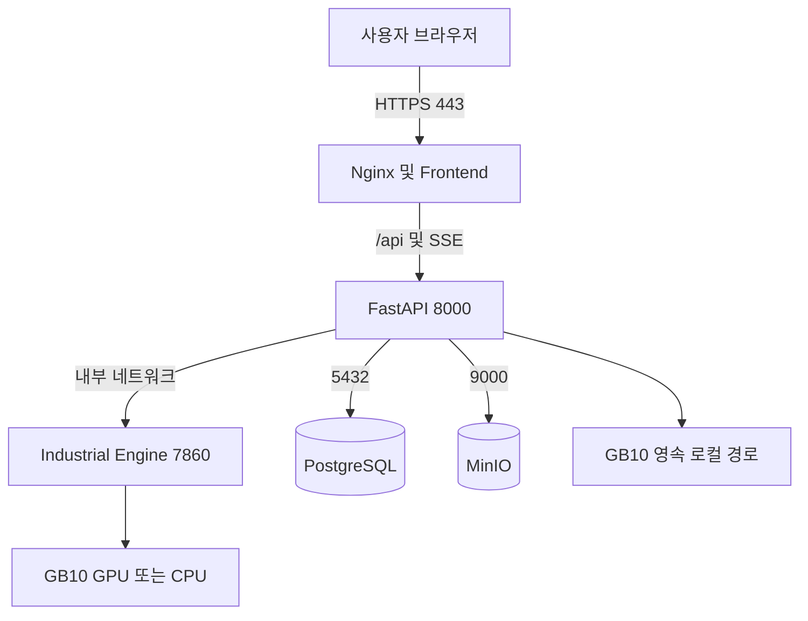

| Compose 서비스 | 내부 포트 예시 | 역할 | 외부 공개 |
| --- | --- | --- | --- |
| frontend | 443/80 | Nginx HTTPS 및 정적 프론트 제공 | HTTPS만 접근 허용 |
| backend | 8000 | FastAPI, REST, SSE | 내부만 |
| industrial-engine | 7860 | 기존 엔진 API | 내부만 |
| postgres | 5432 | 업무 DB | 내부만 |
| minio | 9000 | 객체 데이터 | 내부만 |

포트 번호는 배포안이며 기존 GB10 서비스와 충돌 여부를 확인 후 설정한다. MinIO 관리 콘솔 및 엔진 Swagger는 필요한 관리자용 내부 접근으로만 허용한다. TLS 인증서는 학교·회사 내부 도메인 또는 관리자가 정한 신뢰되는 인증서 체계로 구성한다. 휴대폰 카메라를 사용하므로 단순히 LAN IP의 HTTP 페이지를 제공하는 방식은 피한다. [R3]

Nginx에서 `/api/`를 백엔드로 전달하고 SSE 응답을 버퍼링하지 않도록 구성한다. 프론트엔드 페이지와 REST/SSE는 같은 Origin을 사용한다. 프록시 유휴 연결과 heartbeat를 맞추되 AI 업무 실패 시간 기준을 새로 도입하는 것은 아니다.

### 15.2 GB10 및 엔진 호환성

GB10 계열 시스템은 ARM64 기반이므로 운영 환경에서 실제 CPU 아키텍처와 GPU 런타임을 확인하고 각 컨테이너 이미지를 검증한다. NVIDIA DGX Spark 자료는 ARM64와 NVIDIA Container Runtime의 GPU 컨테이너 지원을 안내한다. [R4, R5]

공개 Industrial 엔진의 문서상 개발 환경 및 체크포인트 지원과 GB10의 실제 호환 여부는 다르다. 아래 순서로 확인하며 GPU 동작을 미리 보장하지 않는다.

1. 호스트 아키텍처, Docker 및 NVIDIA Container Runtime 상태 확인.
2. ARM64 지원 PyTorch/torchvision 등 엔진 의존성 조합 선택 및 고정.
3. 공개 PCB 체크포인트와 메타데이터 준비, 해시 확인.
4. CPU에서 단일 사진 추론으로 모델 로딩과 결과 형식 검증.
5. GPU 컨테이너 접근 시험 후 GPU 추론 가능 여부 및 성능 비교.
6. GPU 경로가 호환되지 않으면 MVP 통합 기능 검증은 CPU로 계속 진행하고 GPU 개선을 별도 과제로 관리.

### 15.3 Docker Compose 운영·테스트 분리

| 항목 | 운영 | 테스트 |
| --- | --- | --- |
| Compose 프로젝트 | pcb-prod | pcb-test |
| 설정 파일 | docker-compose.prod.yml | docker-compose.test.yml |
| 환경 파일 | .env.prod | .env.test |
| 프론트 접근 | 운영 HTTPS 주소 | 별도의 테스트 주소 또는 포트 |
| PostgreSQL | 운영 DB 및 전용 볼륨 | 독립 테스트 DB 및 볼륨 |
| MinIO | 운영 Bucket/볼륨 | 테스트 전용 Bucket/볼륨 |
| 로컬 전처리 | 운영 전용 호스트 경로 | 테스트 전용 호스트 경로 |
| AI 엔진 | 운영 GPU 또는 검증된 CPU | 기본 Mock/CPU, 필요 시 별도 GPU 시험 |
| 인증 | 운영 계정 및 비밀값 | 테스트 계정 및 별도 비밀값 |

공통 Compose와 환경별 오버라이드 구성을 사용하며 프로젝트 명과 볼륨을 분리한다. Compose 오버라이드의 실제 적용 설정을 배포 전 확인한다. [R6, R7] 테스트가 운영 GPU, DB, Bucket에 영향을 주지 않도록 테스트 자원의 공유를 최소화하고 실제 GPU 성능 실험은 운영 검사와 시간대를 분리한다.

### 15.4 데이터 영속화 및 백업

| 유형 | 보존 방식 |
| --- | --- |
| PostgreSQL 데이터 | 환경별 named volume, 정기 백업 |
| MinIO 데이터 | 환경별 영속 volume, 파일/객체 백업 |
| 전처리 이미지 | `backend/data/preprocessed` 또는 전용 호스트 경로 bind mount |
| 모델 체크포인트·metadata | 엔진용 호스트 경로 마운트 및 버전/해시 기록 |
| 인증 세션 | 메모리, 재시작 후 재로그인 |
| 로그 | 크기 제한이 있는 컨테이너 로그 또는 지정된 로컬 경로 |

DB와 MinIO 백업은 동일한 복구 기준 시점을 관리하고 실제 복원 테스트를 통해 Object Key와 파일의 관계가 유지되는지 확인한다. 백업 사본에 대한 권한 및 비밀값 유출 방지를 적용한다. 보관기간 및 저장 공간 한도를 운영 요구 확정 후 정한다. 볼륨 삭제 명령을 일반 재배포 절차에 포함하지 않는다.

### 15.5 환경변수 설계

| 설정명 예시 | 용도 |
| --- | --- |
| APP_ENV, APP_TIMEZONE | 운영 환경 및 Asia/Seoul 기준 |
| DATABASE_URL | PostgreSQL 연결 |
| MINIO_ENDPOINT, MINIO_ACCESS_KEY, MINIO_SECRET_KEY, MINIO_BUCKET | MinIO 연결 및 권한 |
| INDUSTRIAL_BASE_URL, INDUSTRIAL_CATEGORY | 내부 엔진 주소 및 선택 모델 설정 |
| PATCHCORE_AI_MODEL_ID | 환경별 등록 ID와 실제 실행 어댑터 매핑 |
| MAX_CONCURRENT_INSPECTIONS | 초기 1 |
| PREPROCESSED_DIR | 로컬 전처리 저장 경로 |
| SESSION_TTL, SESSION_COOKIE_SECURE | 인증 세션 정책 |
| MAX_UPLOAD_BYTES | 엔진 업로드 한도와 일치 |
| ALLOWED_ORIGIN | 허용된 프론트 Origin 및 CSRF 방어 |

`.env.example`에는 변수명과 예시만 기록하고 실제 비밀값은 환경별 별도 파일로 안전하게 관리한다. 관리자 초기 비밀번호는 이미지나 소스 코드에 고정하지 않는다.

### 15.6 운영 절차 및 보안 (향후 배포 준비)

- 운영 서버는 FastAPI 단일 프로세스로 실행한다. 다중 ASGI 프로세스·수평 확장은 세션 및 작업/SSE 공유 구조 재설계 이후 검토한다.
- DB 마이그레이션을 별도 초기 단계에서 적용하고, PostgreSQL 및 MinIO가 준비되었는지 확인 후 백엔드를 시작한다.
- 내부 엔진 health 확인 및 체크포인트 검증, 모델 ID 매핑 확인 후 ACTIVE로 설정한다.
- 업로드 내용과 민감한 비밀번호를 로그에 저장하지 않는다. 로그에는 검사 ID, 모델 ID, 처리 단계, 오류 유형, 발생 시각을 기록한다.
- 인증 쿠키, 요청 검증 및 권한 확인은 기능 개발에서 유지한다. 실제 비밀번호 해시, 운영 TLS, 네트워크 접근 통제, 운영 DB/MinIO 권한 및 추가 보안 점검은 실제 배포 준비 단계에서 적용·검증한다. 개발용 비밀번호 원문을 제거하고 실제 계정을 새로 설정하기 전에는 운영 배포하지 않는다.
- 서버 업그레이드 전 검사 작업을 중지하고 현재 작업을 정리하며 DB/파일의 백업 상태 확인 후 이미지 및 의존성 롤백 버전을 유지한다.
- 공개 엔진 저장소의 라이선스와 모델 가중치·데이터 이용 조건을 확인한다. [R1] 기업에서의 배포 또는 상용 사용 전에는 해당 조건에 대한 별도의 검토가 필요하다.

## 16. 개발 순서 및 완료 기준

| 단계 | 구현 내용 | 완료 기준 |
| --- | --- | --- |
| 0 | 외부 엔진 기술 검증 | 선택 저장소·체크포인트 확인, CPU 추론, Swagger 응답·전처리 확인, 원본 Anomaly Map 및 PNG 출력 가능성 확인 |
| 1 | 개발 환경 및 프로젝트 골격 | 프론트/백엔드 별도 실행, 테스트 Compose, DB·MinIO 연결, 초기 마이그레이션 |
| 2 | 인증 및 마스터 데이터 | ADMIN/USER, 로그인, PCB·모델·연결 관리, 상태 표시 |
| 3 | 검사 및 이미지 업로드 | 검사 생성 WAITING, 촬영/선택, 원본 업로드, 상태 검증 |
| 4 | Adapter 및 AI 기능 | 기존 엔진 호출, 공통 응답, 필수 파일 및 로컬 전처리 보관 |
| 5 | 작업 관리 및 SSE | 동시 1건, 중복 실행 방지, 완료/실패/취소, 재접속, 이전 검사 연결 |
| 6 | 결과 화면 및 사용자 검토 | 원본/Heatmap/Anomaly Map 표시, 점수·판정, 검토 저장·수정 |
| 7 | 이력 및 대시보드 | 통합 View 조회, 날짜/모델 필터, 기본 통계 |
| 8 | 통합 및 E2E/성능 테스트 | 기능 테스트 통과, 실제 모델 연동 재현, 측정 기준선 확보 |
| 9 (추후) | 운영 배포 | GB10 HTTPS, 독립 볼륨, 백업·복원·재시작 검증, 운영 보안 확인 및 운영 안내 |

프론트엔드와 백엔드를 병행하되 데이터 구조 및 API 계약을 공유한다. 구현 단위별 테스트를 작성하고 변경 범위를 명확하게 분리한다. 구체적인 일정은 실제 담당 인원과 GB10 접근 가능 시간을 확인하여 산정한다. 임의의 날짜나 인력 투입을 확정하지 않는다.

### 16.1 MVP 최종 완료 확인표

- [ ]관리자와 일반 사용자가 권한에 맞게 기능을 사용한다.
- [ ]PCB 등록 및 AI 모델 연결, 개발 중 모델 상태 표시가 동작한다.
- [ ]촬영/선택 → 미리보기 → 업로드 → 수동 검사 실행 순서가 동작한다.
- [ ]실제 PatchCore 모델의 점수·판정·Heatmap·Anomaly Map이 조회된다.
- [ ]전처리 이미지가 관리자 분석용 로컬 폴더에 보관된다.
- [ ]동시 검사 제한, 검사 취소, 실패 처리 및 이전 검사와 연결된 재검사가 동작한다.
- [ ]SSE 연결 끊김 이후에도 실제 검사 상태가 일치한다.
- [ ]사용자 검토와 AI 판정이 독립적으로 보존된다.
- [ ]검사 직후 및 이력 상세 화면이 정상 조회된다.
- [ ]기본 대시보드 집계가 실제 DB 기록과 일치한다.
- [ ]독립 테스트 환경에서 카메라 접근, 데이터 영속화와 복원이 검증된다.

**추후 운영 배포 완료 기준(현재 MVP 완료 조건과 별도)**

- [ ]개발용 임시 비밀번호 제거 및 실제 비밀번호 해시 전환, 운영·테스트 데이터 분리, 운영 HTTPS·접근 통제·추가 보안 검증 및 백업 환경이 준비된다.

## 17. 향후 확장 계획

### 17.1 관리자 주도 피드백 학습 루프

**DIAGRAM 16 흐름도**

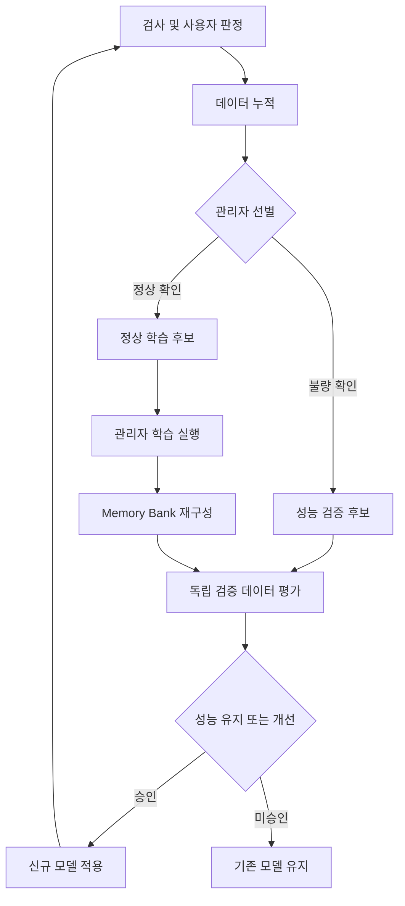

사용자가 검토할 때마다 즉시 자동 재학습하지 않는다. 정상으로 검증한 이미지만 Bank 구성에 사용하고 불량 이미지는 성능 검증에 활용한다. 학습에 사용하지 않은 독립 검증 데이터로 오경보율, 불량 검출률, 처리 시간을 비교한다. AI FAIL/사용자 PASS는 정상 학습 후보가 될 수 있으나 관리자 확인을 거친다. 자체 모델의 Bank 및 가중치 파일은 버전별 별도로 관리하며 이전 결과와 모델을 보존하고 필요 시 이전 버전으로 복구한다.

### 17.2 향후 모듈

| 확장 모듈 예시 | 내용 |
| --- | --- |
| training/ | 관리자 학습 실행 및 평가 |
| datasets/ | 학습 후보, 검증 데이터 분리 및 버전 관리 |
| model_artifacts/ | 체크포인트 및 Memory Bank 파일 관리 |
| workers/ | 별도 추론 및 학습 작업 관리 |
| capture_quality/ | Best Frame, 촬영 품질 검증 |
| precise_inspection/ | 별도 확대 이미지 기반 정밀 검사 |
| potential_defect_inspection/ | 회로 구조·연결 및 전기적 신호 기반 잠재적 결함 검사 |

추후 자체 PatchCore, EfficientAD, DINOv2 등을 선택하여 모델별 어댑터와 전처리 구현을 확장한다. PatchCore의 학습 특성상 정상 패턴의 특징을 Memory Bank에 축적하는 방식을 활용할 수 있다. [R8] 미래 확장 전용 테이블·API·빈 폴더는 현재 MVP에서 미리 구현하지 않는다.

## 18. 개발 전 검증이 필요한 외부 의존성

| 항목 | 현재 문서에서의 처리 | 확인 시점 |
| --- | --- | --- |
| 공개 저장소의 정확한 모델 버전 및 메타데이터 | ResNet-18 pcb1 후보, 문서상 256 입력 | 개발 단계 0 |
| 실제 Engine 응답 필드 및 파일 데이터 형식 | 공개 API 문서 확인; 실제 스키마·수치 배열 반환 검증 필요 | 단계 0 |
| Padding 색상, 정확한 보간법, 정규화 | 기존 엔진 설정 그대로 사용, 임의 확정 없음 | 단계 0 및 자체 모델 구현 시 |
| Anomaly Map 및 전처리 이미지의 실제 반환 | 기존 지원 여부 확인 후 최소 소스 수정 | 단계 0~4 |
| ARM64, GPU 런타임 및 엔진 의존성 | 호스트에서 실측, CPU 경로 우선 검증 | 단계 0~1 |
| 목표 PCB 및 결함 표본, 검사량 | 확보 전 실제 검출 성능 보장 금지 | 단계 8 |
| 운영 네트워크·TLS·포트 | 실제 도메인/서버 조건 확인 후 적용 | 단계 1 및 9 |
| 배포 라이선스 및 자료 사용 조건 | 공개 저장소 명시 조건과 실제 활용 목적 검토 | 단계 0 및 기업 배포 전 |

## 참고 자료

- [R1] [5dawn — Industrial Defect Inspection (공개 저장소, 모델 및 API 설명)](https://github.com/5dawn/industrial-defect-inspection). 공개 문서의 모델·REST 경로·업로드 한도 및 소프트웨어 라이선스 확인에 사용.
- [R2] [Vite — Building for Production](https://vite.dev/guide/build.html).
- [R3] [MDN — MediaDevices.getUserMedia()](https://developer.mozilla.org/en-US/docs/Web/API/MediaDevices/getUserMedia).
- [R4] [NVIDIA DGX Spark — System Overview](https://docs.nvidia.com/dgx/dgx-spark/system-overview.html).
- [R5] [NVIDIA — Container Runtime for Docker](https://docs.nvidia.com/dgx/dgx-spark/nvidia-container-runtime-for-docker.html).
- [R6] [Docker — Use Compose in production](https://docs.docker.com/compose/how-tos/production/).
- [R7] [Docker — Merge Compose files](https://docs.docker.com/compose/how-tos/multiple-compose-files/merge/).
- [R8] [Roth et al., Towards Total Recall in Industrial Anomaly Detection, CVPR 2022](https://openaccess.thecvf.com/content/CVPR2022/html/Roth_Towards_Total_Recall_in_Industrial_Anomaly_Detection_CVPR_2022_paper.html).

---

**최종 개발 방향:** 공개 PCB PatchCore 추론 엔진을 사용하여 일반 외관 검사 플랫폼의 기본 기능과 운영 안정성을 먼저 완성하고, 실제 검사 및 사용자 검토 데이터를 지속적으로 축적한다. 이후 자체 모델 학습, 정밀 검사 및 잠재적 결함 검사로 확장한다.
