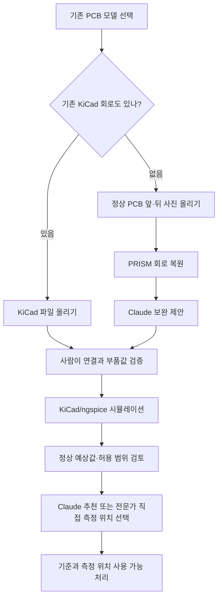
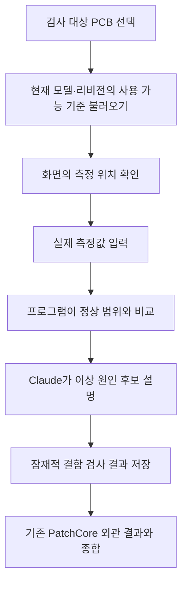
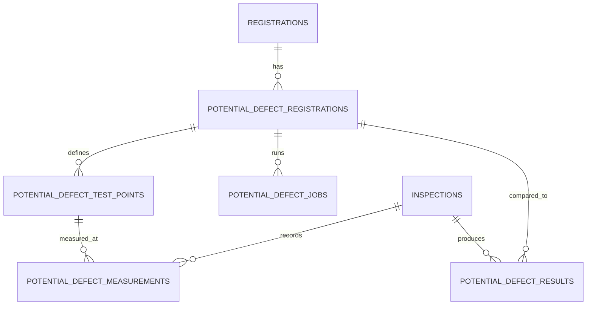

# PCB 잠재적 결함 검사 — 이해하기 쉬운 하위 설계서 v1.2

> 작성: 2026-11-23 · 문서 상태: **검토용 설계안(아직 구현·검증되지 않음)**  
> 기준 문서: `PCB_Potential_Defect_Detailed_Plan_v1.0.md`, `PCB_Potential_Defect_Low_Level_Design_v1.1.md`  
> **개발 원칙:** 독립 모듈 제작 → 모듈 단독 테스트 → 최소 테스트 웹에서 시연 → 기존 FastAPI/Next.js 시스템에 통합

## 0. 한눈에 이해하기

**잠재적 결함 검사란?** PCB의 사진만으로 보이지 않는 전기적 이상을 찾아보는 검사이다. 예를 들어 정상일 때 2.5V가 나와야 하는 지점에서 0.2V가 측정되면, 프로그램은 기준 범위를 벗어났다고 표시하고 Claude는 확인해 볼 원인 후보를 설명한다. **미래에 언제 고장 날지를 예측한다는 뜻은 아니다.**

| 용어 | 쉬운 뜻 | 이 설계에서의 역할 |
|---|---|---|
| PCB 등록 | 어떤 종류의 기판인지 기록 | 기존 PCB 모델 등록을 재사용 |
| 회로 복원 | 사진 속 배선·부품 연결을 찾아 회로 정보로 만들기 | PRISM + 사람 검증 |
| 정상 기준 | 이 PCB에서 정상이라면 어떤 값이 나와야 하는지 | 시뮬레이션 및 검증된 기준을 저장 |
| 측정 위치 | 측정기를 어디에 대고 무엇을 측정할지 | AI 추천 또는 전문가 직접 설정 |
| 실제 측정 | 실물 PCB의 전압·전류 등을 읽어 입력 | 검사 1건마다 새로 기록 |
| 결함 분석 | 기준과 다른 지점을 찾고 가능한 원인 안내 | 수치 비교 프로그램 + Claude 설명 |

### 이전 v1.1에서 단순화하는 핵심

1. **등록 화면은 한 번**: PCB 모델을 고르고 사진 또는 KiCad 파일을 올린다. 내부적으로 기존 모델 등록과 잠재적 결함 기준 데이터를 연결하지만, 사용자에게 3번 등록하라고 하지 않는다.
2. **정상 기준은 한 묶음**: 검증된 연결 정보, KiCad 파일, 시뮬레이션 결과를 하나의 기준 버전으로 관리한다. 변경 시에만 버전 2를 만든다.
3. **검사 위치 설정도 한 화면**: Claude 추천 목록과 전문가 직접 추가를 같은 목록에 합친다. 별도 '계획 생성 → 지점 등록 → 계획 승인' 3개 메뉴가 아니다.
4. **실제 측정도 한 화면**: 값 입력 → 범위 비교 → Claude 설명을 순서대로 처리한다. 기능상 3단계이지만 3개의 등록/검사가 아니다.
5. 화면에는 `DRAFT` 대신 **작성 중**, `APPROVED` 대신 **사용 가능**, `REVIEW_REQUIRED` 대신 **확인 필요**처럼 쉬운 상태를 표시한다. 저장값은 영문 코드로 유지할 수 있다.

## 1. 이름 규칙과 범위

최상위 기능은 잠재적 결함을 뜻하는 `potential_defects`로 묶고, 세부 기능에는 명확한 동작 이름을 붙인다.

| 폴더/모듈명 | 한글 뜻 | 주요 책임 |
|---|---|---|
| `circuit_restoration` | 회로 복원 | PRISM으로 사진에서 배선·연결 구조 추출 |
| `circuit_correction` | 회로 보완 | Claude 제안과 전문가 수정 내용의 검증 |
| `circuit_simulation` | 회로 시뮬레이션 | KiCad/ngspice 실행과 예상 결과 읽기 |
| `measurement_suggestion` | 측정 위치 추천 | AI 추천 및 전문가 지정 위치의 통합 관리 |
| `measurement_inspection` | 실제 측정 검사 | 측정값 저장과 승인된 범위 비교 |
| `defect_analysis` | 결함 분석 | 이상 후보의 원인·추가 확인점 설명 |

> **영어 주의:** `restoration`은 사용자가 요청한 '복원' 표현이다. 회로 역설계 분야에서는 `reconstruction`도 흔히 사용한다. 파일명 변경이 PRISM의 실제 복원 성능을 높여 주지는 않는다. `measurement_suggestion`은 '측정 제안/추천'의 짧은 이름이다.

외관 검사(PatchCore)와의 종합 판정은 **기존 통합 검사 기능**이 담당한다. 잠재적 결함 모듈은 표준화된 전기 검사 결과만 제공한다.

## 2. 개발해야 할 실제 기능 — 크게 두 단계

### A. 최초 1회: PCB 모델의 정상 기준 준비



**왜 한 번만 하나?** 같은 모델·회로 리비전의 PCB 100장을 검사한다면, 회로 복원을 100번 하지 않고 승인된 기준을 재사용한다. 모델이나 회로 리비전이 바뀌거나 검증된 기준을 고칠 때는 새 버전을 만들어야 한다.

### B. PCB 제품 한 개마다: 실제 검사



**중요:** 복원만으로 정상 전압이 자동으로 완성되지는 않는다. 전원·접지·부품값·SPICE 모델·측정 조건이 필요하고, 정상 허용 범위는 전문가 또는 근거 있는 측정 자료로 검증해야 한다. 해당 자료가 없으면 **기준 미확인**으로 표시하며 숫자를 임의로 채우지 않는다.

## 3. 독립 모듈 구조

```text
pcb-project/
├── modules/
│   └── potential_defects/
│       ├── circuit_restoration/
│       │   ├── service.py
│       │   └── prism_adapter.py
│       ├── circuit_correction/
│       │   └── service.py
│       ├── circuit_simulation/
│       │   ├── service.py
│       │   └── ngspice_adapter.py
│       ├── measurement_suggestion/
│       │   └── service.py
│       ├── measurement_inspection/
│       │   └── service.py
│       ├── defect_analysis/
│       │   └── service.py
│       ├── schemas.py           # 모듈 간 자료 형식 정의
│       └── cli.py               # 웹 없이 테스트 실행
├── test_web/                    # 임시 테스트 웹: 정식 프론트와 별도
│   ├── app.py                   # 간단한 FastAPI 서버
│   └── static/index.html        # 최소 UI
├── tests/
│   └── potential_defects/
│       ├── fixtures/            # 정상 사진, 회로, 예상 결과
│       ├── unit/
│       └── integration/
├── backend/                     # 기존 FastAPI와 연결(추후)
├── frontend/                    # 기존 Next.js와 연결(추후)
└── docker-compose.test.yml
```

**모듈은 무조건 웹에서 실행되어야 하는가?** 아니야. `cli.py`로 같은 코드를 먼저 실행해 본다. `test_web`은 기능을 눈으로 확인하기 위한 아주 작은 조작 화면일 뿐이고, 검증 후 기존 Next.js로 옮긴다. PRISM·Claude·KiCad의 내부 객체를 웹에 노출하지 않도록 JSON/파일 경계만 공통으로 유지한다.

## 4. 데이터 흐름 설계 — 반드시 포함

### 4.1 정상 기준 만들 때


### 4.2 실제 측정할 때


**왜 필요한가?** 데이터 흐름도는 '어떤 파일을 누구에게 전달하는가'를 보여 준다. 이 흐름이 없으면 독립 테스트가 끝나도 웹 연결 과정에서 입력 데이터 형식이 맞지 않을 수 있다.

### 4.3 공통 결과 예제 — 수치 판정과 Claude 설명 분리

```json
{
  "inspection_id": "INS-001",
  "reference_version": 1,
  "measurements": [
    {"point": "TP01", "type": "VOLTAGE", "unit": "V", "expected_min": 2.4, "expected_max": 2.6, "actual": 0.2, "status": "OUT_OF_RANGE"}
  ],
  "numeric_status": "ABNORMAL",
  "claude_analysis": {
    "status": "COMPLETED",
    "possible_causes": ["전원 경로 또는 연결 상태 확인 필요"]
  }
}
```

이 JSON의 숫자는 **기능 설명을 위한 가상의 예시**이다. 허용 범위는 실제 제품별 검증이 필요하다. Claude가 실패해도 `numeric_status`는 보존한다.

## 5. 최소 클래스 다이어그램 — 필요한 수준만

```mermaid
classDiagram
 direction LR
 class RestorationService {
   +restore(images) RestorationResult
 }
 class CorrectionService {
   +suggest(restoration) Suggestions
   +apply_approved(changes) VerifiedCircuit
 }
 class SimulationService {
   +run(circuit, conditions) SimulationResult
 }
 class MeasurementSuggestionService {
   +suggest(circuit, simulation) TestPoints
   +add_manual(point) TestPoints
 }
 class MeasurementInspectionService {
   +evaluate(reference, measured) NumericResult
 }
 class DefectAnalysisService {
   +explain(circuit, numeric_result) AnalysisResult
 }
 RestorationService --> CorrectionService : 복원 결과
 CorrectionService --> SimulationService : 검증된 회로
 SimulationService --> MeasurementSuggestionService : 기준값
 MeasurementSuggestionService --> MeasurementInspectionService : 측정 위치
 MeasurementInspectionService --> DefectAnalysisService : 수치 판정
```



이 도표는 **서비스 클래스의 책임만** 나타낸다. DB 저장 클래스, API 라우터, 로깅 클래스, 모든 하위 메서드를 지금부터 전부 그릴 필요는 없다. PRISM 실제 API와 KiCad 호출 경로를 테스트한 뒤 메서드 세부 인수를 확정한다.

| 클래스 | 입력 | 출력 | 실패 시 |
|---|---|---|---|
| `RestorationService` | 양면 사진 | 연결 후보·시각화 | 재촬영/복원 실패 이유 |
| `CorrectionService` | 연결 후보·이미지 | 변경 제안·검증된 회로 | 검토 필요, 원본 보존 |
| `SimulationService` | 검증된 회로·전원 조건 | 예상 노드값·로그 | 기준 미확인 |
| `MeasurementSuggestionService` | 회로·예상값 | 후보 TP 목록·수동 TP | 위치 확인 필요 |
| `MeasurementInspectionService` | TP·정상 범위·실측값 | 정상 범위 내/밖/미측정 | 재입력 또는 보류 |
| `DefectAnalysisService` | 회로·수치 결과 | 가능 원인 및 확인 사항 | 수치 결과 보존, AI 실패 표시 |

## 6. 최소 웹 화면 명세 — 독립 모듈 시험용

**처음에는 3개 화면만 제작한다.** 관리용 대시보드, 권한 관리, 상세 통계는 기존 PCB 웹과 통합할 때 연동한다. `test_web`은 운영 웹이 아니라 개발자가 모듈을 실행·검사하는 시험 도구다.

### 화면 1 — 정상 기준 만들기

```text
┌────────────────────────────────────────────────────────┐
│ [1] 정상 기준 만들기                                   │
│ PCB 모델 [A모델 ▼]  회로 리비전 [Rev1]                 │
│ [앞면 이미지 선택] [뒷면 이미지 선택] [KiCad 파일 선택] │
│ [PRISM 복원 실행]                                      │
├──────────────────────────┬─────────────────────────────┤
│ 원본 PCB 사진            │ 배선/패드 추출 결과         │
│                          │ [겹쳐 보기]                 │
├──────────────────────────┴─────────────────────────────┤
│ Claude 제안: R1~C2 연결 검토 [승인] [거절]             │
│ 전원 [5V] 접지 [GND]  [시뮬레이션 실행]                 │
│ 정상 예상값 표 → 허용 범위 입력 및 확인                │
│ [Claude 측정 위치 추천] [이미지 클릭 직접 추가]        │
│ TP01 / 위치 / 항목 / 허용 범위 / 측정 조건 [수정]       │
│ [이 기준을 사용 가능으로 설정]                         │
└────────────────────────────────────────────────────────┘
```

**최소 기능:** 업로드, PRISM 실행, 결과 오버레이 확인, Claude 보완 후보의 승인/거절, KiCad 재업로드, 시뮬레이션 입력/실행, TP 추가/수정, 기준 활성화, 오류 이유 표시. 회로도 자체를 그리는 복잡한 웹 편집기는 **MVP 최소 테스트 화면에서 제외**한다. 필요하면 KiCad에서 수정한 파일을 재업로드한다.

### 화면 2 — 실제 측정 검사

```text
┌───────────────────────────────────────────────────────┐
│ [2] 실제 측정 검사                                    │
│ 검사 대상 [PCB A / 제품 001]  기준 v1 (사용 가능)      │
├─────────────────────────┬─────────────────────────────┤
│ PCB 사진 + TP01 표시   │ TP01  전압                    │
│                         │ 예상값: 2.4 ~ 2.6 V          │
│                         │ 실제값: [ 0.2 ] V            │
│                         │ [측정값 저장]                │
│                         │ 상태: 범위 밖                │
├─────────────────────────┴─────────────────────────────┤
│ [결함 원인 분석]  [검사 완료]                          │
└───────────────────────────────────────────────────────┘
```

**최소 기능:** 모델 및 기준 버전 확인, 측정점 표시, 실측값·단위 입력, 범위 비교, 빠진 측정 표시, 재측정 기록, Claude 설명 호출. 전류는 전압과 측정 방법이 달라서 안전이 확인된 측정 방법이 없는 지점은 안내를 보류한다.

### 화면 3 — 결과 확인

```text
┌────────────────────────────────────────────────────────┐
│ [3] 검사 결과                                         │
│ 전기적 결과: 확인 필요 (TP01 범위 밖)                 │
│ Claude 설명: 전원 경로 확인 권장 (확정 원인 아님)      │
│ 기존 외관 결과: [연결 전: 없음] / [연결 후: PatchCore] │
│ [측정 내역] [JSON/CSV 저장] [다시 검사]               │
└────────────────────────────────────────────────────────┘
```

**최소 기능:** TP별 측정값·판정 근거, Claude 설명 분리, 검사에 사용한 기준 버전, JSON/CSV 내보내기. 외관 검사 종합 판정은 통합 단계에서 붙인다.

### 테스트 웹의 최소 동작 계약

| 버튼/행동 | 내부 호출 | 완료 화면에 보여 줄 것 |
|---|---|---|
| PRISM 복원 실행 | `RestorationService.restore` | 진행/성공/실패, 오버레이, 회로 연결 결과 |
| Claude 보완 제안 | `CorrectionService.suggest` | 변경 후보와 근거, 승인/거절 |
| 시뮬레이션 실행 | `SimulationService.run` | 예상값, 사용 조건, 오류 로그 |
| 측정 위치 추천 | `MeasurementSuggestionService.suggest` | 후보 위치와 이유, 수동 추가 |
| 측정값 저장 | `MeasurementInspectionService.evaluate` | 해당 지점 범위 내/밖/미측정 |
| 결함 원인 분석 | `DefectAnalysisService.explain` | 설명과 추정 근거, AI 실패 여부 |

## 7. DB 설계 — 우선 최소한으로

**독립 모듈 테스트 중에는 PostgreSQL을 강제하지 않는다.** JSON 파일과 샘플 이미지로 먼저 검증하고, 정식 웹 통합 시 기존 DB와 연결한다.

### 7.1 등록이 세 개인 것이 아니다

- 기존 **PCB 등록** `registrations`: 어떤 PCB 모델·리비전인지.
- **잠재적 결함 기준** `potential_defect_registrations`: 그 PCB의 검증된 회로와 정상값, 측정 지점을 묶은 **한 건의 기준**. 변경 시 버전만 추가하거나 새 버전 행으로 기록한다.
- 기존 **검사 기록** `inspections`: 실제 제품 한 장의 검사 결과. 이는 등록 과정이 아닌 실제 검사 과정이다.

**화면에서는 하나의 PCB 등록/기준 준비 흐름**으로 보여 주고, 내부 저장 관계만 분리한다. 과거 v1.1의 `potential_defect_baseline_versions`를 추가 테이블로 나누는 방식은 이번 최소 설계에서는 사용하지 않는다. 실제 기존 DB 스키마 확인 후 열과 FK 이름을 확정한다.

### 7.2 최소한의 신규 저장 대상

| 테이블(제안) | 왜 필요한가? | 핵심 필드(개념) |
|---|---|---|
| `potential_defect_registrations` | 모델별 회로/정상 기준과 버전 묶음 | 기존 등록 ID, 버전, 회로 파일, 기준 상태 |
| `potential_defect_test_points` | 기준에 포함된 측정 지점 | 기준 ID, 위치, 측정 종류/단위, 정상 범위 |
| `potential_defect_jobs` | PRISM/시뮬레이션/Claude 비동기 실행 추적 | 작업 종류, 상태, 결과 파일, 오류 코드 |
| `potential_defect_measurements` | 실제 제품의 측정값 보존 | 검사 ID, TP ID, 측정값, 단위, 재측정 번호 |
| `potential_defect_results` | 검사별 최종 전기 결과 | 검사 ID, 기준 버전, 수치 판정, Claude 설명 |

PRISM 복원 이력·보완 제안·시뮬레이션 결과는 당장은 `potential_defect_jobs` 및 MinIO 파일 참조에 담아 관리할 수 있다. 추후 별도 검색·통계 요구가 커지면 테이블로 분리한다. **중요한 승인 변경 내역은 덮어쓰지 말고 파일/이력으로 남겨야 한다.**



위 `REGISTRATIONS`, `INSPECTIONS`는 **기존 DB의 실제 테이블명·키를 확인하기 전의 연결 자리**다. 데이터베이스 구현 전에 기존 스키마와 충돌하는지 반드시 확인한다.

## 8. API 설계 — 화면 동작에 필요한 최소 8개

모듈 독립 시험은 CLI를 기본으로 한다. 아래 API는 **테스트 웹**과 나중의 정식 웹에서 재사용할 초안이다. 실제 경로는 기존 API 스타일을 보고 확정한다.

| HTTP | 경로(제안) | 기능 |
|---|---|---|
| `POST` | `/api/potential-defects/references` | 모델·사진·회로 파일을 기준 준비 작업에 연결 |
| `POST` | `/api/potential-defects/references/{id}/restore` | PRISM 회로 복원 실행 |
| `POST` | `/api/potential-defects/references/{id}/correct` | Claude 제안·사람 승인 내용 반영 |
| `POST` | `/api/potential-defects/references/{id}/simulate` | 정상 회로 시뮬레이션 |
| `POST` | `/api/potential-defects/references/{id}/points` | AI 추천 또는 수동 측정 위치 설정 |
| `POST` | `/api/potential-defects/inspections/{id}/measurements` | 실제 측정값 등록/비교 |
| `POST` | `/api/potential-defects/inspections/{id}/analyze` | Claude 결함 원인 분석 |
| `GET` | `/api/potential-defects/inspections/{id}/result` | 전체 전기 검사 결과 조회 |

복원·시뮬레이션처럼 오래 걸리는 호출은 내부에서 작업 ID를 생성하고, 테스트 웹은 상태 조회를 이용한다. 기존 플랫폼에 통합할 때는 기존 설계의 SSE 진행 알림 방식을 사용한다. 이 표의 `correct` API는 수정 제안을 AI가 임의 적용한다는 뜻이 아니며 사용자 승인 데이터가 필요하다.

## 9. 구현 테스트 항목 — 완료 조건 중심

| 단계 | 무엇을 시험할까? | 통과하면 무엇을 확인할까? |
|---|---|---|
| P0. PRISM 검증 | 실제 프로젝트 버전, 라이선스, 독립 실행, 정상 PCB 사진 | GUI 없이 호출 가능한 경로 또는 제한 사항 확인 |
| P1. 회로 복원 | 정상 사진/흐린 사진/앞뒤 잘못된 사진 | 연결 후보 생성 또는 재촬영·실패 이유 명확히 표시 |
| P2. 회로 보완 | Claude가 없는 연결을 임의 제시 | 실제 부품·핀 존재 검증 후 사람 승인 없이는 적용 금지 |
| P3. 회로 시뮬레이션 | 5V·1kΩ·1kΩ 분압기 회로 | 중간값 약 2.5V 계산, 조건 누락은 실패 표시 |
| P4. 측정 위치 | Claude 추천·이미지 직접 클릭 | 위치/단위/측정 조건/정상 범위 저장, 검증 안 된 위치 사용 금지 |
| P5. 실제 측정 | 2.52V/0.2V/누락/재측정 | 범위 내·밖·미측정, 이전 수치 기록 보존 |
| P6. 분석 | Claude 성공/실패 | 수치 판정 유지, 설명은 추정으로 별도 출력 |
| P7. 테스트 웹 | 3개 화면에서 전체 실행 | 모듈 코드 수정 없이 연결, JSON/CSV 출력 |
| P8. 정식 웹 통합 | DB/MinIO/FastAPI/SSE/Next.js | 모델 등록부터 종합 결과까지 동작 |

정량적인 **회로 복원 정확도**는 사람이 확인한 정답 연결 정보(Golden Netlist)가 있어야 계산한다. 결함 검출률·오경보율도 실제로 확인된 정상/불량 데이터가 있어야 계산한다. 초기 테스트 화면의 정상/이상 예제만으로 생산 현장 성능을 확정하지 않는다.

## 10. 주요 오류 및 화면 상태

| 상황 | 개발 상태 코드(예시) | 화면 문구 | 처리 |
|---|---|---|---|
| 사진이 흐리거나 일부가 잘림 | `RECAPTURE_REQUIRED` | 사진을 다시 촬영해 주세요 | 재촬영 |
| 복원 연결이 불확실 | `REVIEW_REQUIRED` | 회로 연결 확인이 필요합니다 | 전문가 검토 |
| 시뮬레이션 전원·모델 누락 | `BASELINE_UNAVAILABLE` | 정상 기준을 계산할 수 없습니다 | 조건·모델 보완 |
| 측정값 미입력 | `NOT_MEASURED` | 아직 측정하지 않았습니다 | 판정 보류 |
| 범위 밖 수치 | `OUT_OF_RANGE` | 정상 범위를 벗어났습니다 | 이상 후보 및 추가 확인 |
| Claude 호출 실패 | `AI_FAILED` | AI 설명을 가져오지 못했습니다 | 숫자 판정 보존, 재시도 |
| 측정 조건과 기준 불일치 | `CONDITION_MISMATCH` | 측정 조건을 확인해 주세요 | 비교 중단 |

## 11. 개발 시작 전에 꼭 검증할 것

1. **PRISM 실사용 가능성:** 정확한 저장소 버전의 라이선스·의존성·GUI 분리 가능성은 아직 기술 검증이 필요하다. 소스 복사·수정·배포 권한은 실제 적용 버전을 기준으로 확인한다.
2. **PCB 샘플 확보:** 처음에는 부품과 연결을 검증할 수 있는 단순한 2층 저전압 PCB를 대상으로 한다. 다층 내부 배선까지 사진으로 복원한다고 가정하지 않는다.
3. **KiCad 시뮬레이션 조건:** 회로 그림만으로 SPICE가 자동 실행되는 것은 아니다. 전원·접지·부품 모델을 확보하지 못하면 **기준 미확인** 상태로 멈춘다.
4. **전기 측정 안전:** 실제 전압·전류 측정 지점과 측정법은 회로 전문가가 검증한다. 전류 측정은 전압 측정과 달라 화면만 보고 무조건 측정하도록 안내하지 않는다.
5. **기존 시스템과 연결:** `registrations`, `inspections`, 이미지 저장, 관리자/일반 사용자 권한 등 기존 코드·DB에서 실제 이름과 구현을 확인하고 중복을 피한다.

## 12. 개발 우선순위 및 산출물

| 차례 | 개발 결과물 | 다음 단계로 넘어가는 기준 |
|---|---|---|
| 1 | PRISM 독립 실행 테스트 리포트 | 무엇이 가능/불가능한지 확인 |
| 2 | `circuit_restoration` + 입력/출력 JSON | 정상·오류 테스트 결과 확보 |
| 3 | `circuit_correction`, `circuit_simulation` | 복원→보완→시뮬레이션 통과 |
| 4 | `measurement_suggestion` | AI 추천과 수동 TP 지정 통과 |
| 5 | `measurement_inspection`, `defect_analysis` | 정상/이상/미측정/AI 실패 처리 통과 |
| 6 | 3개 화면의 `test_web` | 웹에서 위 5개 모듈 호출 및 결과 확인 |
| 7 | 기존 PCB 웹으로 통합 | 기존 외관 검사와 전기 검사 결과 연결 |

**이 문서의 의도:** 처음부터 거대한 DB·API·웹을 만드는 것이 아니라, 핵심 회로 복원과 측정 분석 기능을 **웹 없이도 실행 가능한 모듈**로 먼저 완성하고, **작은 시험 웹에서 검증한 후 정식 플랫폼에 장착**하는 것이다.
