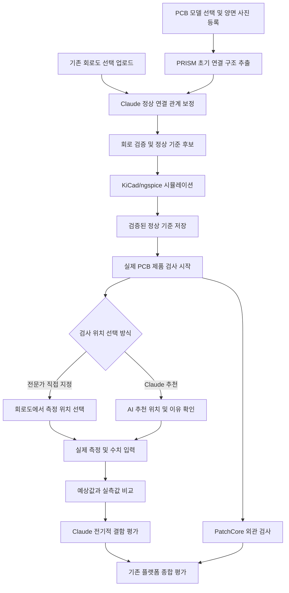
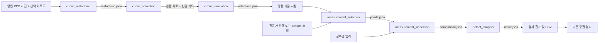
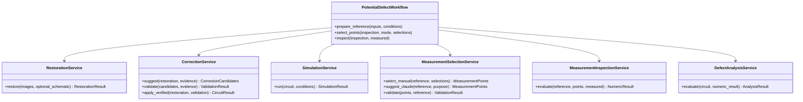

# PCB 잠재적 결함 검사 하위 설계서 v1.3

> 작성일: 2026-11-24 | 상태: 검토용 설계안 (미구현·미검증)  
> 기준: `PCB_Potential_Defect_Low_Level_Design_v1.2.md` 및 이후 합의 사항  
> 개발 원칙: 독립 모듈 제작 → 단독 테스트 → 최소 테스트 웹 → 기존 PCB 검사 플랫폼 통합

## 0. 처음 읽는 사람을 위한 설명

PCB는 여러 전자부품이 배선으로 연결된 기판이다. 사진에서 배선 손상이나 이물질을 확인할 수 있지만, 외관이 멀쩡해도 반도체 또는 부품의 전기적 동작이 이상할 수 있다. 이 프로젝트는 두 종류의 검사를 결합한다.

| 검사 | 담당 기술 | 알아내려는 것 |
|---|---|---|
| 외관 검사 | PatchCore | 정상 이미지와 비교하여 외관상 이상 위치를 찾음 |
| 잠재적 결함 검사 | PRISM, Claude, KiCad/ngspice, 실제 측정 | 정상 회로의 예상값과 실제 측정값의 차이를 통해 전기적 이상을 조사 |
| 종합 평가 | 기존 검사 플랫폼 + Claude | 두 검사 결과 및 근거를 결합하여 추가 확인 사항 안내 |

여기서 잠재적 결함은 외관만으로 판단하기 어려운 전기적 이상을 포함하는 프로젝트 용어다. 미래 고장 시점을 예측하거나 모든 반도체 내부 결함을 검출한다는 의미는 아니다.

**예시:** 정상 회로에서 2.5V가 예상되는데 실제 PCB에서 0.2V가 측정됐다면 프로그램은 정상 범위와 비교하고 Claude는 전원, 연결, 부품 등의 원인 후보를 설명한다. 이때 외관이 정상이라면 외관 검사만으로는 발견하기 어려웠던 이상을 조사할 수 있다.

### v1.3에서 변경된 사항

| 항목 | 변경된 설계 |
|---|---|
| 회로 복원 목적 | 물리적 배선 모양 복구가 아닌 정상 전기적 연결 관계 확보 |
| 회로도 업로드 | 선택 사항. 기존 회로도가 있으면 PRISM 결과의 보정 근거로 활용 |
| Claude 회로 보정 | 회로도·이미지·부품 정보를 이용한 연결 추가/삭제/변경 후보 제안 |
| 외관 결함 | Mouse Bite 등은 PatchCore의 이상 위치 검출 대상. 전기 모듈은 전기적 영향만 조사 |
| 검사 위치 | 정상 기준에 고정하지 않고 실제 검사 시 전문가 직접 지정 또는 Claude 추천 선택 |
| 명칭 | `measurement_suggestion` → `measurement_selection` |
| 화면 | 등록/복원/시뮬레이션 1개, 위치 선택/측정 1개, 평가 결과 1개 |

## 1. 전체 업무 흐름



최초 등록 시에는 같은 모델·리비전의 정상 전기적 기준을 준비한다. 제품 검사 시에는 그 기준을 불러오고, 검사 대상과 목적에 따라 측정 위치를 선택한다. 같은 모델 100개를 검사한다고 해서 회로를 100번 복원할 필요는 없다.

회로도가 없거나 정상 PCB가 없는 경우에도 복원 후보를 만들 수 있지만, 확인되지 않은 후보는 정상 기준으로 확정하지 않는다. 정상 기준이 없는 지점은 실측값을 기록하더라도 정상/이상 판정을 보류한다.

## 2. 사용자 시나리오

### 2.1 정상 회로 준비 — 회로도가 있는 경우

PCB-A100 Rev1의 양면 사진과 기존 회로도를 업로드한다. PRISM이 사진의 배선과 패드를 추출한다. Claude는 원본 사진, PRISM 결과, 기존 회로도를 대조하여 연결 보정 후보를 제안한다. 프로그램이 실제로 존재하는 핀인지, 회로도와 일치하는지 검증하고 변경 이력을 남긴다. 검증된 연결을 KiCad 회로도와 시뮬레이션에 사용한다.

기존 회로도가 KiCad 원본 또는 지원되는 Netlist라면 연결 정보를 직접 파싱하는 것을 우선한다. Claude가 이미 확인된 연결을 추측으로 덮어쓰지 않는다. PDF·이미지 회로도라면 Claude의 추출 결과를 후보로 취급한다. 모델·리비전이 다르거나 정보가 충돌하면 확인이 필요하다.

### 2.2 정상 회로 준비 — 회로도가 없는 경우

PCB 양면 사진을 업로드한다. PRISM이 확인할 수 있는 배선과 패드의 연결 정보를 추출하고, Claude가 확대 사진, 부품 표기, 제공된 데이터시트를 참고해 누락되거나 의심스러운 연결을 제안한다. 확인할 수 없는 내부 배선이나 부품값은 미확인으로 남긴다. 전문가 또는 기존 승인 자료·안전한 물리적 확인 등 충분한 근거가 확보된 범위만 정상 기준으로 사용한다.

### 2.3 전문가가 실제 검사를 하는 경우

전문가는 복원된 회로도에서 자신이 검사할 노드 또는 핀을 직접 선택한다. 시스템은 그 선택을 PCB 사진의 실제 위치 및 시뮬레이션 노드와 연결하여 예상값을 가져온다. 예를 들어 TP01에서 2.48V를 측정해 입력한다. 예상 2.50V, 허용 범위 2.40~2.60V라면 프로그램은 범위 내로 판단한다. Claude는 측정 근거와 결과를 평가한다.

### 2.4 전문가가 없는 경우

검사 담당자는 Claude 추천을 선택한다. Claude가 복원 회로, 시뮬레이션 결과, 검증된 측정 가능 지점을 이용해 확인할 위치·이유·측정 항목을 제안한다. 담당자는 확인된 안전한 측정 지점에서 실제 측정하고 값을 입력한다. TP01에서 0.20V가 나왔다면 동일한 비교 모듈이 범위 밖으로 표시하고 Claude가 가능한 원인을 평가한다. 추천은 자동 측정이 아니며, 검증되지 않은 측정 방법이나 위치는 안내하지 않는다.

위 수치와 PCB 이름은 이해를 위한 가상의 예시다. 전문가 경로와 Claude 경로의 차이는 측정 위치 선정 방식뿐이며, 실측·수치 비교·AI 평가·결과 저장은 동일하다.

## 3. 모듈 구성 및 세부 기능 명세

| 모듈 이름 | 입력 | 처리 및 출력 |
|---|---|---|
| `circuit_restoration` (회로 복원) | PCB 양면 사진, 선택 회로도 | PRISM 초기 연결 구조, 이미지 오버레이, 핀·노드·위치 정보, 기존 회로도 추출 정보 |
| `circuit_correction` (회로 보정) | 초기 복원 결과, 회로도, 부품 자료 | Claude 연결 보정 후보, 변경 근거, 검증 결과, 정상 연결 후보 |
| `circuit_simulation` (회로 시뮬레이션) | 검증된 회로, 부품 모델, 전원·부하 조건 | KiCad/ngspice 실행, 노드별 예상값 및 로그 |
| `measurement_selection` (측정 위치 선택) | 검사 대상, 회로·시뮬레이션·위치 매핑 | 전문가 직접 지정 또는 Claude 추천, 검사별 측정 목록 |
| `measurement_inspection` (측정 검사) | 선택 지점, 예상값, 허용 범위, 실제 측정값 | 단위·조건 검사 및 수치 비교 결과 |
| `defect_analysis` (결함 평가) | 회로 정보, 측정 위치, 예상/실측값, 비교 결과 | Claude 원인 후보, 근거, 불확실성 및 추가 확인 사항 |

### 3.1 `circuit_restoration` — PRISM 초기 복원

- 양면 사진의 모델·리비전·방향·촬영 품질을 확인한다. 필요하면 재촬영을 요청한다.
- PRISM을 실행해 확인 가능한 배선, 패드, 핀, 연결 관계를 추출한다. 실제 지원 범위와 결과 형식은 P0 기술 검증으로 확정한다.
- 기존 회로도는 선택 입력으로 받고 원본을 보존한다. 지원 후보: `.kicad_sch`, `.net`, `.pdf`, `.png`, `.jpg`. Netlist의 세부 포맷과 KiCad 버전 호환 여부는 별도 시험한다.
- 기존 회로도와 사진이 같은 모델·리비전인지 확인한다. 회로도와 PCB의 실제 핀·위치 매핑을 생성할 수 있도록 연결 후보에 식별자를 붙인다.
- 결과: `restoration.json`, 원본/오버레이 이미지, 회로도 추출 데이터. 모듈 내부 데이터 형식은 PRISM의 실제 출력과 구분한다.

### 3.2 `circuit_correction` — Claude 정상 연결 관계 보정

회로도를 제공한 경우 그 연결 정보를 우선 근거로 삼고, 없는 경우에는 사진·PRISM 결과·부품 정보를 참고한다. Claude는 연결 추가/삭제/변경을 구조화된 제안으로 반환한다. 직접 사진을 변경하거나 실제 PCB를 복구하지 않는다.

| 처리 순서 | 구현 내용 |
|---|---|
| 1. 입력 구성 | 원본 이미지, PRISM 연결 후보, 선택 회로도, 확인된 부품·핀 정보 전달 |
| 2. 후보 생성 | Claude가 변경 대상 핀, 변경 이유, 근거, 불확실성 제안 |
| 3. 구조 검증 | 부품·핀 ID 존재, 중복·충돌 및 연결 규칙 검사 |
| 4. 근거 검증 | 일치하는 회로도와 직접 대조하거나 확인된 측정/검토 근거 연결 |
| 5. 결과 저장 | 검증된 변경만 정상 기준에 반영. 미확인 변경은 후보로 유지 |

검증되지 않은 후보로도 별도의 탐색용 시뮬레이션은 가능하지만 실제 정상 판정 기준으로 활성화하지 않는다. ERC와 시뮬레이션 성공은 실제 배선과 일치한다는 증거가 아니다. Claude 실패 시 원래 복원 결과를 보존하고, 확인된 기존 회로도가 있으면 해당 자료를 활용할 수 있다.

**Mouse Bite 처리 원칙:** 배선 가장자리 일부가 손상되어도 연결 관계가 유지된다면 Netlist상 변화가 없을 수 있다. 정상 회로의 연결 관계를 구성할 때 물리적 손상 모양을 재현할 필요는 없다. 정상 연결이 끊어져 보이는 경우에도 검증된 회로도를 근거로 가상 정상 회로를 구성할 수 있다. 이때 실제 PCB의 외관 이상 기록은 절대 지우지 않는다. PatchCore는 이상 위치를 보여 주며, Mouse Bite라는 구체적 유형명은 별도의 확인 또는 분류 근거가 있을 때만 붙인다.

### 3.3 `circuit_simulation` — 정상 예상값 계산

검증된 회로를 KiCad와 호환되는 회로 및 SPICE 입력으로 구성한다. 전원, 접지, 부품 값, 필요한 SPICE 모델, 부하 및 동작 조건을 확인하고 ngspice에서 계산한다. MVP는 단순 저전압 회로의 DC 동작점 분석부터 시작한다. 반도체의 특정 기능이나 시간에 따른 동작 분석은 해당 모델과 조건이 확보된 경우에만 확대한다.

- 출력: 노드별 전압, 계산 가능한 소자/분기 전류, 단위, 조건, 로그, 정상 허용 범위의 출처.
- 시뮬레이션값과 정상 허용 범위를 구분한다. 허용 범위는 부품 공차, 사양, 검증된 정상 PCB 측정 결과 등에 근거하여 설정한다.
- 모델이 없거나 계산이 실패하면 기준 미확인으로 표시한다. 값을 임의 생성하지 않는다.
- 모델·리비전·조건·검증된 회로 버전을 하나의 정상 기준 버전으로 저장한다.

### 3.4 `measurement_selection` — 검사 시 위치를 선택하는 모듈

이 모듈은 기준을 만들 때 검사를 강제로 계획하거나 승인하는 별도 화면이 아니다. 실제 검사 1건을 시작할 때 검사 담당자가 선택한다.

| 방식 | 동작 |
|---|---|
| `manual` (전문가 직접 지정) | 복원 회로도에서 핀/노드를 선택 → 실제 PCB 위치 및 측정 종류 확인 → 검사 목록에 추가 |
| `claude` (Claude 추천) | 회로·시뮬레이션·안전하게 확인된 측정 위치 전달 → 후보 위치·추천 이유 반환 → 담당자가 목록 확인 |

두 방식 모두 같은 `MeasurementPoint` 자료 형식을 사용한다. 회로도의 노드와 실제 PCB의 앞/뒷면 위치를 연결해야 한다. 전압은 기준 노드(예: GND), 전류는 대상 소자/분기 및 검증된 측정 방법이 필요하다. 특정 노드의 예상값이 저장되어 있지 않으면 동일한 검증 조건으로 추가 계산할 수 있지만, 실패하면 비교를 보류한다. 화면의 임의 클릭 좌표만으로 전기적 연결을 확정하지 않는다.

전문가가 없다면 Claude 추천의 범위를 이미 검증된 안전한 저전압 측정점으로 제한한다. 확인되지 않은 위치나 측정법은 `REVIEW_REQUIRED`로 표시한다. 추천 후 위치를 변경하거나 추가할 수 있으며, 변경 이력을 기록한다.

### 3.5 `measurement_inspection` — 실제 측정값 비교

검사 대상 제품, 기준 버전, 선택 위치, 측정 항목·단위·조건, 실측값을 받는다. 값의 숫자 형식과 단위를 확인하고 조건이 일치하는지 먼저 검사한다. 허용 범위를 양 끝 포함으로 비교한다. 실제 측정은 사람이 하고 프로그램은 수치만 비교한다.

| 조건 | 지점별 상태 |
|---|---|
| 값이 허용 범위 안 | `IN_RANGE` / 정상 범위 내 |
| 값이 허용 범위 밖 | `OUT_OF_RANGE` / 정상 범위 밖 |
| 실측값 없음 | `NOT_MEASURED` / 미측정 |
| 허용 범위 또는 검증된 연결 없음 | `BASELINE_UNAVAILABLE` / 정상 기준 미확인 |
| 전원·부하·측정 방법 등 불일치 | `CONDITION_MISMATCH` / 측정 조건 확인 필요 |

검사 전체 수치 결과는 하나라도 범위 밖이면 `ABNORMAL`, 모두 범위 내이면 `IN_RANGE`, 그 외 또는 선택 지점이 없으면 `INCOMPLETE`로 표시한다. 범위 밖과 미측정이 함께 있으면 `ABNORMAL`과 미완료 표시를 함께 보존한다. 이는 검사 범위 내 수치 판정이지 전체 PCB 품질 보증이 아니다. 재측정 시 기존 기록을 덮어쓰지 않는다.

### 3.6 `defect_analysis` — Claude 잠재적 결함 평가

Claude에게 검사 조건, 회로 버전, 선택 지점, 예상값/허용 범위, 실측값, 수치 비교 결과와 불확실성 정보를 전달한다. 정상 범위 안인 결과도 평가할 수 있다. 출력은 확인된 사실, 가능한 원인, 근거가 부족한 부분, 추가 확인 사항으로 분리한다. 반도체 내부 문제를 하나의 측정으로 확정하지 않는다.

Claude는 프로그램의 수치 판정을 변경하지 않는다. 응답 실패 시 수치 판정은 보존하고 AI 분석만 재시도할 수 있도록 한다. 검사가 불완전한 경우 Claude가 정상이라고 단정하지 않도록 한다.

## 4. 독립 실행 구조

```text
pcb-project/
├── modules/potential_defects/
│   ├── circuit_restoration/       # service.py, prism_adapter.py
│   ├── circuit_correction/        # service.py
│   ├── circuit_simulation/        # service.py, ngspice_adapter.py
│   ├── measurement_selection/     # service.py
│   ├── measurement_inspection/    # service.py
│   ├── defect_analysis/           # service.py
│   ├── schemas.py                 # 공통 데이터 규격
│   ├── claude_adapter.py          # 공통 Claude 호출/응답 검증
│   ├── workflow.py                # 모듈 실행 순서 조정
│   └── cli.py                     # 웹 없이 실행
├── test_web/                      # 시험 전용 FastAPI + HTML/JS
├── tests/potential_defects/
│   ├── fixtures/                  # 사진·정답 Netlist·회로·측정 샘플
│   ├── unit/
│   └── integration/
├── backend/                       # 기존 FastAPI (통합 시)
├── frontend/                      # 기존 Next.js (통합 시)
└── docker-compose.test.yml
```

각 서비스는 JSON 및 파일을 입력받아 결과를 반환하며 웹, DB, 다른 서비스 실행 여부에 직접 의존하지 않는다. `workflow.py`가 필요한 서비스를 순서대로 호출한다. 예를 들어 PRISM 개발이 미완료여도 정답 회로 fixture로 시뮬레이션이나 측정 비교 모듈을 먼저 시험할 수 있다. 폴더 구조와 클래스는 설계 계약이며 실제 PRISM API는 P0 이후 확정한다.

## 5. 데이터 흐름 및 입출력 설계



| 데이터 | 주요 필드 | 역할 |
|---|---|---|
| `restoration.json` | 등록 ID, 원본 파일, 부품/핀/노드, 연결 후보, PCB 좌표, 회로도 출처 | 초기 복원 결과 |
| `correction.json` | 변경 ID, 대상 핀, 변경 전/후, 출처, 검증 상태 | Claude 보정 기록 |
| `reference.json` | 기준 ID/버전, 회로 파일, 검증 범위, 시뮬레이션 조건·값, 허용 범위, 위치 매핑 | 재사용할 정상 기준 |
| `points.json` | 검사 ID, 기준 ID/버전, 선택 방식, 지점 ID, 노드/분기, 물리 위치, 측정 조건 | 이번 검사에서 선택한 위치 |
| `comparison.json` | 측정 ID, 지점 ID, 예상값, 범위, 실측값, 단위, 차이, 상태 | 프로그램이 계산한 결과 |
| `result.json` | 검사 ID, 수치 결과, 미완료 여부, Claude 평가, 분석 상태 | 플랫폼 전달 및 보고서 |

### 5.1 노드와 실제 위치의 연결 예시

`TP01`은 실제 PCB의 테스트 패드 이름이다. 복원 회로도의 `N_MID`는 전기적 연결점 이름이다. 이 둘을 동일한 지점으로 매핑해야 예상 전압 2.50V를 TP01의 실측값과 비교할 수 있다. 전류는 노드 전압과 달리 특정 소자 또는 분기 ID를 사용한다.

```json
{
  "inspection_id": "INS-001",
  "reference_id": "REF-A100-1",
  "reference_version": 1,
  "selection_mode": "claude",
  "point_id": "TP01",
  "node_id": "N_MID",
  "reference_node_id": "GND",
  "physical_location": {"side": "front", "x": 0.42, "y": 0.58},
  "measurement_type": "VOLTAGE",
  "unit": "V",
  "expected": 2.5,
  "expected_min": 2.4,
  "expected_max": 2.6,
  "condition_id": "DC-5V-01",
  "actual": 0.2,
  "difference": -2.3,
  "status": "OUT_OF_RANGE"
}
```

예시 좌표는 원본 이미지 너비·높이에 대한 0~1 정규화 좌표이며 실제 PCB 위치가 아니다. 실제 사용 시 이미지 ID, 방향, 좌표 변환과 매핑 검증 상태를 함께 보존한다. 예상값과 실측값은 동일 단위와 조건에서 비교한다.

### 5.2 Claude 응답의 구조 예시

```json
{
  "inspection_id": "INS-001",
  "numeric_status": "ABNORMAL",
  "incomplete": false,
  "claude_analysis": {
    "status": "COMPLETED",
    "facts": ["TP01 전압이 허용 범위를 벗어남"],
    "possible_causes": ["전원 경로 또는 관련 부품 이상 가능성"],
    "limitations": ["단일 측정만으로 원인 확정 불가"],
    "next_checks": ["검증된 다른 측정 지점 확인 권장"]
  }
}
```

JSON은 계약 예시이며 Claude 응답의 필드·타입을 프로그램에서 검증한다. 사실과 원인 후보를 구분하며 분석 실패는 `AI_FAILED`로 기록한다.

## 6. 최소 클래스 다이어그램



| 클래스 | 독립 테스트에서 확인할 일 |
|---|---|
| `RestorationService` | 회로도 유무에 상관없이 사진에서 초기 복원 결과 반환 |
| `CorrectionService` | Claude 후보를 검증하고 확인된 변경만 반영 |
| `SimulationService` | 검증된 회로의 예상값과 계산 실패 이유 반환 |
| `MeasurementSelectionService` | 수동/AI 두 경로에서 동일 형식의 검사 위치 반환 |
| `MeasurementInspectionService` | 같은 조건의 입력에서 항상 동일한 수치 판정 |
| `DefectAnalysisService` | 비교 결과를 보존하며 Claude 평가 및 실패 상태 반환 |
| `PotentialDefectWorkflow` | 서비스 연결, 현재 단계와 결과 관리, 재시도 조정 |

클래스는 설계 수준의 책임과 공개 메서드를 표현한다. 내부 구현·세부 인수는 P0~P3에서 실제 라이브러리를 검증한 뒤 확정한다. 각 서비스가 서로를 직접 실행하게 만들지 않고 워크플로가 호출을 조정한다.

## 7. 최소 테스트 웹 화면 명세

시험 웹은 정식 운영 화면이 아니다. 최소 FastAPI와 HTML/JS만으로 개발자가 독립 모듈을 호출하고 결과를 확인한다. 로그인, 대시보드, 통계, 전체 회로 CAD 편집기는 이 시험 웹 범위에 넣지 않는다. 복잡한 회로 수정은 KiCad에서 수행 후 재업로드한다.

### 화면 1 — PCB 등록 / 회로 복원 / 정상 기준 만들기

```text
┌─────────────────────────────────────────────────────┐
│ 모델 [PCB-A100]  리비전 [Rev1]                       │
│ [앞면 사진] [뒷면 사진] [기존 회로도 선택(선택)]       │
│ [PRISM 복원 실행] [Claude 연결 보정]                  │
├─────────────────────────┬───────────────────────────┤
│ 원본 PCB / 추출 오버레이 │ 회로도 / 연결 후보          │
│                         │ 보정 근거 / 검증 상태       │
├─────────────────────────┴───────────────────────────┤
│ [수정 회로도 재업로드] [검증 결과 확인]                │
│ 전원·부품 모델·부하 조건 [시뮬레이션 실행]             │
│ 예상값 표 / 허용 범위 및 근거                         │
│ [정상 기준 저장]                                     │
└─────────────────────────────────────────────────────┘
```

| 기능 | 동작 및 완료 조건 |
|---|---|
| 이미지·회로도 업로드 | 사진 2장과 선택 회로도 보존, 파일/리비전 상태 표시 |
| PRISM 복원 | 실행 결과와 실패 이유 표시, 원본·오버레이 대조 |
| Claude 연결 보정 | 변경 후보와 근거 표시, 확인된 변경 적용, 미확인 후보 별도 표시 |
| 회로 검증/재업로드 | 확인 자료 및 변경 기록 보존, 원본 덮어쓰기 금지 |
| 시뮬레이션 | 조건 입력, 예상값·로그·실패 이유 표시 |
| 기준 저장 | 근거 있는 허용 범위와 검증 범위 저장, 미검증 기준 활성화 방지 |

이 화면에서 측정 위치를 미리 모두 지정하도록 요구하지 않는다.

### 화면 2 — 측정 위치 선택 및 실제 검사

```text
┌─────────────────────────────────────────────────────┐
│ 검사 제품 [PCB-A100-001]  기준 [Rev1 / v1]            │
│ ( ) 전문가 직접 지정     ( ) Claude 추천             │
│ [선택 위치 추가] 또는 [Claude 추천 실행]              │
├─────────────────────────┬───────────────────────────┤
│ 복원 회로도              │ PCB 실제 위치 / 앞·뒷면    │
│ 노드 선택 및 강조        │ 추천 이유 / 측정 조건      │
├─────────────────────────┴───────────────────────────┤
│ 지점   항목   예상값   허용 범위    실측값    상태    │
│ TP01   전압   2.50V    2.4~2.6V    [0.20]   범위 밖 │
│ [측정값 저장/비교] [재측정] [Claude 평가 실행]         │
└─────────────────────────────────────────────────────┘
```

| 기능 | 동작 및 완료 조건 |
|---|---|
| 검사 대상 선택 | 검증된 모델·리비전과 정상 기준 버전 선택 |
| 전문가 직접 지정 | 회로도 핀/노드 클릭 또는 선택, 실제 위치 매핑과 예상값 확인 |
| Claude 추천 | 지점·추천 이유·조건 표시, 확인된 위치만 검사 목록으로 사용 |
| 실제 측정 입력 | 수치·단위·조건 입력, 범위 내/밖/미측정 표시, 재측정 보존 |
| 평가 실행 | 두 선택 방식 모두 같은 수치 비교 및 Claude 평가 호출 |

### 화면 3 — 잠재적 결함 평가 결과

```text
┌─────────────────────────────────────────────────────┐
│ 검사 결과 / PCB-A100-001 / 기준 v1                    │
│ 측정 위치 선택: Claude 추천                           │
│ 수치 결과: 범위 밖 / 추가 확인 필요                   │
│ TP01 예상 2.50V / 실제 0.20V / 차이 -2.30V             │
│ Claude 평가: 사실 / 원인 후보 / 추가 확인 / 한계       │
│ [JSON 저장] [CSV 저장] [AI 평가 재시도] [다시 검사]     │
└─────────────────────────────────────────────────────┘
```

최소 기능은 지점별 비교표, 사용한 기준 버전·선택 방식, Claude 평가 및 실패 상태, JSON/CSV 내보내기다. CSV는 지점별 한 행으로 저장하고 검사 ID, 기준 버전, 방식, 항목, 예상값/범위/실측값/단위, 차이, 상태를 포함한다. 전체 AI 평가와 변경 이력은 JSON에도 보존한다. 정식 플랫폼에 통합할 때 PatchCore 결과와 종합 평가를 추가한다.

## 8. 데이터 저장 및 API 초안

### 8.1 독립 모듈에서는 JSON/파일부터

기준 폴더와 검사 폴더만 구분한다. 등록을 세 번 하거나 검사 계획을 별도로 등록할 필요가 없다.

```text
artifacts/
├── references/REF-A100-1/    # 원본 사진, 선택 회로도, 복원, 보정, 기준
└── inspections/INS-001/      # 이번 검사 지점, 실측 기록, 비교, 평가, CSV
```

원본은 변경하지 않는다. 기준 변경 시 새 버전을 만들고 검사 시작 시 참조한 버전을 고정한다. 같은 모델의 여러 제품 검사에는 동일 기준을 재사용한다.

### 8.2 기존 DB 연결 시 최소 저장 대상 (제안)

| 테이블 | 저장 목적 / 핵심 필드 |
|---|---|
| 기존 `registrations` | PCB 모델·리비전 등록 정보 재사용 |
| `potential_defect_registrations` | 기준 ID, 기존 등록 ID, 버전, 원본/선택 회로도·복원·보정·시뮬레이션 파일 참조, 검증 상태 |
| `potential_defect_test_points` | 검사 ID, 기준 ID, 지점 ID, 선택 방식, 노드/분기, 위치, 예상값/허용 범위/조건 스냅샷 |
| `potential_defect_measurements` | 검사 ID, 지점 ID, 실측값, 단위, 조건, 재측정 번호, 수치 상태 |
| `potential_defect_results` | 검사 ID, 기준 ID, 전체 수치 결과, 미완료 여부, Claude 분석 및 파일 참조 |
| `potential_defect_jobs` | 비동기 작업 종류, 대상 기준 또는 검사 ID, 상태, 오류, 결과 참조 (통합 시 필요) |
| 기존 `inspections` | 개별 PCB 검사 기록 재사용 |

v1.2와 달리 `potential_defect_test_points`는 고정된 기준 지점 목록이 아니라 **이번 검사에서 선택한 지점**을 저장한다. 정상 기준에는 매핑 및 계산 가능한 예상값을 보유하고 검사 시 사용한 값을 스냅샷으로 남긴다. 기존 DB의 실제 테이블명과 FK는 통합 전 확인한다. 독립 개발 단계에서 모든 테이블을 구현할 필요는 없다.

### 8.3 테스트 웹 API 최소 계약 (제안)

| HTTP / 경로 (`/api/potential-defects` 뒤) | 역할 |
|---|---|
| `POST /registrations` | 모델·이미지·선택 회로도 등록, 기준 ID 반환 |
| `POST /registrations/{id}/restore` | PRISM 실행 |
| `POST /registrations/{id}/correct` | Claude 보정 후보 생성 및 검증된 변경 반영 (action 구분) |
| `POST /registrations/{id}/simulate` | 시뮬레이션 실행 |
| `POST /registrations/{id}/activate` | 검증 근거·허용 범위 확인 후 기준 사용 가능 처리 |
| `POST /inspections` | 실제 제품 검사 시작, 기준 버전 고정 |
| `POST /inspections/{id}/points` | `manual` 또는 `claude` 방식으로 위치 선택 및 확인 |
| `POST /inspections/{id}/measurements` | 실측값 기록 및 비교 |
| `POST /inspections/{id}/analyze` | Claude 평가 |
| `GET /inspections/{id}/result` | 수치 판정 및 AI 결과 조회/내보내기 (`format=json/csv`) |
| `GET /jobs/{id}` | 장시간 실행 작업의 상태와 오류 확인 |

등록은 한 번의 화면에서 이루어진다. `activate`는 새로운 등록이 아니라 기존 기준을 사용 가능 상태로 전환하는 동작이다. `correct`의 action은 `suggest`, `validate_apply`로 구분한다. `validate_apply`에는 변경 ID와 검증 근거가 필요하다. 장시간 작업은 작업 ID를 반환하고 중복 실행을 방지한다. 통합 시 기존 SSE 진행 알림과 연결하며 기존 API 스타일을 확인한다.

## 9. 오류 처리 및 검증 상태

| 발생 상황 | 코드 예시 | 화면에 표시할 내용 / 처리 |
|---|---|---|
| 흐린 사진·앞뒤 오류 | `RECAPTURE_REQUIRED` | 사진 다시 촬영 |
| 회로도 리비전 불일치 | `REFERENCE_MISMATCH` | 일치하는 회로도 확인 |
| 보정 근거 부족·연결 미확인 | `REVIEW_REQUIRED` | 확인 필요, 해당 연결 기준 사용 보류 |
| 시뮬레이션 조건·모델 누락 | `BASELINE_UNAVAILABLE` | 정상 예상값 계산 불가 |
| 지점 매핑·측정 방법 미검증 | `POINT_UNVERIFIED` | 검사 위치 확인 필요, 측정 안내 보류 |
| 실측 없음 | `NOT_MEASURED` | 미측정 표시 |
| 측정 조건 불일치 | `CONDITION_MISMATCH` | 비교 중단, 조건 확인 |
| Claude 실패 또는 응답 형식 오류 | `AI_FAILED` | 해당 AI 단계만 재시도, 기존 결과 유지 |

원본·복원·보정 결과·정상 기준은 구분해서 보존한다. 기준 활성화는 검증된 범위에만 허용한다. UI에는 작성 중, 확인 필요, 사용 가능, 미측정처럼 쉬운 한글 상태를 보여 준다.

## 10. 독립 모듈 테스트 및 완료 조건

| 단계 | 테스트 내용 | 완료 기준 |
|---|---|---|
| P0. 기술 검증 | PRISM 실제 버전/라이선스/의존성, GUI 없는 실행 가능 여부, KiCad/ngspice 호출, Claude 연동 | 실제 실행 방법·출력·제한 사항 기록. 불가능한 범위 명시 |
| P1. 회로 복원 | 정답 회로가 있는 단순 2층 PCB 양면, 오류 사진, 선택 회로도 유무 | 연결 후보와 위치 매핑 출력 또는 명확한 실패 이유 |
| P2. Claude 보정 | 정상 연결 누락·오연결, 회로도 있음/없음/리비전 불일치, 없는 핀 제안 | 근거 없는 변경을 정상 기준에 반영하지 않고 변경 전후 기록 보존 |
| P3. 시뮬레이션 | 5V 분압기(1kΩ 두 개), 부품 모델 누락, 조건 불일치 | 예상 2.5V를 수치 허용 오차 내 계산, 실패와 미확인 분리 |
| P4. 위치 선택 | 전문가 직접 지정, Claude 추천, 미매핑 노드, 검증되지 않은 위치 | 두 경로 동일 자료 형식, 잘못된 위치·측정법 차단 |
| P5. 측정 검사 | 2.48V/0.20V/경계값 2.4·2.6V/미입력/단위 오류/재측정 | 예상한 범위 상태, 차이, 미완료 표시 및 이전 실측 보존 |
| P6. Claude 평가 | 정상/이상/미완료, AI 응답 오류 및 실패 | 수치 결과 불변, 원인 후보와 사실 구분, 재시도 가능 |
| P7. 최소 웹 | 회로도 있음/없음과 두 측정 경로의 조합(4개 경로), 실패 경로 포함 | 3개 화면에서 입력→결과→JSON/CSV까지 실행, 모듈 로직 중복 없음 |
| P8. 기존 플랫폼 | FastAPI/Next.js/DB/MinIO/SSE, 외관/전기 결과 연결 | 동일 제품 검사 ID로 결과 조회, 과거 기준·원본 보존 |

### 10.1 회로 복원 및 보정 효과 비교

정답 연결 정보(Golden Netlist)를 확보한 정상 PCB로 시험한다. 동일 사진에 대해 PRISM 단독, PRISM+Claude(회로도 없음), PRISM+Claude(회로도 있음)를 비교한다. 회로도 있음 조건은 정답과 같은 정보가 입력되는 경우가 있으므로 별도 보조 자료 활용 실험으로 보고한다. 정확히 확인된 핀 연결 쌍을 기준으로 연결 정밀도(올바르게 검출한 연결/검출한 전체 연결), 재현율(올바르게 검출한 연결/실제 전체 연결), F1, 오연결 수, 누락 수, 처리 시간을 측정한다. 같은 Netlist라도 이름이 다를 수 있으므로 핀 연결 관계를 비교한다.

### 10.2 전기적 이상 및 외관 결함 결합 시험

| 시나리오 | 외관 결과 | 전기적 결과 | 기대 평가 |
|---|---|---|---|
| 정상 샘플 | 이상 미검출 | 범위 내 | 검사 범위 내 이상 미발견 |
| Mouse Bite 등 외관 이상 | 이상 검출 | 범위 내 | 외관 이상 보존, 전기 영향 미확인, 신뢰성 검토 |
| 외관 이상과 전기 이상 | 이상 검출 | 범위 밖 | 두 증거 확인, 인과관계 추가 조사 |
| 외관 이상 없는 전기 이상 | 이상 미검출 | 범위 밖 | 부품 또는 내부 기능 이상 등 조사 |
| 기준/측정 부족 | 무관 | 미완료 | 정상 확정 금지 |

위 표는 기대 동작 검증용이지 실측 성능 결과가 아니다. 실제 정상/불량이 확인된 샘플이 확보되면 검출률, 오경보율, 검사 가능 범위, 처리 시간을 측정한다. 외관 이상이면서 전기적으로 정상 범위에 있다고 해서 자동 합격시키지 않으며 제품별 외관 허용 기준이 필요하다.

## 11. 시험 환경 및 통합 설계

독립 개발 환경은 Python CLI, PRISM, KiCad/ngspice, Claude 어댑터와 fixture 중심으로 구성한다. 테스트 웹은 별도 FastAPI 프로세스로 실행한다. Docker Compose 테스트 환경은 실제 PRISM GUI/의존성 및 ngspice 실행 검증 후 구성한다. 테스트 데이터와 운영 DB/파일 저장소를 분리한다. Claude 호출은 실제 연동 테스트와 가짜 응답 기반 단위 테스트를 나누며 인증 정보는 코드에 넣지 않는다.

정식 통합 시 기존 중앙 서버, FastAPI, Next.js, PostgreSQL, MinIO, SSE 구조와 기존 관리자/일반 사용자 기능 접근 구분을 재사용한다. 장시간 복원·AI·시뮬레이션 호출은 작업 큐와 제한된 동시 실행을 적용하고 동일 기준 또는 검사 ID에 결과를 연결한다. 독립 모듈은 외관 모델을 직접 호출하지 않는다.

기존 플랫폼은 PatchCore 외관 결과와 잠재적 결함 결과를 함께 Claude 종합 평가에 제공한다. PatchCore 이상 점수/위치와 전기적 수치 판정은 각각 보존하고, Claude 설명은 평가 근거로만 사용한다. 검사 결과와 허용 기준에 따른 최종 합격/불합격 정책은 기존 통합 검사 설계에서 관리한다.

## 12. MVP 구현 범위 및 개발 우선순위

**포함:** 양면 사진 및 선택 회로도, PRISM 독립 복원, Claude 정상 연결 보정, 회로 검증 및 단순 DC 시뮬레이션, 검사 시 전문가 직접 지정/Claude 추천, 수동 실측 입력, 프로그램의 수치 비교, Claude 평가, 최소 웹 3개와 JSON/CSV 출력, 기존 외관 검사 연동.

**제외/확장:** 배선 모양의 정교한 그래픽 복구, 사진만으로 다층 PCB 내부 배선 완전 복원, 모든 반도체 내부 기능의 자동 검증, 자동 측정 장비 제어, 웹 CAD 편집기, 미래 고장 시점 예측. 사진만으로 확인되지 않는 부품값 및 연결은 미확인 처리한다.

개발 순서는 P0 기술 검증 → P1 회로 복원 → P2 Claude 보정 → P3 시뮬레이션 → P4 위치 선택 → P5 수치 비교 → P6 Claude 평가 → P7 최소 시험 웹 → P8 정식 통합이다. 각 단계의 단독 테스트가 완료되면 연결한다. 시험에 사용할 회로, Golden Netlist, 정상 측정 자료와 안전한 측정 방법을 먼저 확보한다. 기존 DB 스키마 및 실제 PRISM 라이선스·실행 가능성은 아직 미확정이다.

**최종 완료 기준:** 하나의 PCB 모델 등록에서 정상 회로 기준을 만들고, 실제 검사에서 전문가/Claude 두 방식으로 측정 위치를 선택할 수 있어야 한다. 동일한 비교·평가 로직을 거쳐 결과를 내려받을 수 있고, 회로도 유무나 AI 실패에도 근거 없는 정상 판정이 발생하지 않아야 한다. 실제 외관 이상은 PatchCore 결과에 그대로 보존한다.
