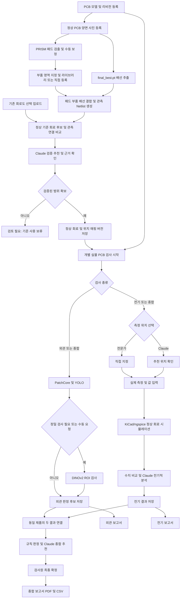
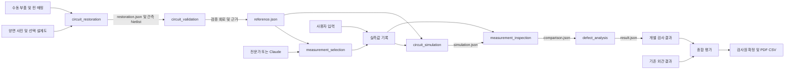
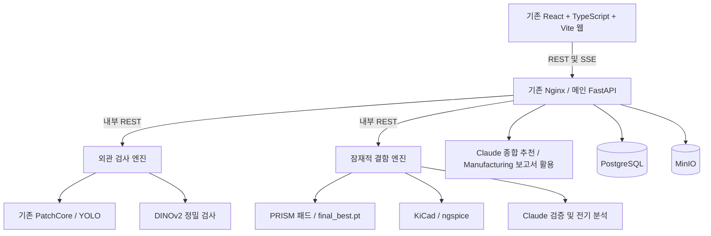

# PCB 잠재적 결함 검사 하위 설계서 v1.4

> 작성일: 2026-11-28 | 상태: 설계 합의 반영본 (실제 코드·성능·통합 미검증)  
> 기준: `PCB_Potential_Defect_Low_Level_Design_v1.3.md`, `PCB 검사 시스템 지도.html`, 2026-11-28 ARCH-01~21 합의 사항  
> 개발 원칙: 기존 구현 재사용 → 변경 모듈 단독 테스트 → 최소 테스트 웹 → 기존 PCB 검사 플랫폼 통합  
> 범위: v1.3의 0~12절 구성 및 P0~P8 개발 순서를 유지한다. 외관 검사는 잠재적 결함 모듈과의 연결에 필요한 변경만 명세하며, 기존 외관 플랫폼을 재개발하지 않는다.

## 0. 처음 읽는 사람을 위한 설명

PCB는 전자부품을 구리 배선으로 연결한 기판이다. 배선이 긁히거나 일부가 떨어진 외관 문제와, 외관은 정상이어도 부품이 제대로 동작하지 않는 전기적 문제는 서로 다르다. 이 시스템은 두 종류의 검사를 각각 실행하거나 결과를 결합할 수 있게 한다.

| 검사 | 담당 기술 | 알아내려는 것 |
|---|---|---|
| 일반 외관 검사 | PatchCore + YOLO | 정상 이미지와 다른 영역 및 학습된 외관 결함 후보 검출 |
| 정밀 외관 검사 | DINOv2 | 원본 이미지에서 잘라낸 관심 영역(ROI) 또는 확대 재촬영 이미지의 이상 여부 확인 |
| 잠재적 결함 검사 | PRISM, 수동 부품 등록, final_best.pt, KiCad/ngspice, Claude | 실제 측정값과 검증된 정상 회로의 계산값 비교 및 전기적 원인 후보 조사 |
| 종합 평가 | 기존 플랫폼 + Claude | 두 검사 결과를 보존하고 규칙 기반 판정, AI 추천 및 검사원 최종 확정 제공 |

잠재적 결함은 외관으로 판단하기 어려운 전기적 이상을 포함하는 프로젝트 용어다. 미래 고장 예측, 모든 반도체 내부 기능의 검증, 완전 자동 전기 검사를 의미하지 않는다.

예를 들어 정상 회로에서 2.50V가 예상되는 지점을 사람이 측정하여 0.20V를 입력하면, 프로그램이 동일 조건에서 정상 회로를 시뮬레이션하고 허용 범위와 비교한다. Claude는 회로 구조와 두 수치를 함께 해석하여 가능한 원인과 추가 확인 사항을 설명한다. 외관이 정상이라도 해당 지점의 전기적 이상을 별도로 확인할 수 있다.

### v1.3에서 변경된 사항 (ARCH 결정 추적)

| 번호 | v1.4 결정 | 반영 절 |
|---|---|---|
| ARCH-01 | 일반 PatchCore+YOLO, 정밀 DINOv2 | 3.7 |
| ARCH-02 | 원본 고해상도 ROI 우선, 부족하면 확대 재촬영 | 3.7 |
| ARCH-03 | 의심·불일치·임계값 근접 시 자동 정밀 검사 및 사용자 수동 지정 | 3.7 |
| ARCH-04 | 외관 모델 교차 검증, 불확실 시 검토/재촬영, 검사원 확정 | 3.7 |
| ARCH-05 | 기존 오픈소스 기반 엔진과 fit/predict, Memory Bank 재사용 방향 | 3.7, 11 |
| ARCH-06 | 관리자가 PCB별 YOLO 모델 수동 연결, 복수 허용 | 3.7, 7 |
| ARCH-07 | PRISM 패드 검출, 영역 지정 자동 패드 선택 및 수동 보정 | 3.1 |
| ARCH-08 | KiCad 등 부품 라이브러리와 직접 등록 병행 | 3.1 |
| ARCH-09 | final_best.pt 배선 추출, 패드·부품 정보 결합 → Netlist. 다중 배선 엔진 제외 | 3.1, 4 |
| ARCH-10 | circuit_correction → circuit_validation. 정상 기준/관측 회로 분리 및 Claude 임의 변경 금지 | 3.2 |
| ARCH-11 | 검사별 위치 선택 → 실측 입력 → 정상 회로 시뮬레이션 → 수치 비교 → Claude 분석. 결함 가설 반복 시뮬레이션은 확장 | 3.3~3.6 |
| ARCH-12 | 외관/전기 독립 검사 및 종합 검사, 나중에 결합 가능 | 1, 3.8 |
| ARCH-13 | 개별 실물 PCB ID 발급, QR은 확장 | 2, 8 |
| ARCH-14 | 규칙 판정 후보 + Claude 추천 + 검사원 확정, 각각 보존 | 3.8 |
| ARCH-15 | 개별·종합 보고서, Claude Manufacturing 활용, PDF/CSV만 사용자 출력 | 3.9, 7 |
| ARCH-16 | PCB 상세 화면 탭 분리, 기존 React/TS/Vite 활용 | 7 |
| ARCH-17 | 통합 관리 웹/DB/파일 저장소, 외관·잠재적 결함 엔진 REST 분리 | 4, 11 |
| ARCH-18 | GPU 작업 순차 실행, 독립 비GPU 작업은 조건 충족 시 별도 진행 | 11 |
| ARCH-19 | 기존 실행 구조 유지, 최소 안전장치. 신규 Worker/큐/Polling/Callback 제외 | 9, 11 |
| ARCH-20 | 기존 DB 유지, 필요한 확장만 추가, 가변 부가 데이터에만 JSONB | 8 |
| ARCH-21 | 사용자 작업 단위 API, 기존 /api 및 SSE 유지 | 8 |

ARCH-05의 엔진 재사용은 적용 방향이며 실제 엔진 API, 가중치 및 ROI Memory Bank 적합성 검증이 필요하다. 아래 클래스, 파일명, API와 DB 필드는 설계 계약 예시이며 실제 저장소에 구현되어 있다는 뜻은 아니다. 명시적으로 합의되지 않은 세부 수치는 미확정으로 둔다.

## 1. 전체 업무 흐름



최초 정상 기준 등록은 PCB 모델·리비전별로 한 번 준비하고 검증된 버전을 재사용한다. 제품마다 회로를 다시 복원하거나 사진에서 추출한 연결을 정상으로 간주하지 않는다. 기준 작성용 사진에서 생성한 관측 Netlist와 실제 검사 대상에서 추가로 추출한 관측 결과가 있다면 각각 출처·제품 ID를 구분한다. 제품별 재복원은 필수가 아니며, 실제 검사 사진의 관측 연결을 비교하는 경우에도 정상 기준을 변경하지 않는다.

설계도가 있다면 해당 모델·리비전과 일치하는 검증된 설계 정보를 정상 기준의 우선 근거로 사용한다. 설계도가 없으면 검증된 정상 PCB의 사진과 부품 정보로 후보를 만들고 추가 근거로 확인한다. 근거 부족 시 후보 작성과 시험 실행은 가능하지만 정상 판정용 기준 활성화는 불가하다. 외관 검사는 전기 기준 준비와 독립적으로 실행할 수 있다.

## 2. 사용자 시나리오

### 2.1 정상 회로 준비 — 회로도가 있는 경우

PCB-A100 Rev1의 양면 사진과 기존 회로도를 업로드한다. KiCad 원본 또는 지원 Netlist의 연결 정보를 직접 파싱하는 것을 우선하고, PDF·이미지 회로도는 추출 후보로 취급한다. 설계도 종류와 모델·리비전이 일치하는지 확인한다.

PRISM은 패드를 검출하고, 담당자는 부품 영역을 지정하여 자동 선택된 패드를 확인한다. 라이브러리 또는 직접 입력으로 부품 종류·값·핀 번호·극성을 등록한다. `final_best.pt`는 배선 영역을 추출한다. 프로그램은 패드·부품·배선을 결합해 관측 Netlist를 만든다. 설계 Netlist와 관측 Netlist의 핀 연결 차이를 찾아 Claude에 전달한다. 실제 불량인지 추출 오류인지 사진만으로 구분할 수 없다면 확인 대상으로 표시한다. 검증된 설계 정보와 위치 매핑을 정상 기준으로 저장한다.

회로도는 전기적 연결을 나타내지만 PCB 위 실제 위치를 반드시 포함하지 않는다. PCB 설계 파일은 레이어·패드 위치 확인에 유용할 수 있다. 각 자료가 제공하는 정보만 사용하고 실제 패드 위치와 핀 번호 매핑은 확인한다.

### 2.2 정상 회로 준비 — 회로도가 없는 경우

정상으로 확인된 PCB의 양면 사진을 사용해 동일한 패드 검출·부품 등록·배선 추출을 진행한다. 필요하면 정상 제품 여러 개를 비교할 수 있으나, 동일 AI의 반복 추출 일치만으로 연결을 확정하지 않는다. 복원 후보의 불확실한 연결은 확대 사진, 확인된 부품 자료, 전문가 검토 또는 안전한 물리적 확인 등 충분한 근거로 검증한다. 정상 샘플 수 및 필수 검증 범위는 아직 미확정이며 모든 정상 PCB를 전수 실측하는 기능을 필수로 추가하지 않는다.

설계도와 전문가 모두 없는 경우에도 후보와 Claude의 확인 추천은 제공할 수 있다. 다만 근거를 확인할 수 없는 내부 배선·부품값·전기 조건은 미확인으로 유지한다. 검증되지 않은 기준으로 PASS를 확정하지 않는다.

### 2.3 전문가가 실제 검사를 하는 경우

개별 제품 PCB-A100-001과 검증된 기준 버전을 선택한다. 전문가는 회로도에서 검사할 노드/핀을 직접 지정한다. 시스템은 실제 PCB 사진 위치, 측정 항목, 기준 노드 또는 분기, 안전한 측정 방법과 조건을 표시한다. 사람이 TP01에서 2.48V를 측정하여 저장한다. 이후 실행 버튼으로 정상 회로를 시뮬레이션한다. 예상 2.50V, 근거 있는 범위 2.40~2.60V라면 프로그램은 범위 내로 표시하고 Claude가 결과를 해석한다.

### 2.4 전문가가 없는 경우

Claude가 검증된 회로·부품·위치 매핑을 기반으로 측정 위치와 이유를 추천한다. 사용자는 확인된 안전한 위치만 검사 목록으로 선택한다. 사람이 실제 측정값 0.20V를 입력하면 전문가 경로와 동일한 시뮬레이션·수치 비교·분석을 실행한다. Claude는 추가 확인을 추천할 수 있지만 자동으로 측정하거나 가설별 시뮬레이션을 반복 실행하지 않는다.

### 2.5 외관 검사 및 종합 검사

외관만 검사하거나 전기 검사만 실행할 수 있고, 처음부터 두 검사를 모두 선택할 수도 있다. 오전 외관 검사 후 오후 전기 검사를 진행해도 동일 실물 ID의 결과라면 나중에 연결할 수 있다. 재검사 결과가 여러 개면 동일 제품·검사 조건인지 확인하고 종합 평가에 사용한 정확한 검사 ID를 기록한다. 제품 ID가 동일하다는 사실만으로 수리 전후 등 다른 상태의 결과를 자동 결합하지 않는다. 구체적 재검사 선택 정책은 기존 코드 확인 후 정한다.

위 이름과 수치는 설명용 가상 예시다.

## 3. 모듈 구성 및 세부 기능 명세

| 모듈 | 입력 | 처리 및 출력 |
|---|---|---|
| `circuit_restoration` (회로 복원) | 양면 사진, 선택 설계도, 등록 부품 | PRISM 패드, 배선 마스크, 연결 후보, 관측 Netlist 및 위치 매핑 |
| `circuit_validation` (회로 검증) | 관측 Netlist, 설계/정상 후보, 부품 및 검증 근거 | 연결 차이, Claude 검증 추천, 확인 이력, 정상 기준 후보 |
| `circuit_simulation` (회로 시뮬레이션) | 검증된 정상 회로, 부품 모델, 전원·부하 조건, 선택 지점 | KiCad/ngspice 실행, 예상값 및 로그 |
| `measurement_selection` (측정 위치 선택) | 검사 대상, 검증 회로 및 위치 매핑 | 전문가 직접 지정 또는 Claude 추천, 검사별 위치 목록 |
| `measurement_inspection` (측정 검사) | 실제 측정값, 조건, 시뮬레이션값, 허용 범위 | 실측 기록, 단위·조건 검사, 수치 비교 |
| `defect_analysis` (결함 평가) | 회로, 실측·시뮬레이션·비교 결과 | Claude 사실·원인 후보·한계·추가 확인 |

위 여섯 모듈은 v1.3의 구조를 유지하며 회로 보정만 검증으로 전환한다. 외관 검사, 종합 평가, 보고서는 기존 메인 플랫폼의 책임이며 잠재적 결함 모듈에서 중복 구현하지 않는다.

### 3.1 `circuit_restoration` — PRISM 패드 + 수동 부품 + 배선 복원

1. 양면 사진의 방향, 모델·리비전, 화질을 확인한다. 필요한 경우 재촬영한다. 원본 이미지와 전처리 변환 정보를 보존한다.
2. PRISM을 호출해 패드 위치를 추출한다. 배선 연결 및 부품 식별을 PRISM에 의존하지 않는다. 원시 결과에 고유 패드 ID를 매기고 좌표계를 원본에 맞춘다.
3. 사용자가 부품 영역을 사각형 등으로 지정하면 영역 내 패드를 자동 선택 후보로 표시한다. 개별 패드를 추가·제외할 수 있으며 PRISM 누락/오검출 패드는 추가·수정·삭제한다. 원시 검출은 유지하고 보정 기록을 별도로 저장한다.
4. 부품명(R1, U1 등), 종류, 값/모델명, 실제 핀 번호와 패드 ID를 등록한다. KiCad 등 기존 라이브러리 검색/선택을 지원하고 없는 부품은 직접 입력한다. BOM이 있다면 확인 근거로 활용한다. 핀 번호, 방향, 극성 및 전원/GND는 담당자가 확인한다. 라이브러리 심볼·핀 정보와 SPICE 모델 확보 여부는 별개다. 부품 YOLO 자동 식별은 MVP에서 사용하지 않는다.
5. 직접 학습한 `final_best.pt`를 사용하여 배선을 추출한다. 시스템 지도상 U-Net ResNet34 구리/실크스크린/패드 모델이며, 실제 출력 클래스·입력 크기·확률 맵 형식·가중치 호환성은 P0에서 확인한다. PatchCore 입력 해상도를 그대로 적용하지 않는다. 원본에 대응되는 마스크와 변환 정보를 보존한다.
6. 배선 마스크의 연결 영역과 패드 영역을 결합하여 같은 전기적 연결(Net)의 후보를 만든다. 부품 핀과 패드 매핑을 통해 핀 연결 관계를 생성한다. 앞뒤면은 동일 좌표계를 기준으로 대응시키되 비아·스루홀 등 확인 가능한 전기적 연결만 결합한다. 겹쳐 보인다는 이유만으로 서로 다른 레이어를 연결하지 않는다. 단절·합선 의심, 연결 없는 핀, 매핑 충돌, 가려진 영역은 불확실로 표시한다. 배선 연결 판단 기준 및 허용 거리 등은 실제 데이터로 검증 후 결정한다.
7. 관측 Netlist와 배선·패드 오버레이, 연결 후보 및 근거를 반환한다. 전기적으로 연결된 패드와 부품 자체를 경유하는 연결을 구분한다. 정상 기준 Netlist는 관측 결과를 검증한 뒤 별도로 만든다.

```text
PCB 사진 ── PRISM ── 패드 좌표 ───────────┐
         ├─ 사용자/라이브러리 ─ 부품·핀 ──┼─ 연결 후보 ─ 관측 Netlist
         └─ final_best.pt ─ 배선 마스크 ───┘
```

예: R1의 2번 핀과 R2의 1번 핀이 동일한 구리 배선에 이어져 있으면 동일 Net 후보가 된다. 부품의 두 핀이 모두 같은 Net이라고 임의 처리해서는 안 된다. MVP에서는 별도 WiringEngine/Oracle 운영 추상화나 여러 배선 모델의 자동 융합을 구현하지 않는다. 테스트용 정답 Netlist는 기존 fixture로만 활용한다.

기존 회로도 입력 후보는 `.kicad_sch`, `.net`, `.pdf`, `.png`, `.jpg`로 유지한다. 지원 포맷·KiCad 버전 호환 여부는 P0에서 확인한다. 출력 계약은 `restoration.json`, 관측 Netlist, 원본/마스크/오버레이, 회로도 추출 자료로 구성한다.

### 3.2 `circuit_validation` — 정상 기준과 관측 회로 검증

Claude가 실제 연결을 추측으로 추가·삭제하거나 원본 관측 Netlist를 수정하는 방식은 사용하지 않는다. 정상 기준 회로는 정상 설계를 표현하고 관측 회로는 이미지에서 추출된 연결 후보를 표현한다. 두 회로가 불일치하면 그 차이 자체를 확인할 대상으로 남긴다.

| 처리 순서 | 구현 내용 |
|---|---|
| 1. 입력 구성 | 관측 Netlist, 원본 이미지 및 마스크, 확인된 부품·핀, 설계도 또는 정상 후보, 자료 출처 |
| 2. 구조 검증 | 존재하는 부품·핀인지, 핀 매핑·전원/GND·중복·충돌·미연결 확인 |
| 3. 연결 비교 | 설계 근거가 있으면 동일 핀 연결 집합 비교. 없으면 확인된 근거와 후보의 불확실성 기록 |
| 4. Claude 분석 | 불일치/누락/합선 의심 위치, 실제 결함 및 추출 오류 가능성, 확인 방법과 이유 제안 |
| 5. 근거 확인 | 일치하는 설계 자료, 담당자 확인 또는 안전한 실제 연결 검증 근거 연결 |
| 6. 결과 저장 | 원시 관측 결과 보존. 근거 확인된 정상 기준 버전만 활성화하고 변경 이력 기록 |

예: 관측상 두 Net이 합쳐졌지만 설계상 분리된 경우, 실제 Short와 추출 오류를 동시에 후보로 남긴다. Claude가 정상처럼 보이게 연결을 제거하지 않는다. 확인 자료가 부족하면 `REVIEW_REQUIRED`다. 연결 확인을 위해 도통·저항 측정을 사용하는 경우 전원 차단 및 안전한 측정 조건이 전제되어야 하며, 장착 부품을 통한 우회 경로 때문에 단순 도통 결과만으로 합선을 확정하지 않는다.

검증된 설계 회로는 실제 불량 회로를 정상화하는 것이 아니라 정상 상태의 시뮬레이션 기준을 표현하는 별도 데이터다. 기준을 변경하는 경우 새 버전을 만든다. ERC 통과와 시뮬레이션 성공은 물리적인 배선 일치의 증거가 아니다. 사진만으로 볼 수 없는 내부층, 부품 아래 배선 또는 미확인 핀은 임의 연결하지 않는다. 정상 기준 활성화는 검증된 범위로 제한한다.

**Mouse Bite 등 외관 결함:** 배선 일부가 손상되더라도 전기적 연결이 유지되면 Netlist에는 차이가 없을 수 있다. 외관 결함은 PatchCore/YOLO/DINOv2의 검사 기록에서 보존하며 Claude가 외관 검출·분류·외관 판정을 수행하지 않는다.

### 3.3 `circuit_simulation` — 검사별 정상 예상값 계산

기준 등록 단계에서 검증된 정상 회로, 필요한 SPICE 모델, 전원·접지·부하 및 허용 조건을 준비하고 기준 버전을 저장한다. 사용 가능 여부를 확인하기 위한 기술 검증이나 시험 시뮬레이션은 할 수 있으나 실제 검사 흐름의 정상값 계산은 실측 저장 이후 실행한다.

검사 실행 시 검증된 정상 기준 Netlist를 KiCad 호환 회로 및 SPICE 입력으로 구성하고 ngspice를 호출한다. 실제 측정 조건이 기준에서 허용하는 조건인지 확인하고 정상 회로의 계산값을 얻는다. 실측한 이상 출력값을 정상 예상값으로 입력하거나 이에 맞춰 부품값·배선을 자동 조정하지 않는다. MVP는 단순 저전압 회로의 DC 동작점 분석부터 시작하며, 복잡한 반도체 기능은 지원 모델과 조건이 확보된 경우에만 다룬다.

- 입력: 기준 ID/버전, 정상 Netlist, 부품 모델, 선택 지점, 전원·부하 등 검증된 조건.
- 출력: 노드별 전압, 계산 가능한 소자/분기 전류, 단위, 계산 조건, 로그, 결과 상태.
- 예상값과 허용 범위는 구분한다. 허용 범위는 사양·부품 공차·검증된 정상 측정 자료 등에 근거한다. 근거 없는 공통 퍼센트나 절대 오차를 임의 확정하지 않는다.
- 모델·조건 누락 또는 실행 실패 시 `BASELINE_UNAVAILABLE` 또는 실행 오류를 표시하고 값을 생성하지 않는다.
- 기본 실행은 정상 회로 시뮬레이션 한 번이다. 사용자가 오류 해결 후 재실행할 수 있으나 Claude가 가설별 회로 변경과 반복 시뮬레이션을 수행하는 기능은 MVP 이후다.

### 3.4 `measurement_selection` — 실제 검사 시 위치 선택

정상 기준 등록에서 모든 측정 위치를 고정하는 별도의 검사 계획 등록은 요구하지 않는다. 검사 담당자가 실제 검사 1건을 시작할 때 선택한다.

| 방식 | 동작 |
|---|---|
| `manual` (전문가 직접 지정) | 검증된 회로의 핀/노드 선택 → 실제 PCB 위치·측정 종류 확인 → 검사 목록 추가 |
| `claude` (Claude 추천) | 검증 회로·부품·안전한 위치 전달 → 추천 지점·이유·측정 조건 반환 → 담당자 확인 |

두 방식은 동일한 `MeasurementPoint` 계약을 사용한다. 전압은 기준 노드(GND 등), 전류는 대상 소자/분기와 안전한 측정 방법이 필요하다. 미확인 위치나 조건을 Claude가 만들어 내지 못하도록 존재하는 핀·노드 및 매핑 상태를 프로그램에서 검증한다. 전문가가 없는 경로는 확인된 안전한 저전압 측정 위치에 한정한다. 위치 변경·추가는 이력을 기록한다. 예상값은 이 시점에 필수로 존재할 필요가 없고 검사 실행 이후 채운다.

### 3.5 `measurement_inspection` — 실측 저장 및 수치 비교

실제 PCB 측정은 사람이 수행한다. 측정값, 단위, 조건 및 재측정 이력을 먼저 저장한 뒤 시뮬레이션과 비교를 실행한다. 시뮬레이션 실패 또는 Claude 실패가 발생해도 이미 저장한 실측값은 보존한다. 숫자 형식, 단위, 측정 조건 일치 여부를 검사하고 허용 범위의 양 끝을 포함하여 비교한다.

| 조건 | 지점별 상태 |
|---|---|
| 값이 허용 범위 내 | `IN_RANGE` |
| 값이 허용 범위 밖 | `OUT_OF_RANGE` |
| 실측 없음 | `NOT_MEASURED` |
| 예상값 또는 허용 범위 근거 부족 | `BASELINE_UNAVAILABLE` |
| 조건 불일치 | `CONDITION_MISMATCH` |
| 위치/측정 방법 미검증 | `POINT_UNVERIFIED` |

전체 수치 결과는 하나라도 범위 밖이면 `ABNORMAL`, 선택한 지점이 모두 유효하고 범위 내이면 `IN_RANGE`, 그 외 또는 선택 지점이 없으면 `INCOMPLETE`다. 범위 밖과 미완료가 동시에 존재할 경우 두 상태를 함께 보존한다. `IN_RANGE`는 측정된 범위에서 이상이 없다는 의미이며 PCB 전체 기능의 보증이 아니다. 전기 PASS 후보는 검증된 필수 검사 범위를 충족해야 한다. 필수 지점·조건·허용 범위는 제품별 근거 확보 후 결정한다.

### 3.6 `defect_analysis` — Claude 잠재적 결함 평가

검증된 정상 회로 및 버전, 부품 정보, 선택 위치, 실측값, 시뮬레이션 결과, 허용 범위 근거 및 수치 상태를 전달한다. 출력은 확인된 사실, 가능한 원인, 판단 한계, 추가 검사 추천으로 분리한다. 단일 전압만으로 특정 반도체 고장을 확정하지 않는다. 프로그램의 수치 비교를 수정하지 않고 분석 상태를 따로 저장한다. Claude 실패 시 수치 비교는 유지하며 사용자가 수동으로 분석을 재실행할 수 있다. 자동 재시도나 반복 시뮬레이션 에이전트는 도입하지 않는다.

### 3.7 기존 외관 검사 모듈 연동 변경 (ARCH-01~06)

기존 외관 엔진을 재사용한다. PatchCore는 일반 검사에서 정상 특징과의 이상을 검출하고, YOLO는 학습된 외관 결함 종류와 위치 후보를 반환한다. DINOv2는 정밀 검사용이다. 기존 시스템 지도상 PatchCore 운영 모델은 ResNet-18/256px이고 벤치마크의 WRN50 모델과 구분한다. 모델별 실제 입력 및 설정은 소스/가중치를 확인한다. 기존 `fit`/`predict`, 정상 이미지 등록·Memory Bank 관리 및 기존 PCB-모델 연결 기능을 최대한 유지한다.

| 대상 | 역할/운영 정책 |
|---|---|
| PatchCore | 일반 이상탐지, 기존 정상 Bank 유지 및 재사용 방향 |
| YOLO `pcb_wiring` | Short, Mouse Bite 등 배선 결함 후보. 실제 지원 클래스는 가중치 확인 |
| YOLO `pcb_green` | 조립 PCB 외관 결함 후보. 부품 누락 전용 모델로 해석하지 않음; 실제 클래스 미검증 |
| DINOv2 | 정밀 ROI 검사. 기존 오픈소스 엔진 및 Bank 재사용 방향, ROI에 적합한 정상 기준 확인 필요 |

관리자가 PCB별 YOLO 모델을 수동 연결한다. 복수 연결 가능하며 MVP 자동 모델 선택은 제외한다. 외관 모델과 `final_best.pt`의 목적 및 모델 키를 구분한다. 부품 식별 YOLO는 사용하지 않는다.

정밀 검사는 일반 검사에서 이상 의심, 모델 간 불일치, 임계값 근접 등이 있는 경우 자동 요청한다. 정상으로 보이는 경우에도 사용자가 ROI를 직접 선택할 수 있다. 원본 고해상도 이미지에서 ROI를 자르는 것이 우선이며, 원본에서 필요한 정보가 확보되지 않으면 확대 재촬영한다. 잘라낸 작은 영상의 단순 확대는 새로운 세부 정보를 만들지 못한다. 정상 비교 영역·촬영 조건·크기·좌표 변환과 모델 기준이 일치하는지 확인한다. 기존 DINOv2 Bank가 전체 이미지용이라면 ROI에 바로 사용할 수 있는지 검증하고, 필요시 동일 영역의 정상 Bank를 준비한다. 실제 점수 임계값, 근접 구간, 품질 및 ROI 확대 기준은 시험 전 미확정이다.

| 상황 | 규칙 기반 외관 판정 후보 |
|---|---|
| 일반 정상, YOLO 검출 없음, 정밀 확인 사유 없음 | PASS 후보 (검사 범위 내) |
| 일반 의심, 동일 영역 DINOv2 이상 확인 | FAIL 후보 |
| 일반·정밀 결과 불일치 또는 정밀에서만 이상 | REVIEW_REQUIRED |
| 정밀 필요하지만 비교 기준 부족 또는 영상 품질 미달 | 검토 필요 또는 RECAPTURE_REQUIRED |
| 모델 실행 오류 또는 필수 결과 미완료 | 실행 실패/검토 필요, PASS 금지 |

YOLO 미검출이 학습 범위 밖의 결함도 정상이라는 의미는 아니다. 서로 다른 모델의 점수는 같은 척도라고 가정하지 않는다. 원본·ROI·재촬영 이미지, 모델별 점수/임계값/버전/검출 위치를 분리 저장하고 검사원이 판정 근거를 확인한다. 위 표의 후보는 제품별 허용 기준과 세부 테스트로 구체화한다. Claude는 외관 검사 자체를 수행하거나 외관 판정을 변경하지 않는다.

### 3.8 기존 플랫폼 — 독립 검사 및 종합 판정

PCB 모델 ID는 종류/리비전을 식별하고, 개별 제품 ID는 실제 기판 한 개를 식별하며, 검사 ID는 한 번의 검사 실행을 식별한다. 사용자에게 개별 제품 ID를 발급하고 같은 제품의 외관/전기 검사 결과만 결합한다. 기존 DB에 해당 기능이 있으면 재사용한다. QR 식별은 확장이다.

| 구분 | 처리 원칙 |
|---|---|
| 외관 검사만 | 외관 결과 및 범위를 보고, 전기 미실행 표시 |
| 잠재적 결함 검사만 | 전기 결과 및 범위를 보고, 외관 미실행 표시 |
| 종합 검사 | 같은 실물·상태에 대한 두 결과가 있을 때 결합. 사용한 검사 ID 고정 |
| 프로그램 판정 후보 | 허용 기준과 검사 완료 상태에 근거한 규칙. 확정 불량이 있으면 FAIL 후보, 두 필수 검사 범위 모두 충족하면 PASS 후보, 불확실/미실행/재촬영 필요 시 PASS 금지 |
| Claude 추천 | 개별 검사 판정 및 근거를 입력받아 종합 PASS/FAIL/검토 필요 추천과 이유 설명. 외관 자체 검사나 기존 결과 덮어쓰기 금지 |
| 검사원 최종 확정 | 결과와 근거를 검토하여 최종 판정 저장. 변경 이유 및 이력 보존, 미실행/미검증을 종합 PASS로 처리 금지 |

외관 FAIL, 전기 PASS라고 해도 외관 허용 기준을 위반했다면 자동 합격시키지 않는다. 전기 FAIL, 외관 PASS도 가능하다. 결함 원인의 인과관계는 근거 없이는 확정하지 않는다. 규칙 후보·Claude 추천·검사원 결과는 별도 필드로 유지한다. 프로그램 실행 상태와 PCB 판정을 구분한다.

### 3.9 검사 보고서 — Claude Manufacturing 활용

외관, 잠재적 결함 각각 독립 보고서를 생성하고 종합 검사에서 동일 제품의 기존 결과를 결합한 보고서를 만든다. 사용자 다운로드 형식은 PDF와 CSV만 제공한다. JSON은 내부 모듈 계약 및 원본 분석 결과 보존 용도이며 사용자 내보내기 형식이 아니다.

| 보고서 | 주요 내용 |
|---|---|
| 외관 | 제품/검사 ID, 원본·이상 위치 이미지, 각 모델 결과, 규칙 판정 및 검사원 결과 |
| 잠재적 결함 | 기준 버전, 측정 위치, 실측/예상/범위/차이/조건, 수치 판정, Claude 분석 및 검사원 결과 |
| 종합 | 참조한 두 검사 ID 및 결과, 규칙 종합 후보, Claude 추천과 근거, 검사원 확정, 미실행/미확인 항목 |

Claude Manufacturing은 보고서 구성·제조 품질 관점 분석 및 설명 작성에 활용한다. 정확한 실행 제품/플러그인, API 또는 CLI 사용 가능 여부와 자동 PDF/CSV 연동 방식은 P0에서 확인한다. UI 설계에 활용하는 것으로 해석하지 않는다. 시스템의 저장된 점수·측정값·판정·식별자를 원본으로 사용하고, Claude의 서술이 해당 값을 변경하지 못하도록 한다. PDF는 이미지·표·분석을 포함하고 CSV는 정형 데이터 중심으로 생성한다. 도구 연동이 불가능할 때는 기존 보고서 생성 로직으로 파일을 생성하고 Claude 분석 텍스트를 결합하는 대안을 검토하되, 해당 대안을 실제 적용하기 전 사용자와 확인한다.

## 4. 독립 실행 구조

```text
pcb-project/
├── modules/potential_defects/
│   ├── circuit_restoration/       # service.py, prism_adapter.py, 배선/패드 결합
│   ├── circuit_validation/        # service.py, 기존 correction 대체
│   ├── circuit_simulation/        # service.py, ngspice_adapter.py
│   ├── measurement_selection/     # service.py
│   ├── measurement_inspection/    # service.py
│   ├── defect_analysis/           # service.py
│   ├── schemas.py                 # 공통 자료 계약
│   ├── claude_adapter.py          # 기존 호출 및 응답 검증
│   ├── workflow.py                # 서비스 실행 순서 조정
│   └── cli.py                     # 웹 없이 실행
├── test_web/                      # 기존 시험용 FastAPI + HTML/JS
├── tests/potential_defects/
│   ├── fixtures/                  # 사진, Golden Netlist, 측정 자료
│   ├── unit/
│   └── integration/
├── backend/                       # 기존 메인 FastAPI
├── frontend/                      # 기존 React + TypeScript + Vite
└── docker-compose.test.yml        # 기존 테스트 환경 활용
```

폴더 구조는 v1.3의 계약을 유지하는 예시다. 실제 저장소의 위치 및 모듈명과 비교하여 필요한 부분만 변경한다. 복원 내부의 부품 등록, 배선 추출, 연결 추출, Netlist 생성은 독립 시험할 수 있는 함수 또는 서비스로 구성하되 별도 운영 엔진이나 컨테이너를 각각 만들지 않는다. 기존 OpenCV, 이전 U-Net 및 부품 YOLO 실험 코드는 운영 경로에서 제외하고 연구용 자료는 필요한 경우 보존한다.

각 서비스는 JSON/파일 입력과 결과를 사용하며 웹이나 운영 DB에 직접 의존하지 않는다. `workflow.py`가 호출을 조정한다. 정답 회로 fixture로 시뮬레이션 또는 측정 비교를 먼저 개발할 수 있다. 독립 시험 웹의 상태 및 파일 저장은 기존 방식을 재사용하고, 정식 통합 후 메인 FastAPI에서 PostgreSQL과 MinIO에 기록한다. 새로운 Worker/큐를 이 워크플로에 도입하지 않는다.

## 5. 데이터 흐름 및 입출력 설계



| 데이터 | 주요 필드 | 역할 |
|---|---|---|
| `restoration.json` | 등록 ID, 사진 ID, 패드 원시/수정 참조, 부품·핀 매핑, 배선 마스크 참조, 연결 후보·불확실성, 관측 Netlist 참조 | 원시 관측 및 복원 데이터 |
| `validation.json` | 관측/정상 후보 참조, 연결 차이, Claude 추천, 검증 근거, 담당자, 상태, 변경 이력 | 검증 결과. 원시 관측 수정 금지 |
| `reference.json` | 기준 ID/버전, 모델·리비전, 검증된 정상 Netlist, SPICE 모델, 검증 범위, 허용 조건/범위 근거, 위치 매핑 | 재사용하는 정상 기준 |
| `points.json` | 검사 ID, 제품 ID, 기준 버전, 선택 방식, 지점 ID, 노드/분기, 위치, 조건 | 검사별 선택 지점 |
| `measurements.json` | 측정 ID, 지점 ID, 실측값, 단위, 조건, 측정/재측정 이력 | 실제 측정 원본 |
| `simulation.json` | 검사 ID, 기준 버전, 조건, 계산 결과, 모델 참조, 로그, 상태 | 실측 이후의 정상 회로 계산값 |
| `comparison.json` | 지점 ID, 측정/시뮬레이션 ID, 예상값, 범위, 실측값, 단위, 차이, 상태 | 프로그램 수치 결과 |
| `result.json` | 검사 ID, 수치 결과, 미완료 여부, Claude 분석 및 분석 상태 | 플랫폼 전달 |
| 종합 결과 | 제품 ID, 참조 외관/전기 검사 ID, 프로그램 후보, Claude 추천, 검사원 최종 확정 | 메인 플랫폼 저장 및 보고서 |

기준 생성 시 여러 개의 독립 등록 건을 만들 필요는 없다. 등록 ID 아래에 관련 결과를 모으고, 정상 기준을 활성화하면 검증 범위와 버전을 고정한다. 검사 실행에 사용한 기준 버전과 모델·임계값 등의 조건은 검사 기록에 보존한다.

### 5.1 노드와 실제 위치의 연결 예시

실제 PCB의 `TP01` 패드가 정상 회로의 `N_MID` 노드와 매핑되면 시뮬레이션의 해당 노드 전압과 실측값을 비교할 수 있다. 전류는 노드 전압과 달리 소자/분기 ID를 지정한다. 선택·측정 시점에는 아직 예상값이 없을 수 있으므로 계산 결과는 실행 이후 별도 기록으로 연결한다.

```json
{
  "inspection_id": "INS-001",
  "product_id": "PCB-A100-001",
  "reference_id": "REF-A100-1",
  "reference_version": 1,
  "selection_mode": "claude",
  "point_id": "TP01",
  "node_id": "N_MID",
  "reference_node_id": "GND",
  "physical_location": {"image_id": "IMG-FRONT-001", "side": "front", "x": 0.42, "y": 0.58},
  "mapping_status": "VERIFIED",
  "measurement_type": "VOLTAGE",
  "unit": "V",
  "condition_id": "DC-5V-01"
}
```

실측을 먼저 저장한 후 실행하여 생성되는 비교 자료 예시:

```json
{
  "inspection_id": "INS-001",
  "point_id": "TP01",
  "measurement_id": "MEAS-001",
  "simulation_id": "SIM-001",
  "reference_version": 1,
  "expected": 2.5,
  "expected_min": 2.4,
  "expected_max": 2.6,
  "range_evidence_id": "EVID-001",
  "actual": 0.2,
  "unit": "V",
  "condition_id": "DC-5V-01",
  "difference": -2.3,
  "status": "OUT_OF_RANGE"
}
```

예시 좌표는 원본 이미지 너비·높이에 대한 0~1 정규화 좌표이며 실제 PCB 위치가 아니다. 실제 사용 시 이미지 ID, 방향, 좌표 변환 및 매핑 검증 상태를 보존한다. 위 숫자와 허용 범위는 가상 시험용이며 운영 기준값이 아니다.

### 5.2 Claude 응답의 구조 예시

```json
{
  "inspection_id": "INS-001",
  "numeric_status": "ABNORMAL",
  "incomplete": false,
  "claude_analysis": {
    "status": "COMPLETED",
    "facts": ["TP01 전압이 허용 범위를 벗어남"],
    "possible_causes": ["전원 경로 또는 관련 부품 이상 가능성"],
    "limitations": ["단일 측정만으로 원인 확정 불가"],
    "next_checks": ["검증된 다른 측정 지점 확인 권장"]
  }
}
```

응답 필드와 타입은 프로그램이 검증한다. 실패하면 `AI_FAILED`를 기록하되 `numeric_status`는 변경하지 않는다. 회로 검증 응답도 연결 식별자, 확인 이유, 근거 및 불확실성을 구조화하되 실행 가능한 임의 변경 명령으로 사용하지 않는다.

### 5.3 종합 결과 저장 예시

```json
{
  "product_id": "PCB-A100-001",
  "visual_inspection_id": "VIS-001",
  "potential_inspection_id": "INS-001",
  "visual_status": "PASS",
  "electrical_status": "FAIL",
  "rule_recommendation": "FAIL",
  "claude_recommendation": "FAIL",
  "claude_reason": "외관 검사 범위 내 이상은 없으나 TP01 수치가 허용 범위를 벗어남",
  "final_decision": null,
  "review_state": "PENDING"
}
```

위 결과는 가상 예시이며 전기 FAIL 후보로 판정할 허용 기준이 검증되었다고 가정한다. 검사원 확정 전에는 최종 판정을 비워 둔다. 실제 필드명은 기존 DB/API 계약과 대조 후 확정한다.

## 6. 최소 클래스 다이어그램

```mermaid
classDiagram
 direction TB
 class PotentialDefectWorkflow {
   +prepare_reference(inputs, evidence)
   +select_points(inspection, mode, selections)
   +save_measurements(inspection, measured)
   +inspect(inspection)
 }
 class RestorationService {
   +detect_pads(images) PadResult
   +restore(images, components, pads, optional_schematic) RestorationResult
 }
 class ValidationService {
   +compare(restoration, reference_candidate) ValidationResult
   +suggest_checks(validation, evidence) ValidationSuggestions
   +verify_reference(candidate, evidence) ReferenceResult
 }
 class SimulationService {
   +run(circuit, conditions) SimulationResult
 }
 class MeasurementSelectionService {
   +select_manual(reference, selections) MeasurementPoints
   +suggest_claude(reference, purpose) MeasurementPoints
   +validate(points, reference) ValidationResult
 }
 class MeasurementInspectionService {
   +record(points, measured) MeasurementRecords
   +evaluate(reference, points, measured, simulation) NumericResult
 }
 class DefectAnalysisService {
   +evaluate(circuit, numeric_result) AnalysisResult
 }
 PotentialDefectWorkflow --> RestorationService
 PotentialDefectWorkflow --> ValidationService
 PotentialDefectWorkflow --> SimulationService
 PotentialDefectWorkflow --> MeasurementSelectionService
 PotentialDefectWorkflow --> MeasurementInspectionService
 PotentialDefectWorkflow --> DefectAnalysisService
```



| 클래스 | 독립 테스트에서 확인할 일 |
|---|---|
| `RestorationService` | 패드 검출, 부품 매핑, 배선 추출 및 관측 Netlist 생성; 실패 이유 명시 |
| `ValidationService` | 차이와 확인 추천 출력, 근거 부족 시 활성화 차단, 관측 원본 불변 |
| `SimulationService` | 검증 회로의 예상값과 실패 이유 반환 |
| `MeasurementSelectionService` | 수동/Claude 경로에서 동일 형태의 유효한 위치 반환 |
| `MeasurementInspectionService` | 실측 먼저 저장, 같은 조건의 데이터에서 동일 수치 결과 |
| `DefectAnalysisService` | 수치 판정 불변, 사실·원인 후보·한계 구분 |
| `PotentialDefectWorkflow` | 서비스 실행 순서와 현재 단계 관리, 실패/중단 표시 및 수동 재실행 |

클래스와 메서드는 기존 v1.3의 책임을 기준으로 변경한 계약 예시다. 내부 구현과 정확한 인수는 P0~P3 검증 및 기존 코드 확인 후 확정한다. 독립적인 서비스가 서로 직접 호출하지 않고 워크플로가 순서를 조정한다.

## 7. 최소 테스트 웹 화면 명세

시험 웹은 정식 운영 UI가 아니다. 기존 FastAPI + HTML/JS 기반 3개 화면을 유지하여 독립 모듈을 호출하고 결과를 확인한다. 로그인·대시보드·통계·웹 CAD 편집기를 시험 웹에 추가하지 않는다. 복잡한 회로 수정은 검증 근거와 함께 KiCad에서 수행하고 재업로드한다.

### 화면 1 — PCB 등록 / 회로 복원 / 정상 기준 만들기

```text
┌──────────────────────────────────────────────────────────┐
│ 모델 [PCB-A100]  리비전 [Rev1]                            │
│ [앞면] [뒷면] [기존 회로도 선택(선택)]                     │
│ [PRISM 패드 검출] [부품 영역 지정/패드 추가·제외]           │
├───────────────────────────┬──────────────────────────────┤
│ 원본 PCB / 패드 오버레이   │ 부품명 / 종류 / 값 / 모델      │
│ 누락 패드 추가·수정·삭제   │ [라이브러리 검색] [직접 등록]   │
│                           │ 핀 번호 / 극성 / 전원 / GND    │
├───────────────────────────┴──────────────────────────────┤
│ [배선 추출 및 Netlist 생성]                                │
│ 관측 Netlist / 정상 후보 / 차이와 불확실성                  │
│ [Claude 검증 추천] [확인 근거 입력/수정 회로도 재업로드]     │
│ 전원·부품 모델·부하 조건 / 허용 범위 근거                    │
│ [정상 기준 저장 및 활성화]                                 │
└──────────────────────────────────────────────────────────┘
```

| 기능 | 동작 및 완료 조건 |
|---|---|
| 이미지·회로도 | 원본 보존, 파일·리비전 확인 |
| 패드 검출/보정 | PRISM 위치 표시, 누락/오검출 수동 처리 및 이력 보존 |
| 부품 등록 | 영역 선택 자동 그룹 + 개별 보정, 라이브러리/직접 등록, 핀 매핑 확인 |
| 회로 복원 | final_best.pt 배선 마스크, 관측 Netlist 및 오버레이 생성 |
| 검증 | 정상 후보와 관측 차이, Claude 추천, 확인 근거 기록. 원시 결과 변경 금지 |
| 기준 활성화 | 검증된 범위와 지원 조건만 활성화. 예상값은 실제 검사에서 계산 가능 |

측정 위치를 이 화면에서 미리 모두 등록하는 기능은 추가하지 않는다.

### 화면 2 — 측정 위치 선택 및 실제 검사

```text
┌──────────────────────────────────────────────────────────┐
│ 제품 [PCB-A100-001]  기준 [Rev1 / v1]                      │
│ ( ) 전문가 직접 지정      ( ) Claude 추천                 │
│ [위치 추가] [Claude 추천 실행]                             │
├───────────────────────────┬──────────────────────────────┤
│ 검증된 회로도             │ PCB 앞/뒷면 실제 위치          │
│ 선택한 핀 / 노드          │ 추천 이유 / 안전한 측정 조건    │
├───────────────────────────┴──────────────────────────────┤
│ 지점    항목      단위     실제 측정값      상태            │
│ TP01    전압       V       [0.20]           입력 완료       │
│ [측정값 저장] [재측정] [시뮬레이션 및 Claude 분석 실행]       │
└──────────────────────────────────────────────────────────┘
```

| 기능 | 동작 및 완료 조건 |
|---|---|
| 검사 대상 | 실물 제품 ID 및 검증 기준 버전 선택 |
| 수동/Claude 위치 | 두 경로의 자료 형식 동일, 확인된 위치만 사용 |
| 실측 입력 | 값·단위·조건 저장, 재측정 이력 보존 |
| 분석 실행 | 정상 회로 시뮬레이션 → 수치 비교 → Claude 분석, 동일 로직 활용 |
| 오류 | 저장된 실측 보존, 실패 원인 표시, 수동 재실행 |

### 화면 3 — 잠재적 결함 평가 결과

```text
┌──────────────────────────────────────────────────────────┐
│ 검사 결과 / PCB-A100-001 / 기준 v1                        │
│ 측정 위치 선택: Claude 추천                                │
│ 수치 결과: 범위 밖 / 추가 확인 필요                        │
│ TP01 예상 2.50V / 범위 2.40~2.60V / 실제 0.20V / -2.30V   │
│ Claude 평가: 확인 사실 / 원인 후보 / 추가 확인 / 한계        │
│ [PDF 다운로드] [CSV 다운로드] [AI 분석 재실행] [재검사]      │
└──────────────────────────────────────────────────────────┘
```

최소 기능은 지점별 비교표, 기준 버전 및 선택 방식, Claude 평가·오류 상태, PDF/CSV 출력이다. 내부 JSON은 저장하되 사용자 다운로드로 노출하지 않는다. 시험 웹에서는 종합 평가 대신 기존 플랫폼 통합 시 외관 결과와 결합하는 계약을 검증한다.

### 7.1 기존 정식 플랫폼에 연결할 화면

| 기존/추가 화면 | 최소 변경 |
|---|---|
| 대시보드 | 기존 검사 통계 유지, 유형·미완료 상태 구분 |
| 외관 검사 | 일반 검사 및 ROI 정밀 검사/재촬영 연결 |
| 잠재적 결함 검사 | 시험 웹의 위치 선택 및 분석 흐름을 기존 React 화면으로 연결 |
| 종합 검사 | 동일 제품의 두 검사 결과 선택/연결, 세 판정 주체 표시 |
| 검사 이력 | 제품별 기존 이력과 재검사 연결, 참조 버전 표시 |
| 보고서 | 개별 및 종합 PDF/CSV 다운로드 |
| PCB 상세 관리 (관리자) | 기본 정보, 정상 이미지, AI 모델, 회로 복원, 정상 기준 탭. 부품 라이브러리는 회로 복원 작업에서 접근 |

ARCH-16의 탭 방식만 반영하고 기존 프론트 기술과 메뉴/라우팅은 재사용한다. 실제 기존 화면 목록과 관리자/일반 사용자 접근 제어를 확인한 뒤 변경한다. 별도 UI 프레임워크, 운영 모니터링 전용 웹 또는 복잡한 CAD 편집기를 신규 구축하지 않는다.

## 8. 데이터 저장 및 API 초안

### 8.1 독립 모듈에서는 JSON/파일부터

```text
artifacts/
├── references/REF-A100-1/      # 원본, 관측, 검증, 정상 기준 버전
└── inspections/INS-001/        # 위치, 실측, 시뮬레이션, 비교, 분석, PDF/CSV
```

기준과 검사 폴더만 구분한다. 원본·기존 결과를 덮어쓰지 않고 변경 버전과 재측정 이력을 남긴다. 기존 파일명 및 저장 기능은 유지 가능한 범위에서 재사용한다. 운영 플랫폼은 PostgreSQL에 조회·비교에 필요한 핵심 데이터를 저장하고 MinIO에는 원본/전처리/Heatmap/마스크/설계도/Netlist/보고서 등의 파일을 저장한다. DB에는 파일 경로 또는 식별자와 버전·상태를 연결한다.

### 8.2 기존 DB 연결 시 최소 저장 대상 (제안)

| 테이블 또는 기존 데이터 영역 | 저장 목적 / 핵심 필드 |
|---|---|
| 기존 `registrations` | PCB 모델·리비전 등록 정보 재사용 (실제 테이블명 확인) |
| 개별 PCB 제품 관리 (기존 없을 때 추가) | 제품 ID, 등록 ID, 리비전, 생성 시각. 실제 기판과 ID 대응 |
| `potential_defect_registrations` | 기준 ID, 기존 등록 ID, 버전, 원본/설계도/관측·정상 Netlist/검증 자료 참조, 조건 및 검증 상태 |
| 부품·패드·연결 자료 | 기준/복원 ID, 확인된 부품·핀·패드 식별자와 위치, 불확실성, 변경 근거. 기존 파일/JSON 계약 활용, 독립 테이블 필요성은 확인 후 결정 |
| `potential_defect_test_points` | 검사 ID, 기준 버전, 지점 ID, 선택 방식, 노드/분기, 위치, 조건. 실행 후 예상값/범위 스냅샷 연결 |
| `potential_defect_measurements` | 검사 ID, 지점 ID, 실측값, 단위, 조건, 재측정 번호, 수치 상태 |
| `potential_defect_results` | 검사 ID, 기준 ID, 시뮬레이션 및 수치 비교 결과, 미완료 여부, Claude 분석, 파일 참조 |
| 기존 `inspections` 및 외관 결과 영역 | 검사 기록 및 모델별 결과 재사용, 개별 제품 ID/기준 버전 연결 |
| 종합 판정 및 보고서 영역 | 같은 제품의 정확한 외관/전기 검사 ID, 프로그램 후보, Claude 추천, 검사원 확정/이력, PDF·CSV 파일 참조 |

v1.3의 `potential_defect_jobs`는 신규 작업 큐를 위한 테이블로 구현하지 않는다. 기존 검사 상태/오류 기록을 활용한다. 기준 작성용 데이터와 개별 제품 검사 데이터를 혼동하지 않는다. 핵심 ID·FK·수치·단위·판정·시각은 일반 컬럼으로 유지하고 모델별 상세 응답 및 가변적인 추가 데이터에만 JSONB를 활용한다. 사진 및 파일 전체를 JSONB에 넣지 않는다. 기존 스키마를 먼저 확인해 중복 테이블을 만들지 않으며 마이그레이션은 필요한 부분만 적용한다.

### 8.3 테스트 웹 API 최소 계약 (제안)

사용자 작업 단위를 기준으로 기존 `/api/potential-defects` 경로를 유지한다. 아래는 v1.3과 합의된 변경을 반영한 예시이며 실제 URL·요청 필드는 기존 구현을 확인해 맞춘다.

| HTTP / 경로 (`/api/potential-defects` 뒤) | 역할 |
|---|---|
| `POST /registrations` | 모델·이미지·선택 설계도 등록 또는 기존 등록 참조, 기준 ID 반환 |
| `POST /registrations/{id}/pads` | PRISM 패드 검출 및 결과 조회/보정 저장에 필요한 계약 |
| `POST /registrations/{id}/components` | 라이브러리/직접 입력 부품과 확인된 핀·패드 매핑 저장 |
| `POST /registrations/{id}/restore` | final_best.pt 배선 추출 → 연결 추출 → 관측 Netlist 생성 |
| `POST /registrations/{id}/validate` | 차이 검토·Claude 검증 추천 또는 사용자 검증 근거 기록 (action 구분) |
| `POST /registrations/{id}/activate` | 검증 근거·지원 조건을 확인하고 정상 기준 버전 활성화 |
| `POST /inspections` | 개별 제품 검사 시작, 검증 기준 버전 고정 |
| `POST /inspections/{id}/points` | manual 또는 claude 위치 선택 및 확인 |
| `POST /inspections/{id}/measurements` | 실제 측정값과 조건 기록 |
| `POST /inspections/{id}/analyze` | 저장된 실측 기준으로 정상 시뮬레이션 → 비교 → Claude 분석 |
| `GET /inspections/{id}/result` | 수치 및 AI 결과 조회 (기존 내부 JSON 계약 유지) |
| `GET /inspections/{id}/result?format=pdf` 또는 `format=csv` | 사용자 보고서 다운로드 예시 |

`validate`에서 제안과 검증 근거 등록 동작을 구분하되 Claude의 연결 수정 실행 기능은 제거한다. 패드·부품 보정 이력은 원본과 구분한다. `activate`는 기존 기준의 상태 전환이다. v1.3의 별도 정상값 사전 생성용 `simulate` 호출은 검사 시 `analyze` 흐름에 포함한다. 독립 개발용 시뮬레이션 CLI 및 단독 서비스 테스트는 유지한다. 신규 `/jobs/{id}` 및 주기적 폴링·콜백을 설계하지 않는다.

프론트엔드는 메인 FastAPI의 기존 REST API만 호출한다. 메인 서버는 내부 검사 엔진에 REST로 요청하고 기존 SSE로 사용자에게 진행 상태를 전달한다. 모델별 실행을 위해 웹에 모든 저수준 API를 노출하지 않는다. 외관 검사, 종합 평가, 보고서의 기존 경로가 있다면 확장하여 사용한다. 정확한 외부 엔진 요청/응답과 오류 코드 호환은 P0/P8에서 확인한다.

## 9. 오류 처리 및 검증 상태

| 상황 | 코드 예시 | 표시 및 처리 |
|---|---|---|
| 흐린 사진·방향 오류 | `RECAPTURE_REQUIRED` | 재촬영, 판정 보류 |
| 회로도 리비전 불일치 | `REFERENCE_MISMATCH` | 자료 확인, 기준 활성화 보류 |
| 패드/핀·배선 연결 불확실, 외관 모델 불일치 | `REVIEW_REQUIRED` | 근거와 위치 표시, 임의 수정/정상 확정 금지 |
| 모델·허용 범위·시뮬레이션 조건 부족 | `BASELINE_UNAVAILABLE` | 정상값 비교 불가 |
| 지점·측정 방법 미검증 | `POINT_UNVERIFIED` | 측정 안내 보류 |
| 실측 없음 | `NOT_MEASURED` | 미측정 표시 |
| 측정 조건 불일치 | `CONDITION_MISMATCH` | 비교 중단 |
| Claude 실패/형식 오류 | `AI_FAILED` | 기존 수치 결과 유지, 수동 분석 재실행 |
| 엔진 오류/시간 초과/저장 실패 | 기존 실행 오류 상태 활용 | 실패한 단계와 원인 표시, 수동 재검사 |
| 서버 재시작으로 실행 중단 | 기존 상태 확장 필요 시 적용 | 미완료/중단 표시. 완료 또는 PASS 처리 금지 |

기존 실행 상태와 검사 품질 판정은 구분한다. 검사 프로그램이 정상 완료되어도 PCB는 FAIL일 수 있고 프로그램 실행 실패 자체가 PCB FAIL은 아니다. 화면에는 쉬운 한글 상태를 사용한다.

### 9.1 MVP 최소 운영 안전장치

| 항목 | 적용 원칙 |
|---|---|
| 예외·입력 검증 | API/엔진 호출 오류 및 잘못된 입력의 원인을 명확히 반환 |
| 시간 제한 | 엔진·Claude·시뮬레이션 호출 타임아웃, 기존 설정 재사용; 실제 값은 시험 후 결정 |
| 결과 보존 | 원본 및 실측값 등 이미 저장된 데이터 유지, 실패 결과로 기존 성공 기록 덮어쓰기 금지 |
| 중복 실행 | 기존 동시 실행 제한과 검사 ID/서버측 중복 검증 활용. 단순 버튼 비활성화만으로는 부족 |
| GPU 관리 | GPU 작업 동시 실행 제한. 별도 엔진에서 동시에 GPU를 사용하는 경우도 제한이 작동하는지 검증 |
| 수동 복구 | 사용자에게 오류 원인 및 재실행 경로 제공. 자동 재시도·단계별 자동 복구 없음 |
| 기본 로그/Health Check | 기존 기능 활용, 검사 ID·실행 단계·오류·시간을 확인할 수 있도록 최소 보완 |
| Docker 재시작 | 기존 Compose 정책 확인, 재시작 중단 검사가 완료 처리되지 않게 함 |
| 기본 백업 | DB·MinIO·가중치·Bank·설정 및 설계 파일의 별도 저장소 백업, 최소 복구 확인 |
| SSE | 기존 연결 및 상태 조회 방식 사용. 연결 종료 시 검사 실행이 어떻게 처리되는지 확인하고 실제 상태를 표시 |

신규 Worker, 작업 대기열, Polling/Callback, 자동 재시도, 자동 단계 복구, 전용 운영 모니터링 대시보드 및 자동 백업 시스템은 MVP 범위 밖이다. 기본 백업은 기존 도구를 활용한 수동/간단 절차로 확보한다. GB10 한 대의 물리 장애에 대한 무중단 서비스와 실행 중 작업 자동 복구를 보장하지 않는다. 이미 저장된 데이터의 보존과 실패를 잘못된 정상 판정으로 처리하지 않는 것을 우선한다.

## 10. 독립 모듈 테스트 및 완료 조건

기존 P0~P8 순서를 유지한다. 이미 구현되었다고 기록된 단계도 변경된 기능에 대해서는 다시 시험한다. 이전 테스트가 통과했다는 문서상 기록을 v1.4의 검증 완료로 간주하지 않는다.

| 단계 | 테스트 내용 | 완료 기준 |
|---|---|---|
| P0. 기술 검증 | PRISM 실제 패드 출력/라이선스/의존성, final_best.pt 가중치·입출력, KiCad 라이브러리 및 SPICE 모델, ngspice 호출, Claude 연동, Claude Manufacturing 보고서 연동 범위, 기존 외관 엔진 계약 | 실제 실행 방식과 입출력·제약 기록. 미지원 범위 명시, 실제 연동과 mock 구분 |
| P1. 회로 복원 | 정답 회로가 있는 단순 2층 PCB 양면, PRISM 패드 누락/오검출, 부품 영역 자동 그룹 및 수동 보정, 라이브러리/직접 등록, 배선 추출 및 관측 Netlist 생성, 회로도 유무 | 패드·핀·Net·실제 위치 매핑 후보와 원본 오버레이 생성 또는 명확한 실패 표시. 미확인 배선을 확정하지 않음 |
| P2. Claude 검증 | 실제 합선과 추출 오류 사례, 누락 연결, 회로도 있음/없음/리비전 불일치, 존재하지 않는 핀, 정상 후보와 관측 결과 불일치 | 관측 원본 불변, 차이 및 확인 추천 저장, 근거 없는 기준 활성화 차단. 검증된 변경 이력 보존 |
| P3. 시뮬레이션 | 5V 분압기(1kΩ 두 개), SPICE 모델 누락, 조건 불일치, 정상 Netlist 불변, 실측 후 실행 흐름 | 예상 2.50V를 수치 오차 범위 내 계산, 계산 실패와 미확인 구분. 정상 회로를 실측값에 맞춰 수정하지 않음 |
| P4. 위치 선택 | 전문가 직접 지정 및 Claude 추천, 미매핑 노드, 잘못된 핀/분기·측정 조건 | 두 경로 동일 자료 형식, 미검증 지점 및 안전하지 않은 방법 차단. 시뮬레이션 사전 실행을 강제하지 않음 |
| P5. 측정 검사 | 2.48V/0.20V/경계값 2.4·2.6V, 미입력, 단위 오류, 재측정, 계산 실패 | 조건 일치 확인 후 범위 상태·차이·미완료 정확히 표시. 시뮬레이션 실패에도 실측값 보존 |
| P6. Claude 평가 | 정상/이상/미완료, AI 응답 실패 및 잘못된 형식 | 수치 결과 불변, 사실과 원인 후보 분리, 수동 재실행 가능 |
| P7. 최소 시험 웹 | 회로도 있음/없음 × 전문가/Claude 위치 선택(4개 경로), 부품 수동 입력 및 검증 실패 경로, 보고서 | 3개 화면에서 등록→실측→계산·분석→PDF/CSV까지 실행. 검증 부족 경로는 PASS 차단. 모듈 로직 중복 없음 |
| P8. 기존 플랫폼 통합 | React/TS/Vite, FastAPI, 기존 엔진 REST, DB/MinIO/SSE; 일반/정밀 외관, 전기 및 종합 결과 연결, 실제 제품 ID와 보고서 | 동일 제품의 올바른 결과를 연결하고 과거 기준·원본·판정 이력을 보존. 기존 외관 기능 회귀 없음. 오류 및 중단을 정상으로 표시하지 않음 |

P3는 시뮬레이터의 단독 개발·테스트 순서이며, 제품 검사 중 실제 실행은 P4에서 선택한 지점과 P5에서 기록한 실측값 이후다. 개발 순서와 사용자 업무 순서를 구분한다. 전체 실행 통합은 P7/P8에서 검증한다.

### 10.1 회로 복원 및 검증 시험

정답 연결 정보(Golden Netlist)가 있는 PCB를 사용한다. 동일한 사진의 원시 관측 결과를 정답과 비교한다. 설계도 없는 조건과 설계도 있는 검증 조건을 분리한다. 설계도 있는 경우 정답과 같은 정보가 입력될 수 있으므로 이를 순수 이미지 복원 성능으로 보고하지 않는다. 정답 Netlist의 이름이 달라도 동일 핀 간 전기적 연결을 비교한다.

| 지표/시험 | 확인 내용 |
|---|---|
| 패드 검출 | 정답 패드와 대응시켜 누락/오검출 수 확인, 수동 보정 전후 구분 |
| 부품·핀 매핑 | 올바른 부품 식별명과 실제 핀·패드 매핑 확인 |
| 배선/Net 연결 정밀도 | 올바르게 검출한 핀 연결 쌍 / 검출한 전체 연결 쌍 |
| 연결 재현율 | 올바르게 검출한 핀 연결 쌍 / 정답 전체 연결 쌍 |
| F1 | 연결 정밀도와 재현율의 조화 평균 |
| 오연결 및 누락 | 실제 Short와 추출 오류를 구분해야 하는 후보 포함, 미확인 수 별도 기록 |
| 처리 시간 | 모델별/복원 단계별 실제 측정 |
| 검증 안전성 | Claude 추천 이후에도 원시 관측 불변, 근거 없는 정상 활성화 차단 |

실제 합선이 있는 이미지와 정상 이미지에서 발생한 추출 오류가 동일 관측 결과를 만들 수 있다는 것을 테스트한다. 두 경우 모두 Claude가 자동으로 연결을 삭제하지 않아야 한다. 부품 아래 또는 내부층의 정답이 없는 영역은 미확인으로 처리하고 성능 평가의 정답 범위를 기록한다. 정답 fixture 비교는 테스트 도구이며 Oracle 운영 엔진을 개발하지 않는다.

### 10.2 전기적 이상 및 외관 결함 결합 시험

| 시나리오 | 외관 결과 | 전기 결과 | 기대 평가 |
|---|---|---|---|
| 정상 샘플, 필수 범위 충족 | 정상 | 범위 내 | 검사 범위 내 이상 미발견, PASS 후보 |
| Mouse Bite 등 외관 이상 | 이상 | 범위 내 | 외관 이상 기록 보존, 허용 기준 및 전기 영향 검토. 자동 합격 금지 |
| 외관 이상과 전기 이상 | 이상 | 범위 밖 | 두 결과 보존, 인과관계는 추가 확인. 허용 기준 위반 시 FAIL 후보 |
| 외관 이상 없는 전기 이상 | 정상 | 범위 밖 | 전기 원인 후보 분석. 허용 기준 위반 시 FAIL 후보 |
| 미실행/기준/측정 부족 | 무관 | 미완료 | 종합 PASS 금지, 미실행 또는 검토 필요 표시 |
| 일반·정밀 결과 불일치 | 검토 필요 | 무관 | 외관 검토 유지, Claude가 외관 판정을 변경하지 않음 |
| 다른 제품 ID의 두 결과 | 정상/이상 | 정상/이상 | 연결 및 종합 보고서 생성 차단 |

위 표는 기대 동작을 검증하는 시험 사례이며 실제 성능 결과가 아니다. 실측 정상/불량 확인 자료가 확보되면 검출률, 오경보율, 검사 가능 범위 및 처리 시간을 측정한다. 외관 허용 기준과 전기 필수 지점·허용 범위의 확정은 검증 자료가 필요하다.

### 10.3 외관 모델 변경 및 최소 장애 시험 (P8에 포함)

새로운 시험 플랫폼을 만들지 않고 기존 테스트 코드, fixture 및 Compose 환경에서 필요한 회귀 시험만 추가한다.

| 시험 | 기대 결과 |
|---|---|
| 기존 PatchCore와 YOLO 일반 검사 | 기존 모델/Bank 호출 성공, 각 결과 및 임계값 보존 |
| 자동/수동 정밀 검사 | DINOv2가 지정 ROI를 검사하고 원본 좌표에 결과 매핑, 품질 부족 시 재촬영 안내 |
| 정상 비교 영역/크기 불일치 | 무리하게 점수를 비교하지 않고 검토 상태 표시 |
| GPU 작업 동시 요청 | 모델 동시 실행 제한 확인, 중복 검사 방지, 기존 웹 조회 유지 |
| 엔진 또는 Claude 타임아웃 | 단계와 오류 표시, 저장된 결과/측정값 유지, 수동 재실행 |
| SSE 또는 브라우저 연결 종료 | 실행 상태가 사실과 일치, 재접속 시 기존 상태 조회. 작업 지속 여부는 기존 실행 구조로 시험 |
| 서버/컨테이너 재시작 | 이미 저장된 데이터 유지, 미완료 작업을 완료 처리하지 않음 |
| MinIO/DB 저장 실패 | 불완전 결과에 완료 상태 부여 금지, 오류 표시 |
| 보고서 검증 | PDF/CSV의 제품/검사 ID, 수치·단위·판정이 저장 데이터와 일치, Claude가 원본 값 변경하지 않음 |
| 백업 확인 | 필요한 DB/파일/가중치/Bank를 별도 위치에서 복원 가능한지 최소 확인 |

모델 임계값과 정확도 합격 수치, 실제 처리 시간 목표는 검증 데이터 및 현재 하드웨어의 측정값 없이 확정하지 않는다. Worker 복구, 자동 재시도, 다중 서버 전환에 대한 별도 테스트 체계는 이번 MVP에 추가하지 않는다.

## 11. 시험 환경 및 통합 설계

### 11.1 독립 시험 환경

Python CLI, 기존 FastAPI 시험 웹, PRISM 어댑터, final_best.pt 배선 추출, KiCad/ngspice, Claude 어댑터 및 fixture를 사용한다. 기존 Compose의 실제/mock 엔진을 재사용한다. 시스템 지도에 따르면 시험 웹 18100, 실제 PRISM 18011, mock PRISM 18010, Claude mock 18020이 구성되어 있다. 이는 제공 문서상 현황이며 실제 포트·실행 상태를 재확인한다. 운영에서는 mock/테스트 데이터를 사용하지 않는다.

Claude는 실제 연동 시험과 가짜 응답을 사용하는 단위 시험을 구분한다. 키·토큰·인증 정보를 소스에 넣지 않는다. 시험 DB·버킷·파일 경로를 운영 데이터와 분리하며 기존 테스트/운영 분리 정책을 재사용한다.

### 11.2 기존 플랫폼 통합



하나의 GB10 서버에서 기존 Docker Compose를 활용해 통합 웹/메인 API와 독립 검사 엔진을 논리적으로 분리한다. PostgreSQL과 MinIO는 메인 플랫폼이 통합 관리한다. 사용자 권한은 기존 관리자/일반 사용자 구분과 기능 접근 제한을 재사용한다. 내부 모듈마다 컨테이너를 새로 만드는 설계가 아니며 실제 엔진의 의존성과 기존 Compose 구성에 맞춰 최소 변경한다.

| 제공 시스템 지도상 연결 지점 | v1.4 적용 |
|---|---|
| `industrial-engine`, `INDUSTRIAL_BASE_URL` | 기존 PatchCore/YOLO 운영 호출 유지. DINOv2 정밀 경로의 기존 HTTP 계약 및 엔진 연결 방식 확인 |
| `dinov2_yolo_engine` | 기존 fit/predict 및 가중치/Bank 재사용 가능성 확인. 운영 Compose 연결 및 정밀 검사 호출 검증 |
| `potential_defect_inspection/`, `POTENTIAL_DEFECT_MODE=external_http` | 기존 잠재적 결함 외부 HTTP 어댑터 자리 활용, P8에서 연동 검증 |
| 기존 SSE | 검사 단계 및 결과 상태 전달 방식 유지, 추가 Polling/Callback 시스템 없음 |

기존 지도상 잠재적 결함 모듈은 P0~P7 완료라고 기록되어 있으나 재실행 검증되지 않았으며 P8 통합은 미연결로 기록되어 있다. DINOv2 엔진도 운영 Compose에 미등록 상태로 보고되었다. 이 문서 작성에서 저장소 실행·소스 직접 검증은 수행하지 않았다. 따라서 실제 경로와 코드, 모델 성능, 통합 완료 여부는 개발 착수 시 확인한다.

### 11.3 실행 방식 및 운영 원칙

GPU를 사용하는 PatchCore, YOLO, DINOv2, PRISM(해당하는 경우), final_best.pt 작업은 초기 한 번에 하나씩 실행되도록 제한한다. 기존 메인 서버의 검사 동시 1건 제한을 우선 재사용한다. 여러 엔진 호출이 GPU에서 겹치지 않는지 확인하고, 확인되지 않으면 기존 제한을 유지한다. KiCad/ngspice, Claude 외부 호출, DB 저장, 사용자 조회 등 비GPU 작업은 선행 조건과 자원 조건이 충족되면 독립적으로 진행할 수 있다. 사용자 실측 대기 상태에서 GPU 실행 자원을 점유하지 않는다.

기존 FastAPI의 REST 처리 및 SSE 진행 표시를 유지하고 새로운 Worker, 큐, Redis, Celery, Kubernetes, Polling/Callback을 추가하지 않는다. 실제 장시간 요청 처리·타임아웃 및 브라우저 종료 시 상태는 기존 코드 확인 후 필요한 최소 예외 처리만 보완한다. 자동 장애 복구는 MVP 이후로 분리한다. 정확한 컨테이너 수와 내부 포트·동시성 설정은 기존 환경 확인 후 결정한다.

### 11.4 개발 자료 보존

제공 시스템 지도에서는 미커밋 작업과 미푸시 브랜치, gitignore 대상 모델 및 Downloads에만 존재하는 가중치/문서가 확인 필요 사항으로 기록되어 있다. 작업 전 기존 코드와 현재 가중치·Memory Bank·기준 문서를 백업하고 변경 범위를 기록한다. 실제 파일과 Git 상태는 현재 저장소에서 확인한다. 기존 실험 코드를 제거하는 경우 필요한 비교 자료와 재현 정보를 먼저 보존한다. 이는 신규 백업 플랫폼 개발이 아니라 기존 파일 및 소스의 기본 보존 절차다.

## 12. MVP 구현 범위 및 개발 우선순위

| 구분 | MVP 포함 |
|---|---|
| 외관 | 일반 PatchCore+YOLO, DINOv2 정밀 ROI 검사, 필요시 확대 재촬영, 규칙 기반 후보와 검사원 확인 |
| 정상 기준 | PCB 모델·리비전별 양면 사진, 선택 설계도, PRISM 패드, 수동 부품·라이브러리, final_best.pt 배선 추출, 관측 Netlist 및 정상 기준 분리·검증 |
| 전기 검사 | 전문가 직접 지정/Claude 추천, 사람이 실제 측정, 실측 후 정상 회로 시뮬레이션, 수치 비교 및 Claude 분석 |
| 종합 검사 | 개별 제품 ID, 독립 검사 및 결과 결합, 규칙 후보/Claude 추천/검사원 확정 분리 |
| 보고서 | 개별·종합 PDF/CSV, Claude Manufacturing 활용 (구체적 연동 검증 필요) |
| 플랫폼 | 기존 UI·DB·MinIO·REST·SSE·Compose 재사용, 최소 시험 웹 3개와 독립 엔진 연동 |
| 안정성 | 오류·타임아웃, 동시 실행 제한, 중복 방지, 로그·Health Check, 기존 결과 보존, 수동 재검사, 기본 백업 |

**제외/확장:** 배선 엔진 다중 모델 융합/WiringEngine 및 Oracle 운영 추상화, 부품 YOLO 자동 인식, 자동 모델 선택, 정교한 물리 배선 모양 복원, 사진만으로 다층 내부 배선 완전 복원, 모든 반도체 내부 기능 검증, 자동 전기 측정 장비, 웹 CAD 편집기, 미래 고장 예측, Claude 결함 가설 생성 및 반복 시뮬레이션, QR 식별, 추가 외관 모델, Worker/큐/Polling/Callback, 자동 재시도·단계별 복구, 전용 운영 모니터링 및 자동 백업 시스템, 다중 서버 장애 전환. 사용자용 JSON 다운로드는 제공하지 않는다.

### 12.1 개발 순서

P0 기술 검증 → P1 회로 복원 → P2 회로 검증 → P3 시뮬레이션 → P4 위치 선택 → P5 측정 및 수치 비교 → P6 Claude 전기 평가 → P7 최소 시험 웹 → P8 기존 플랫폼 연결 및 종합 검사. 기존 외관 모듈 변경은 독립적으로 시험하여 P8에 연결한다. 먼저 정답 회로, 안전한 저전압 측정 조건 및 가중치·Bank를 확보한다. 이미 작동하는 기능은 재개발하지 않고 변경된 계약과 경로만 수정한다.

### 12.2 구현 전 확인 사항 (미확정)

| 확인 대상 | 필요한 이유 |
|---|---|
| 기존 코드/DB/라우팅/REST/SSE 실제 구조 | 불필요한 마이그레이션 및 기존 기능 재개발 방지 |
| PRISM 패드 출력·final_best.pt 입력과 출력, 가중치 위치 | 좌표 매핑 및 실제 배선 연결 추출 가능성 검증 |
| 정상 PCB·설계도·부품값·내부 배선 확인 자료 | 검증된 정상 기준의 범위 및 실제 검증 방법 결정 |
| KiCad 라이브러리와 SPICE 모델/실행 호환 | 부품 라이브러리 검색이 시뮬레이션 가능성을 보장하지 않음 |
| DINOv2 ROI Bank·모델 클래스·임계값·화질 및 허용 기준 | 미세 결함/오경보/정밀 검사 판정의 실제 성능 확인 |
| 전기 필수 측정 지점·조건·허용 범위 | 정상 판정 가능한 범위 결정 |
| 개별 제품 식별 및 재검사 결과 연결 정책 | 다른 제품 또는 다른 상태의 결과 혼합 방지 |
| Claude Manufacturing 실행 및 보고서 연동 | 실제 사용할 도구와 PDF/CSV 생성 계약 확인 |
| 타임아웃 및 GPU 동시 실행·중단 시 상태 | MVP 안정성 범위 안에서 현재 환경에 적합한 값 결정 |

**최종 완료 기준:** 검증 가능한 PCB 모델의 정상 회로 기준을 준비하고, 개별 제품에서 외관 검사 또는 전기 검사를 독립적으로 실행할 수 있어야 한다. 전기 검사에서는 전문가/Claude의 두 위치 선택 방식과 실측 입력 이후 시뮬레이션·수치 비교·Claude 분석이 동일하게 동작해야 한다. 동일 제품의 두 검사 결과를 종합할 수 있고 PDF/CSV 보고서와 판정 이력이 실제 저장 결과와 일치해야 한다. 기준 부족·AI 오류·미측정·검사 미완료를 정상으로 확정하지 않는다. 원시 관측 연결, 외관 결함, 실측 데이터 및 기존 판정 결과를 임의로 삭제하거나 수정하지 않는다. 기존 플랫폼에서 핵심 시나리오와 최소 장애 시험이 통과하면 MVP 완료로 판단하며, 검증하지 않은 범위 및 남은 한계를 명시한다.
