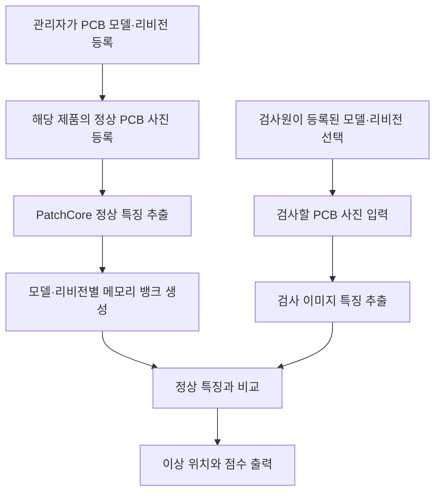
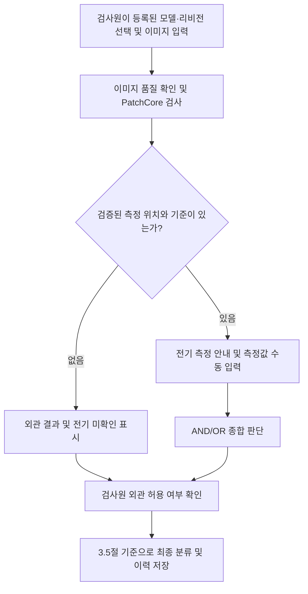
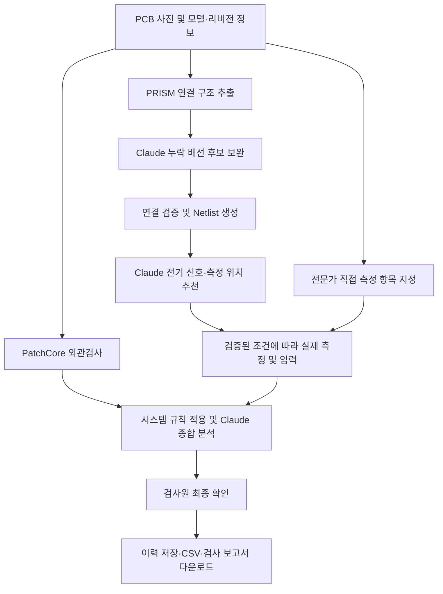
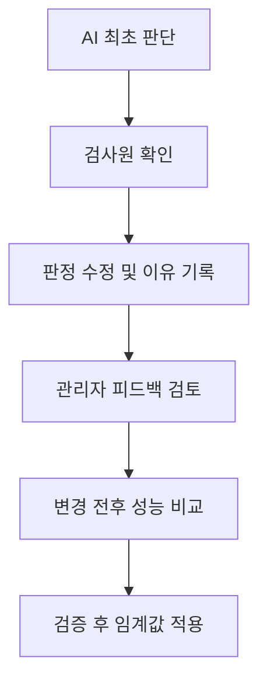

# PCB AI 외관·전기적 검사 통합 진단 시스템 — 상위 기획안 v1.1

작성일: 2026-11-15 | 수정일: 2026-11-18 | 상태: 상위 기획 인터뷰 Q1~Q13 완료 | Claude·PRISM 연계 전기검사 확장 반영

> 이 문서는 PCB 회로나 인공지능을 처음 접하는 사람도 프로젝트의 목적과 사용 방법을 이해할 수 있도록 작성한 상위 기획안이다. 어떤 기능을 만들어야 하는지를 정하며, 구체적인 프로그래밍 방법이나 시스템 구성은 다음 단계의 하위 기획에서 결정한다.

## 0. 이 프로젝트는 무엇을 만드는 것인가?

컴퓨터, 스마트폰, 자동차 등의 전자제품을 분해하면 여러 부품이 붙어 있는 판을 볼 수 있다. 그 판을 **PCB(인쇄회로기판)** 라고 한다. PCB 위의 배선은 전기가 지나가는 길이고, 부품은 전기를 조절하거나 신호를 처리하는 역할을 한다.

제품을 만드는 과정에서 배선이 끊어지거나 부품이 빠지거나 납땜에 문제가 발생할 수 있다. 이런 문제가 있는 PCB를 찾아내는 일이 품질검사이다.

본 프로젝트에서는 PCB 사진을 웹에 입력하면 AI가 정상 제품과 다른 부분을 찾아 표시한다. 검증된 측정 방법을 확보한 제품은 실제 전기적 검사 결과도 입력하여 함께 판단한다. 확장 단계에서는 PRISM과 Claude를 연계해 회로 연결 정보를 보완하고 Netlist를 생성하며, Claude가 추천한 측정 위치에서 얻은 실측 결과를 분석한다. 회로 전문가는 AI 추천과 별개로 자신의 경험을 활용해 직접 측정하고 기록할 수 있다.

예를 들어 PCB에서 검은 흠집이 발견되었다고 하자. 사진만 보면 고장처럼 보이지만 실제 전기는 정상적으로 흐를 수도 있다. 반대로 겉으로 깨끗한 PCB도 내부에 전기적 문제가 있을 수 있다. 따라서 외관검사와 전기적 검사는 서로 다른 정보를 제공한다.

| 질문 | 시스템이 보여주는 정보 |
|---|---|
| 어디가 이상해 보이는가? | PCB 사진 위 이상 의심 위치와 AI 점수 |
| 실제로 전기적 문제가 있는가? | 측정 위치, 정상 범위, 실제 측정값 및 비교 결과 |
| 두 결과를 합치면 무엇을 알 수 있는가? | 외관·전기적 이상 여부의 조합과 종합 판단 근거 |
| AI가 틀렸다면 어떻게 하는가? | 검사원의 판정 수정과 수정 사유, 관리자의 성능 개선 기능 |

쉽게 말해, **사진만 보고 무조건 불량이라고 결정하는 프로그램이 아니라, 발견된 이상과 실제 검사 정보를 함께 보여주고 사람이 확인할 수 있는 웹 검사 시스템**을 만들고자 한다.

### 문서를 읽기 위한 기본 용어

| 용어 | 쉬운 설명 |
|---|---|
| PCB 모델명 | PCB 제품의 종류를 구분하는 이름. 예: PCB_A |
| 리비전(Revision) | 같은 제품이라도 설계나 부품이 변경된 버전. 예: REV 1.0과 REV 2.0 |
| 회로도 | 어떤 부품들이 전기적으로 연결되어 있는지 설명하는 설계도 |
| 외관검사 | 사진에서 보이는 손상, 누락, 비정상적인 형태 등을 검사하는 것 |
| 전기적 검사 | 실제 측정 장비로 전압, 저항, 연결 상태 등을 확인하는 것 |
| PRISM | PCB 이미지에서 확인 가능한 부품·배선 연결 관계를 추출하는 데 활용할 회로 복원 기술 |
| Netlist | 어떤 부품의 어느 핀이 서로 연결되어 있는지 기록한 전기적 연결 목록 |
| Claude | 불확실한 배선 연결 후보를 제안하고, 회로 정보를 바탕으로 전기적 측정 항목을 추천하며 검사 결과를 정리하는 AI 보조 도구 |
| 이상탐지 | 정상적인 형태를 기준으로 평소와 다른 부분을 발견하는 AI 기술 |
| PatchCore | 정상 이미지의 작은 영역별 특징을 모아 두었다가 검사 이미지의 특징과 비교하는 이상탐지 AI |
| 메모리 뱅크(Bank) | PatchCore가 비교에 사용하는 정상 이미지 특징들의 모음. 사진 파일 그 자체와는 다름 |
| 이상 점수 | 정상 데이터의 특징과 얼마나 다른지 나타내는 값. 불량 확률과 동일하지 않음 |
| 임계값 | 이상 점수가 어느 수준을 넘으면 이상으로 분류할지 정하는 기준 |
| MVP | 최소한의 핵심 기능으로 먼저 작동하는 초기 제품. 이후 기능을 추가하여 발전시킴 |

이 문서에서는 **PCB 모델**을 검사할 제품의 종류라는 의미로, **AI 모델**을 PatchCore나 EfficientAD 같은 분석 알고리즘이라는 의미로 구분하여 사용한다.

## 1. 프로젝트 개요

운영 안정성을 최우선으로 하는 PCB 품질검사 시스템을 구축한다. 정상 PCB 이미지에서 얻은 특징을 이용하여 외관 이상을 검출하고, 검증된 전기적 검사 정보가 확보된 PCB에 대해서는 실제 측정값을 함께 분석한다. 각 검사 결과와 종합 판단 근거를 웹에서 시각화하며, 검사원 피드백과 검사 이력을 장기 보관하여 지속적인 품질 개선을 지원한다.

초기 환경은 산업용 카메라와 자동 측정 설비가 없는 상황을 전제로 한다. 스마트폰으로 고정된 PCB를 촬영하거나 웹캠으로 수동 캡처할 수 있도록 구성한다. 컨베이어 및 자동 검사, 정밀 촬영, 회로 복원, 측정 장비 연동은 확장 단계에서 추진한다.

현 단계에서는 사람의 작업을 전부 기계로 대체하는 것이 목표가 아니다. 먼저 검사원이 직접 촬영하고 검사 버튼을 누르더라도, AI 분석부터 결과 확인, 수정, 기록 보관까지 끊김 없이 사용할 수 있는 기본 시스템을 만드는 것이 목표다. 실제 산업용 설비가 확보되면 수동으로 수행하는 부분을 단계적으로 자동화한다.

## 2. 핵심 개발 목표

1. **운영 안정성:** 검사 과정의 오류, 중단, 결과 유실을 예방하고 문제가 발생해도 검사 이력을 보존하는 시스템을 구축한다. 불완전한 검사 결과를 정상으로 처리하지 않는다.
2. **외관검사:** PatchCore로 정상 PCB와 다른 시각적 특징을 검출하고 위치와 점수를 제공한다. 정상 이미지 중심으로 검사 기준을 구축할 수 있게 한다.
3. **전기적 검사:** 검증된 측정 위치·기준값이 확보된 제품의 수동 측정값을 입력받아 정상 범위와 비교한다. 전문가는 회로도 보유 여부와 별개로 검증 가능한 측정 위치·방법·기준을 직접 등록하고 검사할 수 있도록 한다. 확장 단계에서는 PRISM의 연결 구조를 Claude로 보완하고 검증된 Netlist를 토대로 측정 위치와 전기적 신호를 추천받는 기능을 추가한다.
4. **종합 진단:** 영상 및 전기적 이상 여부를 AND/OR로 구분하여 서로 다른 검사 결과와 근거를 제공한다. 회로상 인과관계가 검증되지 않은 경우 동일 고장이나 원인을 확정하지 않는다.
5. **지속 개선:** 검사원 판정과 수정 사유를 보관하고, 관리자가 검출률과 오경보율을 평가하며 임계값을 보정할 수 있도록 한다.
6. **확장성:** 초기에는 PatchCore를 사용하되, 향후 EfficientAD 등 이상탐지 모델을 독립적으로 추가·교체할 수 있어야 한다. 전기적 데이터 수집, PRISM, 자동 검사 등도 공통 검사 기능을 유지하며 확장할 수 있도록 한다. Claude 연계 기능은 배선 복원 보조, Netlist 기반 측정 추천, 외관·전기검사 결과의 종합 해석 및 CSV·보고서 출력으로 확장한다.

### 목표를 실제 상황으로 이해하기

예를 들어 검사원 A가 오전에 PCB 100장을 검사한다고 가정하자. 30번째 제품에서 AI 분석 도중 오류가 발생하더라도 앞서 검사한 29장의 정보는 사라지면 안 된다. 또한 문제가 발생한 제품을 정상으로 기록해서도 안 된다. 이것이 운영 안정성을 최우선으로 하는 이유이다.

이후 더 빠르거나 정확한 이상탐지 모델을 도입하더라도 검사원이 사용하는 제품 등록, 이미지 입력, 검사 결과 확인, 이력 조회 기능은 그대로 유지할 수 있어야 한다. 모델 하나가 바뀔 때마다 웹 전체를 새로 만드는 구조는 피한다. 어떤 구조와 기술을 사용해 이를 구현할지는 하위 기획에서 결정한다.

## 3. 핵심 기술 및 운영 시나리오

### 3.1 PCB 모델 등록과 정상 데이터 구축

관리자가 PCB 모델명과 리비전을 등록하고 정상 이미지를 추가한다. 정상 이미지의 품질을 확인하여 해당 모델·리비전의 전체 검사 전용 PatchCore 메모리 뱅크를 생성한다. 이후 정상 이미지를 추가하고 Bank를 재생성할 수 있다. 기존 검사 이력 및 당시 적용한 Bank와 임계값의 정보는 유지한다.

회로도가 있으면 선택적으로 첨부한다. 실제 측정이 가능한 지점, 측정 기준점 또는 지점 쌍, 측정 종류·단위·조건과 정상 허용 범위는 전문가가 검증한 후 등록한다. 전문가가 회로도 없이도 기존 경험, 정상 PCB 실측 또는 제조사 자료 등을 통해 해당 제품의 측정 방법과 기준을 검증할 수 있다면 직접 등록할 수 있다. 기준 PCB 사진에 위치 표시를 추가하여 검사원에게 안내한다. 이미지에서 점을 찍는 행위는 측정 위치 등록이며, 실제 전기 측정 자체가 아니다.

**왜 검사 전에 정상 PCB를 등록해야 할까?**

사람도 원래 제품의 모습을 알아야 무엇이 잘못되었는지 판단할 수 있다. PatchCore도 마찬가지다. 정상 제품 사진을 여러 장 등록하면 사진에 나타난 작은 영역들의 특징을 숫자로 표현하여 메모리 뱅크에 저장한다. 이후 새로운 사진의 특징과 정상 특징을 비교해 차이가 큰 곳을 찾는다.

PCB 제품마다 부품 배치와 배선 모양이 다르므로 PCB_A의 정상 특징으로 PCB_B를 검사하면 올바른 제품도 이상으로 판단할 수 있다. 같은 모델이라도 리비전이 달라지면 제조 설계가 변경되어 동일한 문제가 발생할 수 있다. 따라서 모델과 리비전별로 정상 기준을 분리한다.

예를 들어 관리 페이지에 다음처럼 등록되어 있다면 검사원은 대상 제품에 맞는 항목을 선택한다.

| 제품명 | 리비전 | 사용할 정상 기준 |
|---|---|---|
| PCB_A | 1.0 | A-REV1 전체 검사 Bank |
| PCB_A | 2.0 | A-REV2 전체 검사 Bank |
| PCB_B | 1.0 | B-REV1 전체 검사 Bank |

새로운 종류인 PCB_C를 검사하려면 먼저 관리자가 PCB_C의 모델명과 리비전을 직접 등록한다. 이어서 PCB_C의 정상 이미지를 등록하고 해당 제품의 메모리 뱅크를 생성한다. 준비가 끝나면 검사원은 등록 목록에서 PCB_C와 해당 리비전을 선택하고 검사할 사진을 입력한다. 시스템은 검사원이 선택한 항목에 연결된 메모리 뱅크로 외관 이상을 검사한다. 등록할 정상 이미지의 수량과 실제 모델 설정값은 아직 확정하지 않는다.

### 3.2 실제 PCB 검사

1. 검사원이 등록 목록에서 검사할 PCB의 모델과 리비전을 직접 선택한다. 목록에 제품이 없으면 관리자가 모델·리비전과 정상 이미지를 등록하고 메모리 뱅크를 생성한 후 검사를 진행한다.
2. 스마트폰으로 고정된 PCB를 촬영하여 전체 이미지 한 장을 업로드하거나 웹캠 영상에서 직접 캡처한다.
3. 이미지의 흐림, 밝기·반사, PCB 전체 포함 여부를 검사한다. 품질이 적합하지 않으면 재촬영을 안내한다.
4. 모델·리비전에 해당하는 메모리 뱅크로 PatchCore 전체 검사를 수행한다.
5. 원본 이미지와 이상 위치, 이상 점수, 적용 임계값 및 외관 판단을 웹에 표시한다.
6. 검증된 측정 기준이 존재하는 제품은 외관검사 결과에 관계없이 사전 등록된 전기적 측정 항목을 검사한다. 검사원이 실제 장비로 측정한 값을 수동으로 입력하면 시스템이 정상 범위와 비교한다. 전문가는 필요한 측정 항목을 직접 추가할 수 있으며, 이후 확장 단계에서는 검증된 Netlist를 활용한 Claude 추천 검사 경로도 제공한다.
7. 두 검사 결과가 확보되면 AND/OR 종합 판단을 제공한다. 전기적 검사가 불가능하거나 미완료된 경우 외관검사 결과를 제공하고 전기적 여부는 확인되지 않았음을 표시한다.
8. 검사원이 결과를 직접 검토하고 필요할 경우 최종 판정과 수정 사유를 입력한다. 최초 AI 판단은 덮어쓰지 않는다.
9. 모든 검사 정보 및 판정 근거를 이력에 저장하고, 통계와 관리자 성능 평가에 활용한다.

**스마트폰과 웹캠을 사용하는 상황은 어떻게 다를까?**

| 구분 | 스마트폰 검사 | 웹캠 검사 |
|---|---|---|
| 이용 상황 | 고정된 검사대에서 PCB 한 장 촬영 | 카메라가 연결된 검사 환경에서 영상 확인 |
| MVP에서 검사 시작 | 사진을 업로드하고 직접 검사 | 웹캠 화면에서 직접 캡처하고 검사 |
| AI 분석 | 동일한 PatchCore 검사 기능 사용 | 동일한 PatchCore 검사 기능 사용 |
| 이후 확장 | 필요 시 정밀 촬영 | 컨베이어 위 PCB 자동 검출과 연속 검사 |

촬영 장비는 다르지만 최종적으로 AI에 검사할 이미지 한 장을 전달한다는 점은 같다. 사진이 흐리거나 빛이 강하게 반사되거나 PCB의 일부가 잘려 있다면 제품 자체가 정상이어도 이상으로 보일 수 있다. 따라서 이미지의 검사 적합성을 먼저 확인한다.

**전기적 측정값은 어디에서 얻는가?**

검증된 측정 정보가 있는 경우 다음과 같이 사용한다. 회로도는 근거 중 하나이며, 전문가가 다른 신뢰 가능한 자료와 정상 PCB 실측 등을 통해 기준을 검증한 경우에는 회로도가 없어도 수동 검사할 수 있다.

1. 전문가가 실제 PCB의 측정할 위치와 조건을 결정한다.
2. 관리자가 기준 PCB 사진 위에 해당 위치를 점으로 표시하고 위치 이름, 정상 범위와 측정 방법을 등록한다. 예를 들어 TP1은 전압 측정 위치, TP2는 다른 전압 측정 위치라는 식이다.
3. 검사원은 웹 화면의 표시를 참고하여 실제 PCB의 금속 측정 단자에 장비를 접촉하고, 정해진 조건에 따라 측정한다.
4. 측정 장비에 표시된 값을 웹에 수동 입력한다. 시스템이 정상 허용 범위에 포함되는지 계산한다.

| 측정 위치 | 정상 허용 범위 | 실제 입력값 | 시스템 판단 |
|---|---:|---:|---|
| TP1 | 4.75~5.25V | 5.01V | 정상 범위 |
| TP2 | 3.14~3.47V | 0.20V | 전기적 이상 의심 |

위 표는 원리를 설명하기 위해 만든 가상 데이터이다. 사진 위에 점을 찍는다고 전기가 측정되는 것은 아니다. 사진은 측정 위치를 안내하는 지도이며, 실제 전기적 수치는 별도의 측정 장비에서 얻는다. 회로도만 있다고 자동으로 정상 전압이나 측정 방법이 결정되는 것도 아니다. 실제 측정 방법과 안전 조건은 전문가 검증 및 하위 기획이 필요하다. 장비 확보 전에는 가상 데이터로 UI와 비교 로직을 시험할 수 있지만, 가상 결과를 실측 결과처럼 표시하지 않는다.

### 3.3 검사 분기

검증된 측정 기준이 없는 PCB는 MVP에서 외관검사만 수행하며 전기적 상태는 미확인으로 표시한다. 회로 전문가가 신뢰 가능한 근거를 바탕으로 기준을 직접 마련한 경우에는 수동 전기검사도 가능하다. 향후 동일한 모델·리비전의 정상 PCB 실측 데이터 및 PRISM·Claude 기반 연결 복원으로 전기적 검사 적용 범위를 넓힌다(3.6절). 사진이나 Netlist만으로 실제 전기적 상태를 확정하거나 실측값을 생성하지 않는다.

### 3.4 종합 판단 기준

A는 PatchCore가 외관에서 평소와 다른 부분을 발견했는지, B는 필요한 전기검사에서 문제가 발견되었는지를 뜻한다. 외관의 ‘이상’에는 허용 가능한 흠집이나 색상 차이도 포함될 수 있다. OR(A,B)은 하나라도 이상인 제품을 확인 대상으로 확보하며, AND(A,B)은 두 검사 모두 이상인 경우를 구분한다.

| A: 외관검사 | B: 전기검사 | 논리 | 종합 해석 |
|---|---|---|---|
| 이상 | 이상 | AND 참 / OR 참 | 불량. 외관 변화와 전기적 문제가 함께 발견됨 |
| 이상 | 정상 | AND 거짓 / OR 참 | 흠집·색상 차이가 허용되는 정도이면 정상. 외관 불량 기준에 해당하면 불량. 아직 판단하기 어려우면 검사원이 추가 확인 |
| 정상 | 이상 | AND 거짓 / OR 참 | 불량. 겉모습은 괜찮지만 전기검사에서 문제가 발견됨 |
| 정상 | 정상 | AND 거짓 / OR 거짓 | 정상. 외관검사와 필요한 전기검사를 모두 통과함 |

전기적 검사가 미수행·미완료된 경우 이 표의 전기적 정상으로 간주하지 않는다. AND/OR 결과는 두 검사에서 이상이 발견되었는지를 보여주는 정보이다. 최종 분류에는 아래 3.5절의 외관 허용 기준과 전기검사 통과 여부를 적용하며, 결함의 원인 관계는 확보된 근거에 따라 검토한다. 외관이 정상인 경우에도 전기 검사 기준이 있다면 지정된 측정 항목을 검사하여 눈에 보이지 않는 결함을 확인한다.

**AND와 OR를 쉽게 이해하기**

- OR(또는): 두 검사 중 **하나라도** 이상이면 추가 확인이 필요한 대상으로 분류한다.
- AND(그리고): **두 검사 모두** 이상이면 외관과 전기 양쪽에서 이상 증거가 발견된 경우로 구분한다.

특히 외관검사가 정상인 경우에도 전기적 검사를 생략하지 않는 이유는, 두 번째 검사에서만 드러나는 고장이 있을 수 있기 때문이다. 외관 이상 영역과 전기적 측정 위치가 가깝다는 사실만으로 두 지점이 연결되어 있다고 판단하지 않으며, 검증된 Netlist를 이용한 관련 회로 추적과 Claude의 측정 추천은 추후 확장 기능이다.

### 3.5 흠집이 있어도 정상으로 처리할 수 있는 경우

**흠집이나 색상 차이가 있어도, 제품에서 허용하는 정도이고 필요한 전기검사를 모두 통과했다면 정상으로 처리한다.**

PCB_C를 등록할 때 품질 담당자는 사진과 설명으로 “이 정도 흠집은 괜찮다”, “이런 손상은 불량이다”라는 기준을 함께 등록한다. 어느 위치의 흠집인지, 얼마나 크고 깊은지 등 제품에 필요한 확인 사항을 정한다. 검사원은 이 기준을 보면서 실제 제품을 확인한다.

검사는 다음 순서로 진행한다.

1. PatchCore가 평소와 다른 부분을 사진에 표시한다.
2. 검사원이 표시된 부분을 확대해서 보고 흠집인지, 색상 차이인지, 그 밖의 변화인지 기록한다. 사진으로 알아보기 어려우면 추가 확인이 필요하다고 기록한다.
3. 검사원이 등록된 기준을 보고 해당 흠집이나 색상 차이를 허용할 수 있는지 확인한다.
4. 정해진 위치를 실제 장비로 측정하고 값을 입력한다. 필요한 측정을 모두 마쳤고 값이 각각 정상 범위 안에 있으면 전기검사 통과로 기록한다.
5. 시스템이 3.4절의 네 가지 검사 조합 표에 따라 결과와 이유를 표시한다.

예를 들어 전기 측정을 세 곳에서 해야 하는데 두 곳만 측정했다면, 나머지 한 곳의 결과가 나올 때까지 기다린다. 외관의 흠집도 아직 확인 중이라면 화면에 “흠집 추가 확인”과 “전기 측정 필요”를 함께 표시한다. 이미 외관이나 전기검사에서 불량이 확인되었다면 불량으로 표시한다.

검증된 측정 기준이 없어 전기검사를 할 수 있는 준비가 되지 않은 제품은 외관검사 결과를 제공하고, “전기검사 미수행 — 최종 판정 보류”라고 표시한다.

**정상으로 처리한 제품의 흠집도 기록에 남긴다.** 흠집 위치와 AI 점수, 검사원이 확인한 내용, 적용한 제품 기준, 실제 전기 측정값을 함께 보관한다. 예를 들어 화면에는 다음처럼 표시한다.

> **최종 결과 — 정상**  
> 작은 흠집이 있지만 PCB_C의 제품 기준에서 허용하는 정도입니다.  
> 필요한 전기검사를 모두 마쳤고 측정값도 모두 정상 범위입니다.

### 3.6 Claude·PRISM 연계 전기적 검사 및 종합 진단 (확장 단계)

기존 수동 검사 플랫폼을 기반으로, 회로도가 없거나 배선 정보가 불완전한 PCB에 대해서도 전기적 검사를 준비할 수 있도록 한다. 핵심은 **PRISM으로 확인 가능한 연결 구조를 추출하고, Claude가 누락된 배선의 연결 후보를 보조적으로 제안한 뒤, 검증된 Netlist를 이용하여 실제 측정할 지점과 신호를 추천하는 것**이다. Claude가 추천한 경로와 회로 전문가의 수동 검사 경로를 모두 지원한다.

#### 3.6.1 PRISM 연결 추출 및 Claude 배선 복원 보조

1. PCB 모델·리비전에 해당하는 기준 사진을 등록하고, 확보 가능한 경우 앞면·뒷면 이미지, 기존 회로도, 부품 정보 등을 함께 제공한다.
2. PRISM을 이용하여 이미지에서 식별 가능한 부품, 핀, 배선 및 연결 관계를 추출한다. 실제 추출·연동 가능 범위는 도입 실험에서 검증한다.
3. 끊겨 보이는 배선, 가려진 연결, 불명확한 핀 연결을 Claude에 전달한다. Claude는 주변 배선 구조, 부품 정보, 기존 설계 자료 등을 이용해 가능한 연결 후보, 보완 이유, 추가 확인이 필요한 부분을 제안한다.
4. 사용자는 원본 추출 결과와 Claude의 추가 제안을 서로 다른 색상 등으로 구분하여 확인한다. 확인된 연결, 추정 연결, 미확인 연결을 구분하며, 근거가 충분한 경우에만 승인한다. 전문가 확인이나 별도의 도통검사 등으로 검증하지 못한 연결은 미확인 상태로 유지한다.
5. 검증된 연결 관계를 기반으로 Netlist를 생성하거나 내보낸다. 추정 연결이 포함된 경우에는 별도 후보 데이터로 구분하고 검증 완료 Netlist와 혼동하지 않도록 한다. 원본 데이터, 보완 내용, 확인 근거 및 Netlist 버전을 보관한다.

이미 검증된 회로도나 Netlist가 있는 제품은 PRISM 복원 과정을 생략하고 해당 설계 정보를 바로 등록하여 사용할 수 있다.

예를 들어 PRISM이 저항 R1의 한쪽 핀과 콘덴서 C1 사이의 일부 배선을 찾았지만 중간 연결을 확인하지 못했다면, Claude는 두 지점이 연결될 가능성을 제안할 수 있다. 다만 그 제안은 실제 단선 결함이나 내부 배선을 임의로 복원해 정상이라고 단정하는 근거가 아니다. **기준 회로의 연결 복원과 개별 검사 대상의 실제 결함 여부는 별도로 관리한다.**

#### 3.6.2 Netlist 기반 Claude 추천 검사 (AI 보조 모드)

Claude에 검증된 Netlist, 부품 정보, 제조사 자료, 정상 PCB 측정 기준, PatchCore 이상 위치 및 기존 검사 결과를 제공한다. Claude는 확인할 가치가 높은 회로와 다음 측정 항목을 추천한다. 회로의 물리적 측정점과 Netlist의 핀·Net 정보를 대응시켜 검사 화면의 PCB 사진 위에 표시한다.

| 추천 항목 | 표시할 내용 |
|---|---|
| 검사 위치 | 부품·핀·테스트 포인트, 기준점 또는 측정 지점 쌍 |
| 전기적 신호 또는 측정량 | 전압, 도통 여부, 저항, 필요 시 전류·파형 등 |
| 검사 조건 | 전원 상태, 필요한 장비, 측정 방식 및 안전 조건 |
| 추천 이유 | 의심되는 회로와 관련 Net, 해당 측정을 우선하는 근거 |
| 비교 기준 | 검증된 정상 범위와 그 출처. 근거가 없으면 기준 미확인 표시 |
| 검사 우선순위 | 필수, 추가 확인, 보류 등으로 구분 |

검사원이 추천 항목을 확인한 후 검증된 측정 절차에 따라 실제 장비로 측정하고 값을 입력한다. 입력된 결과에 따라 Claude가 후속 측정을 추천할 수 있다. 추천에 필요한 회로 정보나 안전 조건이 부족하면 검사를 보류하고 추가 자료 또는 전문가 확인을 요청한다.

전압·전류의 정상값은 Netlist만으로 결정할 수 없다. 부품의 특성, 전원, 동작 모드, 회로 설계 및 정상 제품의 실측 근거가 필요하며, Claude가 예상한 수치를 검증된 정상 기준이나 실제 측정값으로 취급하지 않는다. 전원 인가 상태에서의 측정이나 전류·저항·도통검사는 각각 적절한 안전 조건과 배선 방법의 확인이 선행되어야 한다.

#### 3.6.3 회로 전문가 직접 검사 (수동 모드)

회로 전문가가 있는 경우, Claude 또는 PRISM의 결과를 기다리거나 추천을 따를 필요 없이 자신의 경험과 설계 자료를 활용하여 검사할 수 있다.

- PCB 사진에서 원하는 측정 위치 또는 지점 쌍 직접 지정.
- 검사 대상 부품·핀·신호, 전압·저항·도통 등 검사 항목, 장비, 측정 조건 및 정상 허용 범위 직접 등록.
- 실제 측정값과 검사 의견 입력 및 결과 확인.
- Claude가 제안한 측정 항목의 수정·추가·제외. 변경 사유와 실제 측정 내역은 별도 기록.
- 검증된 수동 검사 절차를 동일 모델·리비전의 다음 검사에 재사용할 수 있도록 관리.

전문가가 직접 측정한 결과도 AI 추천 모드에서 얻은 결과와 동일한 검사 이력에 저장한다. 측정 항목별로 **Claude 추천 / 전문가 지정 / 기존 등록 기준** 중 어느 경로로 생성되었는지 구분한다. 두 모드는 한 검사 내에서 함께 사용할 수 있다. 정상 기준을 확인할 수 없는 측정값은 참고 정보로 보존하며 정상·불량을 자동 확정하지 않는다.

#### 3.6.4 Claude 종합 분석 및 파일 다운로드

시스템에서 적용된 외관 임계값, 전기검사 비교 기준 및 AND/OR 규칙에 따른 결과를 먼저 산출한다. Claude는 PatchCore의 외관 이상 정보, 검증된 Netlist, AI 추천 검사와 전문가 수동 검사의 실측 결과, 검사 기준 및 검사원 의견을 종합하여 이해하기 쉬운 진단 요약을 작성한다.

| 분석 결과 | 제공 내용 |
|---|---|
| 외관 진단 요약 | 의심 위치, 이상 점수, 임계값, 외관 허용 여부 |
| 전기 진단 요약 | 측정 항목, 실제값, 정상 범위, 미측정·기준 미확인 여부 |
| 종합 해석 | 외관·전기적 이상 조합, 관련 회로 및 가능한 원인 후보, 근거 및 판단 한계 |
| 후속 조치 | 추가 측정·재검사·전문가 확인이 필요한 부분 |
| 최종 판정 | 시스템 규칙에 따른 분류, Claude의 의견, 검사원이 확정한 판정을 구분 |

검사원은 결과를 확인한 후 웹에서 다음과 같은 파일을 다운로드할 수 있다. CSV의 실측 수치와 판정 원본은 저장된 검사 데이터를 기반으로 시스템이 생성하고, Claude의 요약 및 근거는 별도 항목으로 포함한다. 보고서에서도 실측과 추정, 가상 데이터, AI 의견을 구분한다.

| 다운로드 파일 | 주요 내용 |
|---|---|
| inspection_summary.csv | 검사 ID, 모델·리비전, 일시, 외관 점수, 전기검사 상태, 규칙 판정, Claude 요약, 최종 판정 |
| electrical_measurements.csv | 검사 ID, 측정 ID, 측정 위치·기준점, 항목, 실측값·단위, 정상 범위, 결과, 추천/수동 구분 |
| netlist.json 또는 지원 Netlist 파일 | 승인된 연결 관계, Netlist 버전 및 검증 정보(미확인 후보는 별도 구분) |
| 종합 검사 보고서(Markdown 또는 PDF) | 외관 이미지와 이상 위치, 전기검사 결과, Claude 분석 근거, 검사원 의견 및 최종 결과 |

개별 검사 결과뿐 아니라 기간·모델·리비전별로 선택한 검사 이력을 묶어 내보낼 수 있게 한다. 웹 다운로드 버튼뿐 아니라 연동된 Claude에서 “오늘 검사한 PCB_A의 외관과 전기검사 결과를 종합하고 CSV로 만들어 줘”처럼 요청할 경우, 권한 범위 내 검사 이력을 조회하고 파일을 생성하여 다운로드할 수 있도록 한다. 원본 사진, Netlist, 실측값, Claude 분석 및 다운로드 파일은 검사 ID를 통해 추적 가능해야 한다. 실제 Claude 연동 방식(API 또는 권한이 부여된 MCP 도구), 보고서 형식, 데이터 외부 전송 여부 및 접근 제어는 하위 기획에서 결정한다. 기업의 회로 이미지와 Netlist는 기밀 정보로 취급하며 허가 없이 외부 AI 서비스에 전송하지 않는다.

#### 3.6.5 검사 상황 예시

PCB_A REV 1.0의 전원 회로 주변에서 PatchCore가 이상을 표시했다고 가정한다. PRISM으로 확인된 연결 구조를 Claude가 보조적으로 보완하고 검증된 Netlist를 만든 뒤, Claude는 특정 전원 Net과 연결된 테스트 포인트를 우선 확인할 후보로 제안한다. 전문가는 추천된 항목을 검토하거나 경험에 따라 다른 측정 지점을 추가한다. 검사원이 안전 조건을 확인하고 실제 측정값을 입력하면 시스템이 검증된 기준과 비교하며, Claude는 외관 이상과 전기적 이상이 관련되어 있을 가능성 및 추가 확인 사항을 설명한다. 검사원이 최종 확인한 결과는 CSV와 종합 보고서로 다운로드할 수 있다. 추천과 판정이 불확실하면 그 상태를 그대로 기록한다.

## 4. MVP 기능 명세

MVP는 프로젝트가 처음 완성되었을 때 실제 사용할 수 있어야 하는 최소 기능을 뜻한다. 아래 표는 구현해야 할 기능을 빠짐없이 확인하기 위한 목록이다. F01~F16은 기능을 서로 구분하기 위한 번호이며 개발 순서를 의미하지는 않는다.

| ID | 기능 | MVP 범위 |
|---|---|---|
| F01 | PCB 모델 관리 | 모델명·리비전 등록 및 선택, 기준 이미지 등록, 회로도 선택 첨부, 외관 허용 기준과 허용·불량 사례 등록 |
| F02 | 정상 데이터 관리 | 정상 이미지 등록·추가, 품질 확인 |
| F03 | Bank 관리 | 모델·리비전별 전체 검사 전용 Bank 생성·재생성, 독립 관리, 버전 식별 |
| F04 | 수동 이미지 입력 | 스마트폰 사진 업로드, 웹캠 미리보기 및 수동 캡처, 전체 이미지 단일 검사 |
| F05 | 이미지 품질 관리 | 흐림, 밝기·과다 반사, 전체 PCB 포함 여부 확인 및 재촬영 안내 |
| F06 | 이상탐지 | PatchCore 전체 검사, 이상 영역 및 점수, 모델별 임계값 적용 |
| F07 | 모델 확장 가능성 | 공통 검사 기능 유지, 다른 이상탐지 모델의 추가·교체가 가능한 구조적 요구사항 |
| F08 | 전기적 검사 기준 | 전문가가 검증한 측정 위치·기준점·항목·조건·정상 허용 범위 등록. 회로도는 선택 첨부 |
| F09 | 수동 전기적 검사 | 등록된 측정 지점 안내, 전문가의 직접 측정 위치 지정 및 항목 추가, 실제 측정값 입력, 정상 범위 비교, 미측정·기준 미확인 구분 |
| F10 | 종합 판단 | AND/OR 결과 표시, 외관 허용 여부와 필수 전기검사 결과를 조합하여 정상·불량·검토 필요·판정 보류 분류 |
| F11 | 결과 시각화 | 외관검사·전기적 검사·종합 판단의 3영역 웹 UI, 각각의 근거 표시 |
| F12 | 검사원 피드백 | 외관 변화 유형·허용 여부 확인, 최종 판정 수정 및 사유 필수 작성, AI 최초 판단과 수정 결과 별도 보관 |
| F13 | 검사 이력 | 장기·지속 보관, 기간·모델·리비전·판정별 검색 및 상세 조회, CSV·Excel 내보내기 |
| F14 | 사용자 대시보드 | 검사 수, 정상·불량 건수, 모델별·기간별 통계, 최근 이력 |
| F15 | 관리자 성능 관리 | 모델별 검출률·오경보율, 피드백 조회, 변경 후보 임계값의 전후 성능 비교 |
| F16 | 임계값 관리 | 관리자 수동 보정, 변경 이력 관리, 보정값은 이후 검사에 적용 |

### 4.1 Claude·PRISM 연계 확장 기능 명세

다음 기능은 MVP의 안정적인 전체 검사 및 수동 측정 기반을 유지한 채 별도 확장 단계에서 구현한다.

| ID | 기능 | 확장 범위 |
|---|---|---|
| E01 | PRISM 회로 구조 추출 | PCB 기준 이미지 기반 부품·핀·배선 연결 후보 추출 및 결과 표시 |
| E02 | Claude 배선 보완 보조 | 인식되지 않은 배선·연결 후보 제안, 제안 근거 및 미확인 영역 표시, 사용자 검토·수정·승인 |
| E03 | Netlist 관리 | 검증된 연결 관계 기반 Netlist 생성·조회·저장·다운로드, 모델·리비전·버전 관리 및 추정 연결 분리 |
| E04 | Claude 전기검사 추천 | 검증된 Netlist 및 등록된 검사 정보를 이용한 측정 위치·신호·조건·우선순위·근거 추천, 실측 결과에 따른 후속 검사 제안 |
| E05 | 전문가 수동 검사 확장 | AI 추천 항목의 수정·제외·추가, 자체 측정 항목 생성, 측정 절차 재사용 및 검사 경로 이력 관리 |
| E06 | Claude 종합 분석 | 외관·전기 실측·검사 기준·Netlist·전문가 내용을 종합하여 근거, 원인 후보, 추가 검사 및 미확인 사항 정리 |
| E07 | 종합 결과 파일 출력 | 개별·기간별 검사 요약 CSV, 측정 상세 CSV, Netlist 및 종합 검사 보고서 다운로드 |
| E08 | Claude 연동 및 권한 | 승인된 데이터 조회·추천·분석·파일 생성 기능 연동, 기밀 데이터 보호 및 감사 기록 |

## 5. 사용자 화면과 권한

### 5.1 일반 사용자

- 검사 화면: 모델·리비전 선택, 스마트폰 이미지 업로드 또는 웹캠 수동 캡처, 재촬영 안내, 검사 시작.
- 검사 결과: ① PatchCore 원본·이상 영역·점수·임계값 ② 측정 위치·정상 기준·실측값·전기적 판단(가능한 경우) ③ 종합 판단 및 AND/OR 근거. 전기적 검사 미수행은 명시한다.
- 판정 검토: 외관 변화 유형과 허용 여부 확인, 정상·불량·검토 필요·판정 보류 확인 및 수정, 수정 시 이유 필수 등록.
- 검사 이력: 과거 검사 검색, 개별 결과 상세 확인, CSV·Excel 내보내기.
- 기본 통계: 모델별·기간별 검사 건수, 정상 및 불량 건수 등의 품질 현황.

**검사 결과 화면은 어떤 모습인가?**

아래는 화면에 표시하는 정보의 예시이다. 실제 UI 레이아웃 및 디자인은 하위 기획에서 결정한다.

| ① 외관검사 결과 | ② 전기적 검사 결과 | ③ 종합 판단 결과 |
|---|---|---|
| 원본 PCB 사진 | 측정 위치: TP2 | 외관과 전기 모두 이상 |
| 이상 위치를 색으로 강조 | 정상 범위: 3.14~3.47V | AND = 참, OR = 참 |
| 이상 점수: 0.86 | 실제 값: 0.20V | 외관·전기적 이상 동시 발견 |
| 임계값: 0.50 | 전기적 이상 의심 | 종합 판단 근거 확인 |

이 예시는 가상의 점수·임계값·측정값을 사용한다. 실제로 검증된 측정 정보가 없는 제품이라면 두 번째 검사 영역에 전기적 검사를 수행하지 않았다는 사실을 보여주고, 세 번째 영역에는 외관검사의 결과와 전기적 판단의 한계를 표시한다.

검사원은 AI 판단이 잘못되었다고 생각하면 최종 판정을 수정할 수 있다. 예를 들어 AI가 정상적인 제조 패턴을 이상으로 판단했다면 검사원은 '정상'으로 수정하고 '정상적인 제조 과정에서 발생한 무늬임'이라는 이유를 작성한다.

### 5.2 관리자

일반 사용자 기능에 더해 다음을 제공한다.

- PCB 모델·리비전 및 회로도 관리.
- 정상 이미지 등록·추가 및 메모리 뱅크 생성·재생성.
- 전문가 검증을 거친 전기적 검사 위치·정상 기준 관리.
- 검사원 피드백과 판정 수정 사유 조회.
- 모델별 검출률·오경보율 등의 성능 조회 및 임계값 수동 보정.
- 동일한 검증 데이터를 이용한 임계값 변경 전후 성능 비교와 버전·변경 이력 관리.

세부 사용자 계정 및 접근 제어 구현은 하위 기획에서 확정한다.

**관리자가 임계값을 보정한다는 것은 무엇일까?**

예를 들어 AI 이상 점수가 0.50보다 높으면 이상으로 판단하도록 설정했는데, 0.55~0.65의 점수를 가진 제품 중 정상으로 확인된 사례가 반복되었다고 가정해 보자. 관리자는 해당 사례의 사진과 검사원이 작성한 이유를 검토한다. 이후 임계값을 0.60 또는 0.70으로 변경했을 때 어떤 결과가 나오는지 검증 데이터로 비교한다. 이 수치들은 설명을 위한 예시이다.

임계값을 무작정 높이는 것이 좋은 것은 아니다. 정상 제품을 불량으로 잘못 판단하는 사례는 줄어들지만 실제 불량 제품도 놓칠 수 있기 때문이다. 따라서 관리자 화면에서 오경보율과 결함 검출률을 함께 확인한 후 보정값을 적용한다. 검사원 피드백은 임계값 변경을 위한 참고 자료이지 AI 모델에 즉시 자동 반영되는 명령이 아니다.

### 5.3 회로 전문가 및 Claude 보조 검사 화면

- 전문가 수동 검사 화면: 이미지 위 측정 위치·기준점 지정, 검사 종류·정상 범위·검사 조건·실측값 입력, 검사 의견 작성 및 기존 절차 재사용.
- PRISM·Claude 배선 검토 화면(확장): 원본 추출 배선, Claude 보완 후보 및 검증 상태 구분, 연결 승인·수정 후 Netlist 저장.
- Claude 추천 검사 화면(확장): 추천 위치와 관련 신호, 추천 이유 및 측정 조건을 확인하고 검증된 추천 항목을 선택해 실측값 입력. 전문가의 수동 항목도 함께 표시.
- 종합 결과 화면(확장): 시스템 판정, Claude 분석, 전문가·검사원 최종 판정 및 추가 확인 사항을 구분하여 표시. CSV, Netlist, 종합 검사 보고서 다운로드.

일반 검사원은 검증된 측정 절차를 이용할 수 있으며, 회로 정보 및 측정 기준을 승인·변경할 권한은 검증 책임이 있는 전문가 또는 관리자에게 부여한다. 검증되지 않은 추천만으로 위험한 측정을 진행하지 않는다.

## 6. 검사 이력 보관 요구사항

검사 식별번호, 모델명·리비전, 검사 시각, 원본 이미지, 이상 위치·점수, 적용 임계값, 적용 AI 모델 및 Bank 버전, 전기적 검사 위치와 기준·실측값(있는 경우), 종합 판단, 최초 AI 판정, 검사원 최종 판정 및 수정 이유, 외관 변화 유형·허용 여부와 적용한 외관 기준을 보관한다.

Claude·PRISM 확장 단계에서는 PRISM 원본 연결 구조, Claude 보완 후보 및 검증 근거, Netlist 버전, 측정 항목 생성 경로(기존 등록·Claude 추천·전문가 지정), 추천 내용 및 수정 사유, 측정 조건·단위·실제값·기준 출처, Claude 모델·분석 버전 및 분석 근거, 최종 판정과 출력 파일 생성 정보를 함께 보관한다. 모델의 추정과 검증된 사실, 실측값은 각각 분리하여 추적할 수 있어야 한다.

모델 개선 및 임계값·Bank 변경이 이루어져도 과거 검사 결과는 당시의 판단 근거와 함께 유지한다. 시스템 재시작 이후도 조회할 수 있어야 하고, 장기 보관 및 복구 가능성을 목표로 한다. 구체적인 저장 구조와 백업·복구·보존 정책은 하위 기획에서 정한다.

예를 들어 11월 15일에 검사한 PCB에 AI가 이상 점수 0.62를 부여했고, 당시 임계값이 0.50이었다면 그때의 기록에는 두 값이 모두 남아 있어야 한다. 다음 날 임계값을 0.65로 보정하더라도 과거 검사 내역이 자동으로 정상으로 바뀌면 안 된다. 그래야 실제로 어떤 판단을 했었는지 확인하고 개선 전후의 성능을 비교할 수 있다.

## 7. 확장 기능 및 MVP 제외 범위

| 확장 항목 | 추진 방향 |
|---|---|
| EfficientAD | PatchCore와 동일한 공통 검사 기능을 사용할 수 있는 독립 모델 모듈 추가 |
| DINOv2 등 | 향후 모델·백본 비교 검토 |
| Claude 기반 종합 분석 | 외관검사 결과, AI 추천 및 전문가 수동 실측값, Netlist, 검사 기준 및 관련 이력을 입력받아 종합 해석·근거·추가 확인 사항 제공. CSV·보고서 출력 지원(3.6절) |
| 자동 검사 | 컨베이어 기반 웹캠 자동 감지, 개별 PCB 식별·추적, Best Frame 선택, 중복 방지 |
| 모델 자동 인식 | PCB 모델명 및 리비전 자동 식별 |
| 정밀검사 | 전체 검사 이상 영역 또는 사전 지정 중요 영역을 실제 확대 촬영하여 추가 등록·검사 |
| 정밀 Bank | 전체와 정밀 Bank 분리, 중요 ROI별 독립 Bank 및 검사 기준 관리. 특징 추출기 공유 가능 |
| 중요 영역 | 전문가 수동 지정 이후 회로 정보·과거 결함 이력 기반 추천 검토 |
| PRISM·Claude 배선 복원 보조 | PRISM 추출 결과의 미확인 연결 후보를 Claude가 보완 제안. 실제 검증 후 Netlist 생성 및 관리. 내부 배선과 단선 결함 복원 한계 고려(3.6절) |
| 정상 PCB 전기적 비교 | 회로도가 없어도 전문가가 선정한 측정 위치의 정상 기준 실측값과 비교하는 기능 검토 |
| 자동 측정 | 실제 측정 장비 연동 및 데이터 자동 수집 |
| 회로 분석 및 Claude 검사 추천 | 검증된 Netlist와 이상 영역·관련 Net 매핑, 측정 위치·종류·조건 추천, 전문가 수동 검사와 병행, 실측 결과 기반 추가 측정 추천 |
| 이미지 자동 보정 | 촬영 조건 자동 보정 및 최적 프레임 선별 |
| 피드백 기반 개선 | 관리자 검증 후 정상 데이터 편입, 자동 재학습·임계값 최적화 검토 |
| 성적서 및 종합 출력 | 개별·기간별 검사 요약 CSV, 측정 상세 CSV, Netlist 다운로드 및 Claude 분석이 포함된 종합 검사 보고서 작성 |

정밀 검사는 의심 영역을 잘라 확대하는 것과 별도로 실제 광학적으로 확대 촬영한 이미지에 기반하는 방향을 우선한다. 전체·ROI Bank의 물리적 저장 방법과 특징 추출·검색 및 임계값 방식은 상세 설계에서 결정한다.

**확장 기능을 처음 접하는 사람을 위한 설명**

- EfficientAD: PatchCore와 다른 방식으로 정상 이미지를 학습하고 이상을 찾는 AI 모델이다. 추후 실제 검사 성능과 속도를 비교할 수 있도록 추가할 예정이다. DINOv2는 이미지 특징을 추출하는 모델로, 이를 활용한 이상탐지도 추후 검토한다.
- PRISM: PCB 사진에서 확인 가능한 연결 관계를 추출하는 데 활용한다. 회로도가 없을 때 Claude를 통해 누락된 배선 후보를 제안받되, 사진에서 보이지 않는 내부 배선과 잘못 복원된 연결 정보는 실제 검증이 필요하다. PRISM이나 Claude가 실제 전기적 측정을 대신하는 것은 아니다.
- 자동 검사: 현재 사람이 웹캠 화면에서 직접 촬영하지만, 확장 이후에는 PCB가 카메라 앞을 지나갈 때 시스템이 자동으로 감지·촬영하여 검사한다. 여러 PCB 중 어떤 제품의 결과인지 구분하는 기능도 필요하다.
- ROI 정밀 검사: ROI는 관심 영역을 뜻한다. 전체 이미지에서는 작아서 알아보기 어려운 부분을 실제로 확대해 다시 촬영한다. AI가 발견한 영역뿐 아니라 전원부 등 전문가가 지정한 중요 영역도 정밀 검사할 수 있도록 한다. 정밀 검사 Bank를 별도로 두는 이유는 전체 사진과 확대 사진의 정상 특징이 다를 수 있고, 영역별 정상 기준을 독립적으로 비교하기 위해서이다.
- Netlist: 부품의 핀과 전기적 연결 관계를 기록한 데이터로, 회로의 지도 역할을 한다. 검증된 연결 정보를 이용해 이상 위치에 관련된 회로를 찾고 Claude에게 검사할 전기적 신호와 측정 위치를 추천받는다.
- Active Diagnosis: 현재까지 얻은 검사 결과를 바탕으로 다음에 어느 곳을 측정하면 고장 후보를 효과적으로 줄일 수 있는지 추천하는 기술이다.

**Claude 기반 종합 분석의 확장 방향**

Claude는 글과 수치로 전달된 검사 정보를 함께 해석하여 종합 분석과 판단 의견을 제공한다. 입력에는 PCB 모델·리비전, 외관 이상 위치와 점수·임계값, 검증된 Netlist, AI 추천 및 전문가 수동 측정값과 정상 범위, 등록된 검사 기준 및 관련 검사 이력을 포함한다. 출력에는 시스템 판정에 대한 해석, 근거, 원인 후보 및 추가 확인 사항을 담는다. 정보가 부족하면 판단 보류와 필요한 정보를 표시한다. 자세한 추천·출력 기능은 3.6절을 따른다.

예를 들어 외관검사에서 배선 부근의 이상이 발견되고 TP2의 측정값이 정상 범위를 벗어났다면, Claude는 “외관 이상과 전기적 이상이 함께 발견되어 추가 확인이 필요함”이라고 종합 분석하고 각 검사 결과를 근거로 제시한다. 두 이상 사이의 원인 관계는 확보된 회로 정보와 검증 근거의 범위에서 설명한다. 전기적 측정값이 없는 제품은 외관 결과와 확보된 정보에 근거하여 판단하고 전기적 상태를 미확인으로 표시한다.

Claude의 종합 분석과 시스템 규칙 판정, 검사원의 최종 판정을 각각 기록한다. 적용 모델·버전, 입력 근거 및 출력 결과를 검사 이력에 남겨 판단 내용을 검토할 수 있게 한다. Claude의 구체적인 모델, 연동 방식과 운영 적용 조건은 하위 기획 및 검증 단계에서 결정한다. 결과는 CSV와 종합 보고서로 출력한다.

이 기능들은 현재 MVP의 필수 개발 항목이 아니다. 먼저 전체 검사 플랫폼의 안정성을 검증한 다음 필요한 기능부터 확장한다.

## 8. 품질 목표와 검증 원칙

최우선은 운영 안정성이다. 검사 중 오류 처리를 명확히 하고, 결과 유실·잘못된 정상 판정·모델 변경으로 인한 시스템 장애를 방지한다. 오경보율, 결함 검출률, 검사 속도는 병행 개선 목표이다. 모델 교체뿐 아니라 정상 데이터 품질, 촬영 조건, 임계값, 처리 흐름 등을 함께 검토한다.

| 지표 | 평가 의미 |
|---|---|
| 운영 안정성 | 검사 완료율, 오류 처리 및 복구, 검사 이력 보존 확인 |
| 오경보율 | 검증된 정상 제품 중 AI가 이상으로 분류한 비율 |
| 결함 검출률 | 검증된 실제 결함 제품 중 AI가 이상으로 분류한 비율 |
| 검사 처리속도 | 수동 작업 시간을 구분한 영상 추론 및 시스템 검사 소요 시간 |
| 연결 복원 검증(확장) | 확인 가능한 실제 연결 정답과 비교하여 PRISM 원본 및 Claude 보완 후 연결 정확도·미확인 비율을 측정 |
| 검사 추천 품질(확장) | 전문가가 검토한 추천 측정 위치·항목·조건의 적절성과 안전성, 불필요한 측정의 감소 여부 |
| 종합 분석 및 파일 정합성(확장) | 보고서·CSV의 수치가 실제 저장 데이터와 일치하는지, 미측정 및 추정 정보를 올바르게 구분하는지 확인 |

예를 들어 실제 정상이라고 확인된 PCB 100개 중 AI가 5개를 이상으로 분류했다면 그 데이터에서의 오경보율은 5%이다. 실제 불량이라고 확인된 PCB 100개 중 AI가 95개를 이상으로 분류했다면 결함 검출률은 95%이다. 두 지표는 서로 다른 제품 집합을 기준으로 계산한다. 위 숫자는 목표 성능이 아니라 지표를 이해하기 위한 가상의 사례이다.

실제 검출률과 오경보율 산출에는 정상·불량 정답이 확인된 평가 데이터가 필요하다. 검사원 피드백이 곧바로 모든 제품의 정답을 의미하지 않으므로 검증된 데이터를 사용한다. 임계값 변경 전후는 가능한 동일한 별도 평가 데이터로 비교한다. 수치 목표와 테스트 케이스는 초기 실험 및 하위 기획에서 확정한다. 현재 장비로 특정 미세 결함 크기의 검출을 보장하지 않는다.

## 9. 최종 요약 및 다음 세션 인계

**MVP는 안정적인 수동 PCB 전체 검사 플랫폼이다.** PatchCore 외관검사와 전문가가 검증한 기준을 활용하는 수동 전기적 검사, 3영역 결과 UI, 검사원 피드백, 관리자 임계값·성능 관리, 검사 이력 보관을 구현한다. 검증된 측정 기준이 없는 PCB에 대해서도 외관검사는 독립적으로 사용 가능하게 한다.

**차별화 확장 단계는 Claude·PRISM 연계 전기검사 및 종합 진단이다.** PRISM 연결 구조 추출 → Claude 배선 보완 후보 제안 → 연결 검증 및 Netlist 생성 → Claude 전기 신호·측정 위치 추천 → 검사원 실측 및 결과 입력 → Claude 종합 분석 → 검사원 최종 확인 → CSV·보고서 다운로드를 구현한다. 회로 전문가는 AI 추천과 독립적으로 수동 검사할 수 있으며 두 경로의 결과를 함께 종합한다. EfficientAD, 자동 검사·측정, 정밀 검사 등은 별도의 확장 항목으로 유지한다.

다음 세션에서는 본 문서의 기능 범위를 유지하며 하위 기획을 시작한다. 상위 기획의 범위를 변경해야 할 사항이 발견되면 먼저 변경 필요성과 영향을 논의하고 결정한다.
